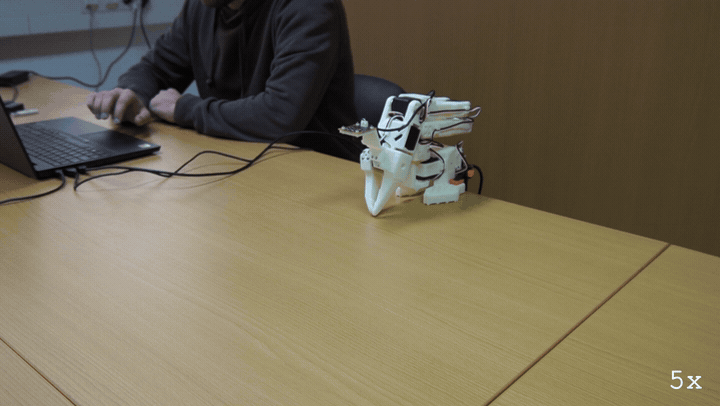
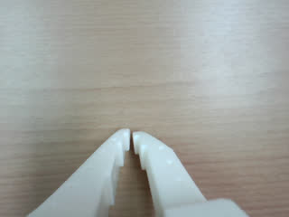
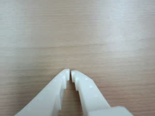

# E116: Unplug the USB mid-move

**The USB cable came out mid-reach. The run ended under half a second after the arm's last answer, and the arm stayed where it was.**



Filmed with an external camera. The GIF plays at 5x speed.

| Category | Goal met | The run ended with | Date | quackd |
|---|---|---|---|---|
| Safety | Yes | ERROR | 2026-11-06 | 0.31.3 |

The numbers and the trace below are copied from the run's own record.
[All examples](../README.md)

## Why this matters

**Why this example exists:** A USB cable can be knocked out, and the arm does not go limp when it is: its servos take their power from their own supply, not from USB, and keep holding their last goal. In that moment quackd has lost the only way it had to steer the arm. This example pulls the cable mid-move to see whether quackd notices at once, stops trying to drive the arm, and says plainly what state it leaves the arm in.

**Why this result is important:** With the cable out, nothing can fold the arm, stop it or let it go, so what matters is what quackd says and when. It ended the run under half a second after the arm's last answer and told the person the one thing that was true: it could not tell whether the arm was holding itself up, so hold it and cut its power. Once the cable was back in, `quackd robot release` put the arm down at its rest pose.

## The goal

Show that pulling the arm's USB cable mid-move ends the run at once, that the arm stays where the move left it, and that quackd tells the person to hold the arm and cut its power rather than claiming anything it cannot check.

**What we expected:** The run ends within about a second of the pull, saying the arm did not answer. The arm holds its last goal and does not sag. The close cannot read the arm, so it ends on a line telling the person to hold it and cut its power, and nothing is asked. Once the cable is back in, `quackd robot release` folds the arm to its rest pose and lets go there.

## What the run showed

* The LLM began the reach with one slow move of 5 s, from the fold toward the arm held out. The cable came out about 3 s into it, after 29 sends had gone through.
* The next send could not read the arm, 0.11 s after the last good one, and the run stopped there. Its last line came under half a second after the arm's last answer, `✗ error: the arm did not answer: ...`, on one line and with no Python traceback, which is what 0.31.3 changed for an arm that stops answering.
* Before that, the close said what this example asks to hear, word for word: `quackd cannot tell whether the arm is holding itself up (...), so it kept whatever torque the arm has: hold it, and cut its power`. It asked nothing, because nothing could reach the arm.
* The video shows the arm staying where the reach stopped while the cable was out. Once it was back in, `quackd robot release arm-01` read the arm within 3° of the last goal sent, folded it to its rest pose and took torque off: `✓ torque reads off on every joint of arm-01`.
* The error says `Port is in use!`, though what happened was a pulled cable. Those are the words of the servo SDK underneath, and they read as if another program held the port.

## What the run did not show

* It does not show the heartbeat catching a pull. The pull came mid-move, and the move's own read failed first.
* Nothing could read the arm while the cable was out, so whether it held is shown by the video and by where it read once the cable was back in, not by the run's own record.
* The robot's own camera kept no picture after the reach began. Its three frames are from before the move, because the run ended before it took another.

## How the run ended

The run ended with **ERROR**. The reason on record:

> TransportError: the arm did not answer: ConnectionError: Failed to sync read 'Present_Position' on ids=[1, 2, 3, 4, 5, 6] after 3 tries. [TxRxResult] Port is in use!

## The exact command

The following command was run with quackd 0.31.3:

```text
quackd run D:/Development/quackd-shoot/docs/examples/lerobot/e116/slow-raise.duck --robot arm-01 --camera-url 'opencv://1?name=arm' --llm openai:gpt-6-astra --max-steps 10 --no-memory
```

## The numbers

| | |
|---|---|
| quackd version | 0.31.3 |
| Started | 2026-11-06 11:58:31 UTC |
| Robot | `arm-01` (real) |
| LLM | `openai:gpt-6-astra` |
| Task file | [`slow-raise.duck`](slow-raise.duck) |
| Steps | 2 |
| LLM calls | 3 |
| Total time | 22.9 s |
| Connecting | 6.5 s |
| Waiting for the LLM | 12.5 s |
| First motion | 19.4 s after the start |
| Tokens | 11,647 in, 230 out |
| Cost at list price | $0.0859 |
| Speed cap | not recorded |
| Run folder | `runs\20261106-115831-e116-slow-raise` |

## What the robot saw

| Start | Middle | End |
|---|---|---|
|  |  |  |

## Try it yourself

This runs the same task file with no arm attached, on `lerobot:mock`, an arm that lives in memory.
It shows the rules a run is held to and not the physics. Run it from a checkout of this repository
with quackd's `lerobot` extra and the LLM's own SDK and key. It costs what the LLM charges.

```bash
quackd run docs/examples/lerobot/e116/slow-raise.duck --robot lerobot:mock --llm openai:gpt-6-astra --no-memory
```

## Full terminal trace

<details>
<summary>Show the full terminal trace (169 lines)</summary>

```text
$ quackd run D:/Development/quackd-shoot/docs/examples/lerobot/e116/slow-raise.duck --robot arm-01 --camera-url 'opencv://1?name=arm' --llm openai:gpt-6-astra --max-steps 10 --no-memory
quackd 0.31.3, started 2026-11-06T11:58:28Z, cwd D:\Development\lerobot-test\.venv

╭─ 🦆 e116-slow-raise ─────────────────────────────────────────────────────────────────────────────────────────────────────────────────────────────────────╮
│ provider  openai (gpt-6-astra)                                                                                                                           │
│ robot     arm-01 (lerobot:real)                                                                                                                          │
│ detector  color_blob on this machine  (once the body reports a camera)                                                                                   │
╰─ Ctrl-C or q stops the duck. Ctrl-C twice quits at once. ────────────────────────────────────────────────────────────────────────────────────────────────╯
WARNING  no camera field of view given for a real camera, so detections use the simulator's 90 degrees. Distances will be out by tens of percent: pass      
         --fov-deg (a Pi Camera Module 2 is about 62) once you know yours.                                                                                  
WARNING:quackd.perception:no camera field of view given for a real camera, so detections use the simulator's 90 degrees. Distances will be out by tens of 
percent: pass --fov-deg (a Pi Camera Module 2 is about 62) once you know yours.
   run     connected in 6.49 s
   tools   report_state, move_joints, gripper, place, stop, assess_task, declare_success, declare_failure
system prompt, 5583 chars, 72 lines (also in transcript.jsonl as run_start): ───────────────────────────────────────────────────────────────────────────────
   You are the brain of a six-joint desktop robot arm with a parallel gripper (an SO-101 class arm driven by LeRobot), bolted to a table. You are a high-level pilot:
   you choose ONE verb per turn; the robot's own controllers handle the motion. Do not micro-manage.

   ## Rules (enforced by the executor — not optional)
   - Call exactly one tool per turn. Never zero, never two.
   - Only these verbs are allowed: report_state, move_joints, gripper, place, stop. Anything else is refused.
   - Budgets: 10 steps, 4 minutes, 16 LLM calls. The run stops when any is hit.
   - Verbs marked confirm (none) ask a human before running.
   - Before the first verb that moves the body, call `assess_task` with your verdict on whether this body can do this task at all, judged against its datasheet below: `feasible`, `infeasible` (the run ends, nothing moves) or `uncertain` (a human is asked). The verdict is about the body, not the view: not having found the target yet is not by itself a reason for `uncertain`. It is one when a limit turns on that unseen thing's mass or size, or on a figure the datasheet does not publish. Until then only `report_state` and `stop` run. Assess again later if what you see changes your mind.
   - When a success criterion is met, call `declare_success`. If the task turns out impossible while doing it, call `declare_failure`.

   ## Success criteria
   - You have done what the task asks, as best you can tell from your joints and any camera pictures, or said plainly why this body cannot.

   ## Abort conditions you must respect yourself
   - (none beyond the enforced ones)

   ## Verbs
   - `report_state`: Report the arm: every joint in degrees, whether torque is on, how warm the servos are, and whether anything is held.
   - `move_joints`: Move one or more joints to goal angles in degrees (gripper 0..100) over duration_s seconds, and wait for them to arrive.
   - `gripper`: Open or close the gripper.
   - `place`: Release what is held by opening the gripper where the arm is.
   - `stop`: Stop moving immediately (zero velocity). Always allowed.

   ## Your body: what it can and cannot do
   Each number says how sure quackd is of it and who says so (official: the maker or a paper says so; estimate: one vendor, a community number or a reading off a photo; measured: somebody measured it and said how).
   - Height: 0.53 m (estimate: one vendor's listing; reaching straight up)
   - Actuated joints: 6 (official: the LeRobot SO-101 docs; five joints and a gripper)
   - Payload: 0.5 kg (estimate: one vendor's listing)
   - Reach: 0.4 m (estimate: the maker's URDF, TheRobotStudio/SO-ARM100 Simulation/SO101/so101_new_calib.urdf; link lengths from the shoulder to the gripper frame, summed with the arm straight and rounded down)
   - Manipulator: one arm with a gripper.
   - Not published: mass. Where a task turns on it, say uncertain and name it rather than guessing; do not decline on it alone.
   - Mains powered, so nothing runs down. It does not move: no base and no legs.
   - quackd clamps you to gripper 0 to 100.
   - Each joint's travel in degrees, read from its own calibration, and the only goals quackd will send: shoulder_pan -119.6 to 119.6, shoulder_lift -100.7 to 100.7, elbow_flex -96.7 to 96.7, wrist_flex -101.4 to 101.4, wrist_roll -180 to 180, gripper 0 to 100. A joint can read past its travel when it was folded or placed there with torque off, which is where a rest pose usually is; goals are still limited to the travel.
   - Senses: joint_state, camera.
   Whatever the task says, this body cannot:
   - go anywhere: it is bolted to a table and has no base
   - lift or hold more than about half a kilogram: a pen, an empty cup or a wooden block weighs far less than that, and a full bottle or a tool may weigh more
   - reach anything more than about 0.4 m from its shoulder: that is the arm held straight out, and any bent pose reaches less
   - feel what it holds: nothing reports grip force, so holding is inferred from the gripper stopping short of shut, which an empty hand that binds also does
   - know its own mass: vendor listings disagree by a factor of three
   Worth knowing:
   - How wide the gripper opens and how hard it grips are not published
   - No sensors beyond the servo positions unless a camera is configured, and the servo temperature, which quackd reads off the bus because LeRobot does not
   - Vendor listings give the mass as anything from 0.8 to 2.5 kg and nobody official publishes one, so it is listed as not published rather than picked from a hat
   - There are 7.4 V and 12 V builds of the same arm, with different stall torque and different supplies. Which one is on the desk is not something quackd can ask

   ## What is a stand-in on this robot
   The robot reported these itself, and they are in `extras.assumptions` in every observation.
   Each is something quackd stands in for or assumes, not something this robot does. Do not
   report one as the robot's own work, and do not read a success from one as evidence that the
   real skill works.
   - GRIPPER_OPEN_VALUE
   - HOLDING_INFERRED
   - TEMPERATURE_C

   ## Persona
   Game for anything and honest about this body: commit to the bit, and say plainly when something is beyond you.

   ## Task file: e116-slow-raise — Fully extend the arm and reach forward.

   # Task

   Fully extend the arm and reach forward.

   ## Strategy

   1. Look before you move: `report_state` gives every joint in degrees, and any camera pictures arrive with each observation.
   2. Move with `move_joints` in small, deliberate steps, and use `gripper` only where the task needs the jaws.
   3. Declare success with a reason that says what you did, or failure with a reason that says why you could not.
────────────────────────────────────────────────────────────────────────────────────────────────────────────────────────────────────────────────────────────
·  note    moving to the rest pose
·  note    already at the rest pose
step 0/10 · llm calls 0/16, 0.0/4 min ──────────────────────────────────────────────────────────────────────────────────────────────────────────────────────
   obs     state: posture=unknown policy=idle stand-ins=3-listed-in-extras.assumptions
           camera: nothing detected
           Choose exactly one tool.
           note: nothing detected yet. That is not by itself a reason for `uncertain`: the verdict is about this body's limits, not about where the target is. Answer `uncertain` only if a limit turns on that unseen thing's mass or size, or on a figure the datasheet does not publish.
   llm>    step 0: 1 messages (1 with image) to openai gpt-6-astra
   tool    report_state()
   tokens  in=3420 out=14 cache_write=3294 (run total in=3420 out=14 $0.0431) latency=4.4 s cost=$0.0431 stop=tool_calls
▶  verb    report_state()
✓  result  report_state ok: shoulder_pan -4, shoulder_lift -91, elbow_flex 97, wrist_flex 74, wrist_roll 1, gripper 0; torque on; hottest elbow_flex 28°C; holding nothing (0.0 s, 0 intents)
step 1/10 · llm calls 1/16, 0.1/4 min ──────────────────────────────────────────────────────────────────────────────────────────────────────────────────────
   obs     state: posture=unknown policy=idle stand-ins=3-listed-in-extras.assumptions
           camera: nothing detected
           last verb `report_state`: ok — shoulder_pan -4, shoulder_lift -91, elbow_flex 97, wrist_flex 74, wrist_roll 1, gripper 0; torque on; hottest elbow_flex 28°C; holding nothing
           Choose exactly one tool.
           note: nothing detected yet. That is not by itself a reason for `uncertain`: the verdict is about this body's limits, not about where the target is. Answer `uncertain` only if a limit turns on that unseen thing's mass or size, or on a figure the datasheet does not publish.
   llm>    step 1: 2 messages (2 with image) to openai gpt-6-astra
   tool    assess_task(verdict='feasible', reason='This is an unloaded extension of the fixed arm within its...', limits_consulted=['reach_m', 'joint_limits', 'mobility'], estimates=[], needs={'payload_kg': 0, 'reach_m': 0.4, 'endurance_min': 0, 'work_height_m': 0, 'arms': 1, 'manipulator': 'none', 'mobility...)
   tokens  in=3985 out=127 cached=3294 cache_write=565 (run total in=7405 out=141 $0.0611) latency=4.0 s cost=$0.0180 stop=tool_calls
✓  assess  feasible: This is an unloaded extension of the fixed arm within its own approximately 0.4 m reach and calibrated joint travel. No locomotion, object gripping, or external payload is required.
   needs   payload_kg=0, reach_m=0.4, endurance_min=0, work_height_m=0, arms=1, manipulator='none', mobility='none', terrain='indoor_flat'
step 1/10 · llm calls 2/16, 0.1/4 min ──────────────────────────────────────────────────────────────────────────────────────────────────────────────────────
   obs     state: posture=unknown policy=idle stand-ins=3-listed-in-extras.assumptions
           camera: nothing detected
           last verb `assess_task`: ok — recorded feasible: This is an unloaded extension of the fixed arm within its own approximately 0.4 m reach and calibrated joint travel. No locomotion, object gripping, or external payload is required.; verbs that move the body now run
           Choose exactly one tool.
   llm>    step 1: 3 messages (2 with image) to openai gpt-6-astra
   tool    move_joints(positions={'shoulder_pan': 0, 'shoulder_lift': -65, 'elbow_flex': 75, 'wrist_flex': 55, 'wrist_roll': 0}, duration_s=5)
   tokens  in=4242 out=89 cached=2813 cache_write=1303 reasoning=31 (run total in=11647 out=230 $0.0859) latency=4.1 s cost=$0.0248 stop=tool_calls
▶  verb    move_joints(positions={'shoulder_pan': 0, 'shoulder_lift': -65, 'elbow_flex': 75, 'wrist_flex': 55, 'wrist_roll': 0}, duration_s=5)
→  send    joint x20 over 2.0 s (positions {'shoulder_pan': -4.4, 'shoulder_lift': -91.1, 'elbow_flex': 96.7, 'wrist_flex': 73.5, 'wrist_roll': 0.7}/{'shoulder_pan': -4.3, 'shoulder_lift': -90.5, 'elbow_flex': 96.2, 'wrist_flex': 73.1, 'wrist_roll': 0.7}/{'shoulder_pan': -4.2, 'shoulder_lift': -90.0, 'elbow_flex': 95.8, 'wrist_flex': 72.7, 'wrist_roll': 0.7}..., duration_s 5)
→  send    joint x9 over 0.9 s (positions {'shoulder_pan': -2.5, 'shoulder_lift': -80.0, 'elbow_flex': 87.4, 'wrist_flex': 65.6, 'wrist_roll': 0.4}/{'shoulder_pan': -2.4, 'shoulder_lift': -79.4, 'elbow_flex': 87.0, 'wrist_flex': 65.2, 'wrist_roll': 0.4}/{'shoulder_pan': -2.3, 'shoulder_lift': -78.9, 'elbow_flex': 86.5, 'wrist_flex': 64.8, 'wrist_roll': 0.4}..., duration_s 5)
✗  send    joint(positions={'shoulder_pan': -1.7, 'shoulder_lift': -74.9, 'elbow_flex': 83.3, 'wrist_flex': 62.0, 'wrist_roll': 0.3}, duration_s=5) REFUSED: joint failed: ConnectionError: Failed to sync read 'Present_Position' on ids=[1, 2, 3, 4, 5, 6] after 3 tries. [TxRxResult] Port is in use!
→  send    stop
✗  result  move_joints FAIL: move_joints: joint refused: joint failed: ConnectionError: Failed to sync read 'Present_Position' on ids=[1, 2, 3, 4, 5, 6] after 3 tries. [TxRxResult] Port is in use! (3.1 s, 31 intents)
·  note    run ended with an error: TransportError: the arm did not answer: ConnectionError: Failed to sync read 'Present_Position' on ids=[1, 2, 3, 4, 5, 6] after 3 tries. [TxRxResult] Port is in use!
→  send    stop
·  note    moving to the rest pose
·  note    the arm did not reach its rest pose: the hold did not reach the arm: ConnectionError: Failed to sync read 'Present_Position' on ids=[1, 2, 3, 4, 5, 6] after 3 tries. [TxRxResult] Port is in use!
·  note    quackd cannot tell whether the arm is holding itself up (the arm did not answer: ConnectionError: Failed to sync read 'Present_Position' on ids=[1, 2, 3, 4, 5, 6] after 3 tries. [TxRxResult] Port is in use!), so it kept whatever torque the arm has: hold it, and cut its power
✗ error: the arm did not answer: ConnectionError: Failed to sync read 'Present_Position' on ids=[1, 2, 3, 4, 5, 6] after 3 tries. [TxRxResult] Port is in 
use!

(lerobot-test) PS D:\Development\lerobot-test\.venv> quackd robot release arm-01
⚠ connecting takes torque off every motor for a moment, because LeRobot configures them with it off, and the arm then folds to its rest pose and is let go
of there: support it while it connects, then take your hands away when it says so, before it folds
fold arm-01 to its rest pose and release torque there? [y/N]: y
arm-01 (lerobot:real) is at
shoulder_pan   -2.1
shoulder_lift  -75.6
elbow_flex     86.4
wrist_flex     63.3
wrist_roll     0.7
gripper        0.5
folding arm-01 to its rest pose in 3 s: take your hands away from it now. Ctrl-C or q stops it before it moves
folding arm-01 to its rest pose: keep your hands out of its way
WARNING:root:Relative goal position magnitude had to be clamped to be safe.
{   'elbow_flex': {   'original goal_pos': 96.79120879120879,
                      'safe goal_pos': 91.50549450549451},
    'shoulder_lift': {   'original goal_pos': -91.4,
                         'safe goal_pos': -80.56043956043956},
    'wrist_flex': {   'original goal_pos': 73.7,
                      'safe goal_pos': 68.25274725274726}}
WARNING:root:Relative goal position magnitude had to be clamped to be safe.
{   'elbow_flex': {   'original goal_pos': 96.79120879120879,
                      'safe goal_pos': 94.67032967032966},
    'shoulder_lift': {   'original goal_pos': -91.4,
                         'safe goal_pos': -83.37362637362638},
    'wrist_flex': {   'original goal_pos': 73.7,
                      'safe goal_pos': 71.06593406593407}}
WARNING:root:Relative goal position magnitude had to be clamped to be safe.
{   'shoulder_lift': {   'original goal_pos': -91.4,
                         'safe goal_pos': -86.8021978021978}}
WARNING:root:Relative goal position magnitude had to be clamped to be safe.
{   'shoulder_lift': {   'original goal_pos': -91.4,
                         'safe goal_pos': -90.31868131868131}}
✓ torque reads off on every joint of arm-01
  the arm is limp at its rest pose, where it was folded and let go of because you asked for it, and where it still reads: it rests there with no torque, as
it does at the end of every run
(lerobot-test) PS D:\Development\lerobot-test\.venv>
```

</details>
