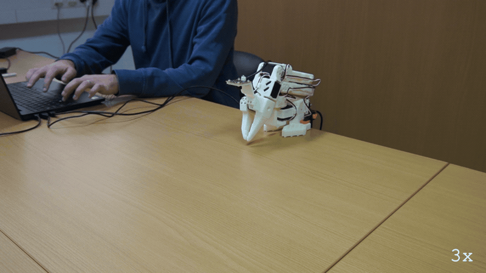
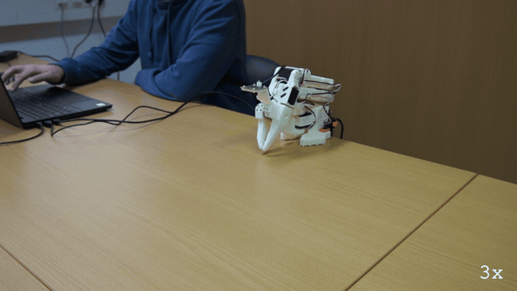
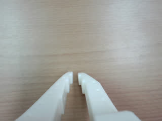
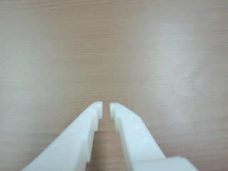
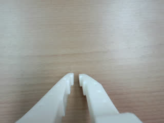
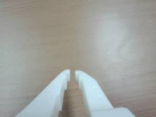

# E117: Ctrl-C mid-move

**Ctrl-C folded the arm away. A hard kill left it reached out over the table under torque, until `quackd robot release` put it down.**

**Part 1 of 2:** Ctrl-C, pressed once



Filmed with an external camera. The GIF plays at 3x speed.

**Part 2 of 2:** A hard kill from a second terminal, then `quackd robot release`



Filmed with an external camera. The GIF plays at 3x speed.

| Category | Goal met | The run ended with | Date | quackd |
|---|---|---|---|---|
| Safety | Partly | ABORTED / KILLED | 2026-11-10 | 0.33.0 |

The numbers and the trace below are copied from the run's own record.
[All examples](../README.md)

## Why this matters

**Why this example exists:** A process that stops is not an arm that stops. The SO-101's servos, with their torque on, hold their last goal until the torque or the power is cut, so when quackd ends, the arm stays where it was unless something puts it down. This example compares two of the ways a run can be stopped from the keyboard: Ctrl-C, which quackd handles, and a hard kill, which it never sees.

**Why this result is important:** Both behaved as designed. Ctrl-C cut the LLM call it landed in, sent a `stop` and folded the arm back to its rest pose within a second. The hard kill gave quackd no chance: no `stop`, no fold and no `summary.json`, and the arm stayed reached out under torque, still reading shoulder_lift -75.3, until `quackd robot release` folded it and turned its torque off. That is the hazard the card warns about, and the way back from a killed run is to support the arm and let `quackd robot release` put it down, or to hold it and cut its power.

## The goal

Show that killing the process does not stop the arm: it holds its last commanded position under torque, which is the real hardware hazard quackd is designed around. Ctrl-C, an ordinary exit, is the contrast.

**What we expected:** Ctrl-C: `aborted mid-verb; the verb was cancelled and a stop was sent`, the arm freezes, then folds to the rest pose and goes limp there. Hard kill: the arm freezes under torque and stays there, with nothing running to release it and no `summary.json` in the run folder, until `quackd robot release` puts it down.

## What the run showed

* In Part 1 the LLM read the arm, judged the reach `feasible` and raised it, shoulder_lift to -75 over 5 s. Ctrl-C landed while it waited on its next answer, and that call ended `ERROR Aborted: kill switch after 0.2 s`.
* quackd then sent a `stop` and folded the arm: `moving to the rest pose`, then `at the rest pose` 0.8 s later. The run ended `ABORTED` on `kill switch`, with its summary written.
* In Part 2 nearly the same move ran, this time also turning the pan to 0, and the process was killed from a second terminal while the LLM was thinking: `taskkill /F /IM quackd.exe` ended four quackd.exe processes. The run's own terminal stops at the call it was waiting on, and the screen's last line was `waiting on openai gpt-6-astra (last call 4.4 s)`, the 4.4 s being how long the call before it took.
* Nothing ran after the kill: no `stop`, no fold and no `summary.json`. The run folder kept its terminal, its transcript and its frames up to that moment, which is where this part's numbers come from.
* The arm held its pose under torque. When `quackd robot release arm-01` connected, it read shoulder_lift -75.3, elbow_flex 78.2 and wrist_flex 60.8, within a degree of where the move had left it, then folded it and let go: `torque reads off on every joint of arm-01`.
* The release said first that `connecting takes torque off every motor for a moment`, so the arm has to be supported while it connects.

## What the run did not show

* Neither stop landed mid-move. Both came while the LLM was thinking, after the move had finished, so the run does not show a move cut off, and the card's `aborted mid-verb` line was never printed.
* It does not show how long the arm would hold after a kill: the release came within the same take.
* Part 2's numbers stop at the kill. Its total time is not recorded, and its fourth LLM call was sent and never answered, so that call is counted and its wait, tokens and cost are not.
* It does not show which quackd.exe processes the taskkill ended besides the run's own. It ends every one on the machine, and the card warns that an editor's MCP server can be among them.

## How the run ended

**Part 1 of 2:** Ctrl-C, pressed once

The run ended with **ABORTED**. The reason on record:

> kill switch

**Part 2 of 2:** A hard kill from a second terminal, then `quackd robot release`

The run did not end on its own: its process was killed, so it wrote no summary and recorded no
reason. What it did record up to then is in the numbers and the trace.

## The exact command

**Part 1 of 2:** Ctrl-C, pressed once

The following command was run with quackd 0.33.0:

```text
quackd run D:/Development/quackd-shoot/docs/examples/lerobot/e117/slow-raise.duck --robot arm-01 --camera-url 'opencv://1?name=arm' --llm openai:gpt-6-astra --max-steps 10 --no-memory
```

**Part 2 of 2:** A hard kill from a second terminal, then `quackd robot release`

The following command was run with quackd 0.33.0:

```text
quackd run D:/Development/quackd-shoot/docs/examples/lerobot/e117/slow-raise.duck --robot arm-01 --camera-url 'opencv://1?name=arm' --llm openai:gpt-6-astra --max-steps 10 --no-memory
taskkill /F /IM quackd.exe
quackd robot release arm-01
```

## The numbers

| | Part 1 | Part 2 |
|---|---|---|
| quackd version | 0.33.0 | 0.33.0 |
| Started | 2026-11-10 11:27:43 UTC | 2026-11-10 11:32:31 UTC |
| Robot | `arm-01` (real) | `arm-01` (real) |
| LLM | `openai:gpt-6-astra` | `openai:gpt-6-astra` |
| Task file | [`slow-raise.duck`](slow-raise.duck) | [`slow-raise.duck`](slow-raise.duck) |
| Steps | 2 | 2 |
| LLM calls | 4 | 4 |
| Total time | 47.6 s | not recorded |
| Connecting | 23.4 s | 10.3 s |
| Waiting for the LLM | 16.3 s | 17.6 s |
| First motion | 41.0 s after the start | 28.3 s after the start |
| Tokens | 11,972 in, 211 out | 12,004 in, 226 out |
| Cost at list price | $0.0865 | $0.0540 |
| Speed cap | 5° per send | 5° per send |
| Run folder | `runs\20261110-112743-e117-slow-raise` | `runs\20261110-113231-e117-slow-raise` |

## What the robot saw

**Part 1 of 2:** Ctrl-C, pressed once

| Start | Middle | End |
|---|---|---|
|  |  |  |

**Part 2 of 2:** A hard kill from a second terminal, then `quackd robot release`

| Start | Middle | End |
|---|---|---|
|  |  |  |

## Try it yourself

This runs the same task file with no arm attached, on `lerobot:mock`, an arm that lives in memory.
It shows the rules a run is held to and not the physics. Run it from a checkout of this repository
with quackd's `lerobot` extra and the LLM's own SDK and key. It costs what the LLM charges.

```bash
quackd run docs/examples/lerobot/e117/slow-raise.duck --robot lerobot:mock --llm openai:gpt-6-astra --no-memory
```

## Full terminal trace

<details>
<summary>Show the full terminal trace (382 lines)</summary>

```text
$ quackd run D:/Development/quackd-shoot/docs/examples/lerobot/e117/slow-raise.duck --robot arm-01 --camera-url 'opencv://1?name=arm' --llm openai:gpt-6-astra --max-steps 10 --no-memory
quackd 0.33.0, started 2026-11-10T11:27:39Z, cwd D:\Development\lerobot-test\.venv

╭─ 🦆 e117-slow-raise ─────────────────────────────────────────────────────────────────────────────────────────────────────────────────────────────────────╮
│ provider  openai (gpt-6-astra)                                                                                                                           │
│ robot     arm-01 (lerobot:real)                                                                                                                          │
│ detector  color_blob on this machine  (once the body reports a camera)                                                                                   │
╰─ Ctrl-C or q stops the duck. Ctrl-C twice quits at once. ────────────────────────────────────────────────────────────────────────────────────────────────╯
WARNING  no camera field of view given for a real camera, so detections use the simulator's 90 degrees. Distances will be out by tens of percent: pass      
         --fov-deg (a Pi Camera Module 2 is about 62) once you know yours.                                                                                  
WARNING:quackd.perception:no camera field of view given for a real camera, so detections use the simulator's 90 degrees. Distances will be out by tens of 
percent: pass --fov-deg (a Pi Camera Module 2 is about 62) once you know yours.
   run     connected in 23.40 s
   tools   report_state, move_joints, gripper, place, stop, assess_task, declare_success, declare_failure
system prompt, 5583 chars, 72 lines (also in transcript.jsonl as run_start): ───────────────────────────────────────────────────────────────────────────────
   You are the brain of a six-joint desktop robot arm with a parallel gripper (an SO-101 class arm driven by LeRobot), bolted to a table. You are a high-level pilot:
   you choose ONE verb per turn; the robot's own controllers handle the motion. Do not micro-manage.

   ## Rules (enforced by the executor — not optional)
   - Call exactly one tool per turn. Never zero, never two.
   - Only these verbs are allowed: report_state, move_joints, gripper, place, stop. Anything else is refused.
   - Budgets: 10 steps, 4 minutes, 16 LLM calls. The run stops when any is hit.
   - Verbs marked confirm (none) ask a human before running.
   - Before the first verb that moves the body, call `assess_task` with your verdict on whether this body can do this task at all, judged against its datasheet below: `feasible`, `infeasible` (the run ends, nothing moves) or `uncertain` (a human is asked). The verdict is about the body, not the view: not having found the target yet is not by itself a reason for `uncertain`. It is one when a limit turns on that unseen thing's mass or size, or on a figure the datasheet does not publish. Until then only `report_state` and `stop` run. Assess again later if what you see changes your mind.
   - When a success criterion is met, call `declare_success`. If the task turns out impossible while doing it, call `declare_failure`.

   ## Success criteria
   - You have done what the task asks, as best you can tell from your joints and any camera pictures, or said plainly why this body cannot.

   ## Abort conditions you must respect yourself
   - (none beyond the enforced ones)

   ## Verbs
   - `report_state`: Report the arm: every joint in degrees, whether torque is on, how warm the servos are, and whether anything is held.
   - `move_joints`: Move one or more joints to goal angles in degrees (gripper 0..100) over duration_s seconds, and wait for them to arrive.
   - `gripper`: Open or close the gripper.
   - `place`: Release what is held by opening the gripper where the arm is.
   - `stop`: Stop moving immediately (zero velocity). Always allowed.

   ## Your body: what it can and cannot do
   Each number says how sure quackd is of it and who says so (official: the maker or a paper says so; estimate: one vendor, a community number or a reading off a photo; measured: somebody measured it and said how).
   - Height: 0.53 m (estimate: one vendor's listing; reaching straight up)
   - Actuated joints: 6 (official: the LeRobot SO-101 docs; five joints and a gripper)
   - Payload: 0.5 kg (estimate: one vendor's listing)
   - Reach: 0.4 m (estimate: the maker's URDF, TheRobotStudio/SO-ARM100 Simulation/SO101/so101_new_calib.urdf; link lengths from the shoulder to the gripper frame, summed with the arm straight and rounded down)
   - Manipulator: one arm with a gripper.
   - Not published: mass. Where a task turns on it, say uncertain and name it rather than guessing; do not decline on it alone.
   - Mains powered, so nothing runs down. It does not move: no base and no legs.
   - quackd clamps you to gripper 0 to 100.
   - Each joint's travel in degrees, read from its own calibration, and the only goals quackd will send: shoulder_pan -119.6 to 119.6, shoulder_lift -100.7 to 100.7, elbow_flex -96.7 to 96.7, wrist_flex -101.4 to 101.4, wrist_roll -180 to 180, gripper 0 to 100. A joint can read past its travel when it was folded or placed there with torque off, which is where a rest pose usually is; goals are still limited to the travel.
   - Senses: joint_state, camera.
   Whatever the task says, this body cannot:
   - go anywhere: it is bolted to a table and has no base
   - lift or hold more than about half a kilogram: a pen, an empty cup or a wooden block weighs far less than that, and a full bottle or a tool may weigh more
   - reach anything more than about 0.4 m from its shoulder: that is the arm held straight out, and any bent pose reaches less
   - feel what it holds: nothing reports grip force, so holding is inferred from the gripper stopping short of shut, which an empty hand that binds also does
   - know its own mass: vendor listings disagree by a factor of three
   Worth knowing:
   - How wide the gripper opens and how hard it grips are not published
   - No sensors beyond the servo positions unless a camera is configured, and the servo temperature, which quackd reads off the bus because LeRobot does not
   - Vendor listings give the mass as anything from 0.8 to 2.5 kg and nobody official publishes one, so it is listed as not published rather than picked from a hat
   - There are 7.4 V and 12 V builds of the same arm, with different stall torque and different supplies. Which one is on the desk is not something quackd can ask

   ## What is a stand-in on this robot
   The robot reported these itself, and they are in `extras.assumptions` in every observation.
   Each is something quackd stands in for or assumes, not something this robot does. Do not
   report one as the robot's own work, and do not read a success from one as evidence that the
   real skill works.
   - GRIPPER_OPEN_VALUE
   - HOLDING_INFERRED
   - TEMPERATURE_C

   ## Persona
   Game for anything and honest about this body: commit to the bit, and say plainly when something is beyond you.

   ## Task file: e117-slow-raise — Fully extend the arm and reach forward.

   # Task

   Fully extend the arm and reach forward.

   ## Strategy

   1. Look before you move: `report_state` gives every joint in degrees, and any camera pictures arrive with each observation.
   2. Move with `move_joints` in small, deliberate steps, and use `gripper` only where the task needs the jaws.
   3. Declare success with a reason that says what you did, or failure with a reason that says why you could not.
────────────────────────────────────────────────────────────────────────────────────────────────────────────────────────────────────────────────────────────
·  note    moving to the rest pose
·  note    already at the rest pose
step 0/10 · LLM calls 0/16, 0.0/4 min ──────────────────────────────────────────────────────────────────────────────────────────────────────────────────────
   obs     state: posture=unknown policy=idle stand-ins=3-listed-in-extras.assumptions
           camera: nothing detected
           Choose exactly one tool.
           note: nothing detected yet. That is not by itself a reason for `uncertain`: the verdict is about this body's limits, not about where the target is. Answer `uncertain` only if a limit turns on that unseen thing's mass or size, or on a figure the datasheet does not publish.
   llm>    step 0: 1 messages (1 with image) to openai gpt-6-astra
   tool    report_state()
   tokens  in=3531 out=14 cache_write=3405 (run total in=3531 out=14 $0.0445) latency=7.8 s cost=$0.0445 stop=tool_calls
▶  verb    report_state()
✓  result  report_state ok: shoulder_pan -6, shoulder_lift -100, elbow_flex 96, wrist_flex 79, wrist_roll 0, gripper 2; torque on; hottest elbow_flex 25°C; holding nothing (0.0 s, 0 intents)
step 1/10 · LLM calls 1/16, 0.1/4 min ──────────────────────────────────────────────────────────────────────────────────────────────────────────────────────
   obs     state: posture=unknown policy=idle stand-ins=3-listed-in-extras.assumptions
           camera: nothing detected
           last verb `report_state`: ok — shoulder_pan -6, shoulder_lift -100, elbow_flex 96, wrist_flex 79, wrist_roll 0, gripper 2; torque on; hottest elbow_flex 25°C; holding nothing
           Choose exactly one tool.
           note: nothing detected yet. That is not by itself a reason for `uncertain`: the verdict is about this body's limits, not about where the target is. Answer `uncertain` only if a limit turns on that unseen thing's mass or size, or on a figure the datasheet does not publish.
   llm>    step 1: 2 messages (2 with image) to openai gpt-6-astra
   tool    assess_task(verdict='feasible', reason='This is an unloaded extension of the single arm within it...', limits_consulted=['reach_m', 'arms', 'joint_limits', 'mobility'], estimates=[], needs={'payload_kg': 0, 'reach_m': 0, 'endurance_min': 0, 'work_height_m': 0, 'arms': 1, 'manipulator': 'none', 'mobility':...)
   tokens  in=4096 out=123 cached=3405 cache_write=565 (run total in=7627 out=137 $0.0624) latency=4.2 s cost=$0.0179 stop=tool_calls
✓  assess  feasible: This is an unloaded extension of the single arm within its own calibrated joint travel and approximately 0.4 m reach; it requires no locomotion or grasping.
   needs   payload_kg=0, reach_m=0, endurance_min=0, work_height_m=0, arms=1, manipulator='none', mobility='none', terrain='indoor_flat'
step 1/10 · LLM calls 2/16, 0.2/4 min ──────────────────────────────────────────────────────────────────────────────────────────────────────────────────────
   obs     state: posture=unknown policy=idle stand-ins=3-listed-in-extras.assumptions
           camera: nothing detected
           last verb `assess_task`: ok — recorded feasible: This is an unloaded extension of the single arm within its own calibrated joint travel and approximately 0.4 m reach; it requires no locomotion or grasping.; verbs that move the body now run
           Choose exactly one tool.
   llm>    step 1: 3 messages (2 with image) to openai gpt-6-astra
   tool    move_joints(positions={'shoulder_lift': -75, 'elbow_flex': 75, 'wrist_flex': 60}, duration_s=5)
   tokens  in=4345 out=74 cached=2924 cache_write=1295 reasoning=28 (run total in=11972 out=211 $0.0865) latency=4.1 s cost=$0.0241 stop=tool_calls
▶  verb    move_joints(positions={'shoulder_lift': -75, 'elbow_flex': 75, 'wrist_flex': 60}, duration_s=5)
→  send    joint x20 over 2.0 s (positions {'shoulder_lift': -100.1, 'elbow_flex': 96.4, 'wrist_flex': 79.1}/{'shoulder_lift': -99.6, 'elbow_flex': 95.9, 'wrist_flex': 78.7}/{'shoulder_lift': -99.0, 'elbow_flex': 95.5, 'wrist_flex': 78.3}..., duration_s 5)
→  send    joint x20 over 2.0 s (positions {'shoulder_lift': -89.4, 'elbow_flex': 87.3, 'wrist_flex': 71.0}/{'shoulder_lift': -88.9, 'elbow_flex': 86.8, 'wrist_flex': 70.6}/{'shoulder_lift': -88.3, 'elbow_flex': 86.4, 'wrist_flex': 70.1}..., duration_s 5)
→  send    joint x8 over 0.7 s (positions {'shoulder_lift': -78.6, 'elbow_flex': 78.1, 'wrist_flex': 62.7}/{'shoulder_lift': -78.1, 'elbow_flex': 77.6, 'wrist_flex': 62.3}/{'shoulder_lift': -77.5, 'elbow_flex': 77.2, 'wrist_flex': 61.9}..., duration_s 5)
✓  result  move_joints ok: moved shoulder_lift=-75, elbow_flex=78, wrist_flex=61 (5.2 s, 48 intents)
step 2/10 · LLM calls 3/16, 0.4/4 min ──────────────────────────────────────────────────────────────────────────────────────────────────────────────────────
   obs     state: posture=unknown policy=idle stand-ins=3-listed-in-extras.assumptions
           camera: nothing detected
           last verb `move_joints`: ok — moved shoulder_lift=-75, elbow_flex=78, wrist_flex=61
           Choose exactly one tool.
   llm>    step 2: 4 messages (2 with image) to openai gpt-6-astra
kill switch: Ctrl-C — cancelling the verb and stopping the robot
✗  llm<    ERROR Aborted: kill switch after 0.2 s
→  send    stop
·  note    moving to the rest pose
WARNING:root:Relative goal position magnitude had to be clamped to be safe.
{   'elbow_flex': {   'original goal_pos': 96.4,
                      'safe goal_pos': 82.62637362637362},
    'shoulder_lift': {   'original goal_pos': -100.79120879120879,
                         'safe goal_pos': -80.38461538461539},
    'wrist_flex': {   'original goal_pos': 79.2,
                      'safe goal_pos': 65.79120879120879}}
WARNING:root:Relative goal position magnitude had to be clamped to be safe.
{   'elbow_flex': {   'original goal_pos': 96.4,
                      'safe goal_pos': 85.61538461538461},
    'shoulder_lift': {   'original goal_pos': -100.79120879120879,
                         'safe goal_pos': -83.63736263736264},
    'wrist_flex': {   'original goal_pos': 79.2,
                      'safe goal_pos': 68.78021978021978}}
WARNING:root:Relative goal position magnitude had to be clamped to be safe.
{   'elbow_flex': {   'original goal_pos': 96.4,
                      'safe goal_pos': 89.65934065934066},
    'shoulder_lift': {   'original goal_pos': -100.79120879120879,
                         'safe goal_pos': -86.97802197802197},
    'wrist_flex': {   'original goal_pos': 79.2,
                      'safe goal_pos': 72.12087912087912}}
WARNING:root:Relative goal position magnitude had to be clamped to be safe.
{   'elbow_flex': {   'original goal_pos': 96.4,
                      'safe goal_pos': 93.35164835164835},
    'shoulder_lift': {   'original goal_pos': -100.79120879120879,
                         'safe goal_pos': -90.23076923076923},
    'wrist_flex': {   'original goal_pos': 79.2,
                      'safe goal_pos': 75.37362637362638}}
WARNING:root:Relative goal position magnitude had to be clamped to be safe.
{   'shoulder_lift': {   'original goal_pos': -100.79120879120879,
                         'safe goal_pos': -93.48351648351648},
    'wrist_flex': {   'original goal_pos': 79.2,
                      'safe goal_pos': 78.71428571428571}}
WARNING:root:Relative goal position magnitude had to be clamped to be safe.
{   'shoulder_lift': {   'original goal_pos': -100.79120879120879,
                         'safe goal_pos': -97.0}}
WARNING:root:Relative goal position magnitude had to be clamped to be safe.
{   'shoulder_lift': {   'original goal_pos': -100.79120879120879,
                         'safe goal_pos': -100.25274725274726}}
·  note    at the rest pose
╭─ ✗ ABORTED ──────────────────────────────────────────────────────────────────────────────────────────────────────────────────────────────────────────────╮
│ kill switch                                                                                                                                              │
│ steps 2 · LLM calls 4 · tokens 11972+211 · time 47.6 s (LLM 16.3 s) · LLM calls p50 4.2 s, p90 7.8 s, max 7.8 s · first motion at 41.0 s, after 3 LLM    │
│ calls · cost $0.0865                                                                                                                                     │
│ run dir  runs\20261110-112743-e117-slow-raise                                                                                                            │
╰──────────────────────────────────────────────────────────────────────────────────────────────────────────────────────────────────────────────────────────╯

$ quackd run D:/Development/quackd-shoot/docs/examples/lerobot/e117/slow-raise.duck --robot arm-01 --camera-url 'opencv://1?name=arm' --llm openai:gpt-6-astra --max-steps 10 --no-memory
quackd 0.33.0, started 2026-11-10T11:32:25Z, cwd D:\Development\lerobot-test\.venv

╭─ 🦆 e117-slow-raise ─────────────────────────────────────────────────────╮
│ provider  openai (gpt-6-astra)                                           │
│ robot     arm-01 (lerobot:real)                                          │
│ detector  color_blob on this machine  (once the body reports a camera)   │
╰─ Ctrl-C or q stops the duck. Ctrl-C twice quits at once. ────────────────╯
WARNING  no camera field of view given for a real camera, so detections use 
         the simulator's 90 degrees. Distances will be out by tens of       
         percent: pass --fov-deg (a Pi Camera Module 2 is about 62) once you
         know yours.                                                        
WARNING:quackd.perception:no camera field of view given for a real camera, 
so detections use the simulator's 90 degrees. Distances will be out by tens 
of percent: pass --fov-deg (a Pi Camera Module 2 is about 62) once you know 
yours.
   run     connected in 10.32 s
   tools   report_state, move_joints, gripper, place, stop, assess_task, declare_success, declare_failure
system prompt, 5583 chars, 72 lines (also in transcript.jsonl as run_star… ─
   You are the brain of a six-joint desktop robot arm with a parallel gripper (an SO-101 class arm driven by LeRobot), bolted to a table. You are a high-level pilot:
   you choose ONE verb per turn; the robot's own controllers handle the motion. Do not micro-manage.

   ## Rules (enforced by the executor — not optional)
   - Call exactly one tool per turn. Never zero, never two.
   - Only these verbs are allowed: report_state, move_joints, gripper, place, stop. Anything else is refused.
   - Budgets: 10 steps, 4 minutes, 16 LLM calls. The run stops when any is hit.
   - Verbs marked confirm (none) ask a human before running.
   - Before the first verb that moves the body, call `assess_task` with your verdict on whether this body can do this task at all, judged against its datasheet below: `feasible`, `infeasible` (the run ends, nothing moves) or `uncertain` (a human is asked). The verdict is about the body, not the view: not having found the target yet is not by itself a reason for `uncertain`. It is one when a limit turns on that unseen thing's mass or size, or on a figure the datasheet does not publish. Until then only `report_state` and `stop` run. Assess again later if what you see changes your mind.
   - When a success criterion is met, call `declare_success`. If the task turns out impossible while doing it, call `declare_failure`.

   ## Success criteria
   - You have done what the task asks, as best you can tell from your joints and any camera pictures, or said plainly why this body cannot.

   ## Abort conditions you must respect yourself
   - (none beyond the enforced ones)

   ## Verbs
   - `report_state`: Report the arm: every joint in degrees, whether torque is on, how warm the servos are, and whether anything is held.
   - `move_joints`: Move one or more joints to goal angles in degrees (gripper 0..100) over duration_s seconds, and wait for them to arrive.
   - `gripper`: Open or close the gripper.
   - `place`: Release what is held by opening the gripper where the arm is.
   - `stop`: Stop moving immediately (zero velocity). Always allowed.

   ## Your body: what it can and cannot do
   Each number says how sure quackd is of it and who says so (official: the maker or a paper says so; estimate: one vendor, a community number or a reading off a photo; measured: somebody measured it and said how).
   - Height: 0.53 m (estimate: one vendor's listing; reaching straight up)
   - Actuated joints: 6 (official: the LeRobot SO-101 docs; five joints and a gripper)
   - Payload: 0.5 kg (estimate: one vendor's listing)
   - Reach: 0.4 m (estimate: the maker's URDF, TheRobotStudio/SO-ARM100 Simulation/SO101/so101_new_calib.urdf; link lengths from the shoulder to the gripper frame, summed with the arm straight and rounded down)
   - Manipulator: one arm with a gripper.
   - Not published: mass. Where a task turns on it, say uncertain and name it rather than guessing; do not decline on it alone.
   - Mains powered, so nothing runs down. It does not move: no base and no legs.
   - quackd clamps you to gripper 0 to 100.
   - Each joint's travel in degrees, read from its own calibration, and the only goals quackd will send: shoulder_pan -119.6 to 119.6, shoulder_lift -100.7 to 100.7, elbow_flex -96.7 to 96.7, wrist_flex -101.4 to 101.4, wrist_roll -180 to 180, gripper 0 to 100. A joint can read past its travel when it was folded or placed there with torque off, which is where a rest pose usually is; goals are still limited to the travel.
   - Senses: joint_state, camera.
   Whatever the task says, this body cannot:
   - go anywhere: it is bolted to a table and has no base
   - lift or hold more than about half a kilogram: a pen, an empty cup or a wooden block weighs far less than that, and a full bottle or a tool may weigh more
   - reach anything more than about 0.4 m from its shoulder: that is the arm held straight out, and any bent pose reaches less
   - feel what it holds: nothing reports grip force, so holding is inferred from the gripper stopping short of shut, which an empty hand that binds also does
   - know its own mass: vendor listings disagree by a factor of three
   Worth knowing:
   - How wide the gripper opens and how hard it grips are not published
   - No sensors beyond the servo positions unless a camera is configured, and the servo temperature, which quackd reads off the bus because LeRobot does not
   - Vendor listings give the mass as anything from 0.8 to 2.5 kg and nobody official publishes one, so it is listed as not published rather than picked from a hat
   - There are 7.4 V and 12 V builds of the same arm, with different stall torque and different supplies. Which one is on the desk is not something quackd can ask

   ## What is a stand-in on this robot
   The robot reported these itself, and they are in `extras.assumptions` in every observation.
   Each is something quackd stands in for or assumes, not something this robot does. Do not
   report one as the robot's own work, and do not read a success from one as evidence that the
   real skill works.
   - GRIPPER_OPEN_VALUE
   - HOLDING_INFERRED
   - TEMPERATURE_C

   ## Persona
   Game for anything and honest about this body: commit to the bit, and say plainly when something is beyond you.

   ## Task file: e117-slow-raise — Fully extend the arm and reach forward.

   # Task

   Fully extend the arm and reach forward.

   ## Strategy

   1. Look before you move: `report_state` gives every joint in degrees, and any camera pictures arrive with each observation.
   2. Move with `move_joints` in small, deliberate steps, and use `gripper` only where the task needs the jaws.
   3. Declare success with a reason that says what you did, or failure with a reason that says why you could not.
────────────────────────────────────────────────────────────────────────────
·  note    moving to the rest pose
·  note    already at the rest pose
step 0/10 · LLM calls 0/16, 0.0/4 min ──────────────────────────────────────
   obs     state: posture=unknown policy=idle stand-ins=3-listed-in-extras.assumptions
           camera: nothing detected
           Choose exactly one tool.
           note: nothing detected yet. That is not by itself a reason for `uncertain`: the verdict is about this body's limits, not about where the target is. Answer `uncertain` only if a limit turns on that unseen thing's mass or size, or on a figure the datasheet does not publish.
   llm>    step 0: 1 messages (1 with image) to openai gpt-6-astra
   tool    report_state()
   tokens  in=3531 out=14 cached=2924 cache_write=481 (run total in=3531 out=14 $0.0109) latency=5.8 s cost=$0.0109 stop=tool_calls
▶  verb    report_state()
✓  result  report_state ok: shoulder_pan -6, shoulder_lift -100, elbow_flex 96, wrist_flex 79, wrist_roll 0, gripper 2; torque on; hottest elbow_flex 27°C; holding nothing (0.0 s, 0 intents)
step 1/10 · LLM calls 1/16, 0.1/4 min ──────────────────────────────────────
   obs     state: posture=unknown policy=idle stand-ins=3-listed-in-extras.assumptions
           camera: nothing detected
           last verb `report_state`: ok — shoulder_pan -6, shoulder_lift -100, elbow_flex 96, wrist_flex 79, wrist_roll 0, gripper 2; torque on; hottest elbow_flex 27°C; holding nothing
           Choose exactly one tool.
           note: nothing detected yet. That is not by itself a reason for `uncertain`: the verdict is about this body's limits, not about where the target is. Answer `uncertain` only if a limit turns on that unseen thing's mass or size, or on a figure the datasheet does not publish.
   llm>    step 1: 2 messages (2 with image) to openai gpt-6-astra
   tool    assess_task(verdict='feasible', reason='This asks for an unloaded forward extension of the arm wi...', limits_consulted=['reach_m', 'joint_limits', 'arms', 'mobility'], estimates=[], needs={'payload_kg': 0, 'reach_m': 0, 'endurance_min': 0, 'work_height_m': 0, 'arms': 1, 'manipulator': 'none', 'mobility':...)
   tokens  in=4096 out=139 cached=3405 cache_write=565 (run total in=7627 out=153 $0.0296) latency=7.3 s cost=$0.0187 stop=tool_calls
✓  assess  feasible: This asks for an unloaded forward extension of the arm within its own travel, not reaching an external target. The single fixed arm can extend within its 0.4 m reach using its calibrated joint ranges; no grasp or locomotion is needed.
   needs   payload_kg=0, reach_m=0, endurance_min=0, work_height_m=0, arms=1, manipulator='none', mobility='none', terrain='indoor_flat'
step 1/10 · LLM calls 2/16, 0.2/4 min ──────────────────────────────────────
   obs     state: posture=unknown policy=idle stand-ins=3-listed-in-extras.assumptions
           camera: nothing detected
           last verb `assess_task`: ok — recorded feasible: This asks for an unloaded forward extension of the arm within its own travel, not reaching an external target. The single fixed arm can extend within its 0.4 m reach using its calibrated joint ranges; no grasp or locomotion is needed.; verbs that move the body now run
           Choose exactly one tool.
   llm>    step 1: 3 messages (2 with image) to openai gpt-6-astra
   tool    move_joints(positions={'shoulder_pan': 0, 'shoulder_lift': -75, 'elbow_flex': 75, 'wrist_flex': 60}, duration_s=5)
   tokens  in=4377 out=73 cached=2924 cache_write=1327 reasoning=21 (run total in=12004 out=226 $0.0540) latency=4.4 s cost=$0.0244 stop=tool_calls
▶  verb    move_joints(positions={'shoulder_pan': 0, 'shoulder_lift': -75, 'elbow_flex': 75, 'wrist_flex': 60}, duration_s=5)
→  send    joint x20 over 2.1 s (positions {'shoulder_pan': -5.9, 'shoulder_lift': -99.6, 'elbow_flex': 96.3, 'wrist_flex': 79.0}/{'shoulder_pan': -5.8, 'shoulder_lift': -99.1, 'elbow_flex': 95.8, 'wrist_flex': 78.6}/{'shoulder_pan': -5.6, 'shoulder_lift': -98.5, 'elbow_flex': 95.4, 'wrist_flex': 78.2}..., duration_s 5)
→  send    joint x20 over 2.0 s (positions {'shoulder_pan': -3.4, 'shoulder_lift': -89.0, 'elbow_flex': 87.1, 'wrist_flex': 70.8}/{'shoulder_pan': -3.2, 'shoulder_lift': -88.4, 'elbow_flex': 86.6, 'wrist_flex': 70.4}/{'shoulder_pan': -3.1, 'shoulder_lift': -87.9, 'elbow_flex': 86.2, 'wrist_flex': 70.0}..., duration_s 5)
→  send    joint x8 over 0.7 s (positions {'shoulder_pan': -0.8, 'shoulder_lift': -78.4, 'elbow_flex': 78.0, 'wrist_flex': 62.7}/{'shoulder_pan': -0.7, 'shoulder_lift': -77.9, 'elbow_flex': 77.5, 'wrist_flex': 62.2}/{'shoulder_pan': -0.6, 'shoulder_lift': -77.4, 'elbow_flex': 77.1, 'wrist_flex': 61.8}..., duration_s 5)
✓  result  move_joints ok: moved shoulder_pan=-1, shoulder_lift=-75, elbow_flex=78, wrist_flex=61 (5.2 s, 48 intents)
step 2/10 · LLM calls 3/16, 0.4/4 min ──────────────────────────────────────
   obs     state: posture=unknown policy=idle stand-ins=3-listed-in-extras.assumptions
           camera: nothing detected
           last verb `move_joints`: ok — moved shoulder_pan=-1, shoulder_lift=-75, elbow_flex=78, wrist_flex=61
           Choose exactly one tool.
   llm>    step 2: 4 messages (2 with image) to openai gpt-6-astra

(lerobot-test) PS D:\Development\lerobot-test\.venv> taskkill /F /IM quackd.exe
SUCCESS: The process "quackd.exe" with PID 21872 has been terminated.
SUCCESS: The process "quackd.exe" with PID 35824 has been terminated.
SUCCESS: The process "quackd.exe" with PID 22152 has been terminated.
SUCCESS: The process "quackd.exe" with PID 20864 has been terminated.
(lerobot-test) PS D:\Development\lerobot-test\.venv>
(lerobot-test) PS D:\Development\lerobot-test\.venv> quackd robot release arm-01
⚠ connecting takes torque off every motor for a moment, because LeRobot
configures them with it off, and the arm then folds to its rest pose and is
let go of there: support it while it connects, then take your hands away
when it says so, before it folds
fold arm-01 to its rest pose and release torque there? [y/N]: y
arm-01 (lerobot:real) is at
shoulder_pan   -0.6
shoulder_lift  -75.3
elbow_flex     78.2
wrist_flex     60.8
wrist_roll     0.5
gripper        2.5
folding arm-01 to its rest pose in 3 s: take your hands away from it now.
Ctrl-C or q stops it before it moves
folding arm-01 to its rest pose: keep your hands out of its way
WARNING:root:Relative goal position magnitude had to be clamped to be safe.
{   'elbow_flex': {   'original goal_pos': 96.4,
                      'safe goal_pos': 83.24175824175825},
    'shoulder_lift': {   'original goal_pos': -100.79120879120879,
                         'safe goal_pos': -80.2967032967033},
    'shoulder_pan': {   'original goal_pos': -5.7,
                        'safe goal_pos': -5.571428571428571},
    'wrist_flex': {   'original goal_pos': 79.2,
                      'safe goal_pos': 65.79120879120879}}
WARNING:root:Relative goal position magnitude had to be clamped to be safe.
{   'elbow_flex': {   'original goal_pos': 96.4,
                      'safe goal_pos': 86.49450549450549},
    'shoulder_lift': {   'original goal_pos': -100.79120879120879,
                         'safe goal_pos': -83.1978021978022},
    'wrist_flex': {   'original goal_pos': 79.2,
                      'safe goal_pos': 68.6923076923077}}
WARNING:root:Relative goal position magnitude had to be clamped to be safe.
{   'elbow_flex': {   'original goal_pos': 96.4,
                      'safe goal_pos': 90.53846153846153},
    'shoulder_lift': {   'original goal_pos': -100.79120879120879,
                         'safe goal_pos': -86.53846153846153},
    'wrist_flex': {   'original goal_pos': 79.2,
                      'safe goal_pos': 72.03296703296704}}
WARNING:root:Relative goal position magnitude had to be clamped to be safe.
{   'elbow_flex': {   'original goal_pos': 96.4,
                      'safe goal_pos': 94.14285714285714},
    'shoulder_lift': {   'original goal_pos': -100.79120879120879,
                         'safe goal_pos': -89.79120879120879},
    'wrist_flex': {   'original goal_pos': 79.2,
                      'safe goal_pos': 75.28571428571429}}
WARNING:root:Relative goal position magnitude had to be clamped to be safe.
{   'shoulder_lift': {   'original goal_pos': -100.79120879120879,
                         'safe goal_pos': -93.04395604395604},
    'wrist_flex': {   'original goal_pos': 79.2,
                      'safe goal_pos': 78.62637362637362}}
WARNING:root:Relative goal position magnitude had to be clamped to be safe.
{   'shoulder_lift': {   'original goal_pos': -100.79120879120879,
                         'safe goal_pos': -96.47252747252747}}
WARNING:root:Relative goal position magnitude had to be clamped to be safe.
{   'shoulder_lift': {   'original goal_pos': -100.79120879120879,
                         'safe goal_pos': -99.81318681318682}}
✓ torque reads off on every joint of arm-01
  the arm is limp at its rest pose, where it was folded and let go of
because you asked for it, and where it still reads: it rests there with no
torque, as it does at the end of every run
(lerobot-test) PS D:\Development\lerobot-test\.venv>
```

</details>
