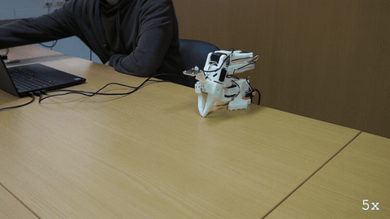
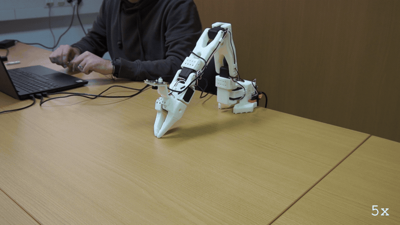
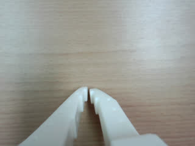
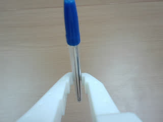

# E119: Rest pose and hand-off, first time on hardware

**quackd handed the arm over, held the pose a person set by hand, and folded it back to rest when the run was done.**

**Part 1 of 3:** The rest pose at both ends of a run


Filmed with an external camera. The GIF plays at 5x speed.

**Part 2 of 3:** The hand-off: a person places the arm and quackd holds it



Filmed with an external camera. The GIF plays at 5x speed.

**Part 3 of 3:** Recording the rest pose



Filmed with an external camera. The GIF plays at 5x speed.

| Category | Goal met | The run ended with | Date | quackd |
|---|---|---|---|---|
| Safety | Yes | SUCCESS / SUCCESS / SUCCESS | 2026-11-06 | 0.31.3 |

The numbers and the trace below are copied from the run's own record.
[All examples](../README.md)

## Why this matters

**Why this example exists:** When LeRobot disconnects from an arm it takes the torque off, so an arm left raised falls where it is. This project's first arm did that at the end of every run. The rest pose is quackd's answer: a pose the arm can hold with no power, which every run starts from and folds back to. The hand-off is the other half, where a person places the arm and quackd takes hold of it without dropping it. This example shows both on a real arm.

**Why this result is important:** A run on this arm begins and ends at a pose it can hold on its own, so the end of a run is not the moment it falls. When a person placed the arm by hand, quackd took hold of a pose it had never been told about and only then said to let go, and at the end it opened the gripper first and gave 3 s to clear before it folded. Those are the moments a person's hands are nearest the arm.

## The goal

Show the rest pose and the hand-off working on a real arm: a run starts from the rest pose and folds back to it, a person can place the arm by hand and quackd holds it there, and a new rest pose can be recorded.

**What we expected:** At each end of a run quackd says `moving to the rest pose`, then `already at the rest pose` or `at the rest pose`. Placed by hand, the arm holds the pose it is given once quackd says the person can let go, and it folds back to its rest pose at the end.

## What the run showed

* Part 1: the arm was already folded, so quackd said `already at the rest pose` at both ends and nothing moved. The LLM read the arm back once and ended the run, with no joint reading hot.
* Part 2: quackd took the torque off at the rest pose and handed the arm over, saying `the arm is yours`. With a pen in the jaws and the arm held up by hand, Enter made quackd take hold and say `holding the pose you set, you can let go`. The arm stayed there for the 38 s until the next Enter.
* At the end of Part 2, Enter opened the gripper all the way so the pen could be taken, and 3 s later the arm folded back in about 2.6 s, ending on `at the rest pose`.
* The arm reported `holding nothing` while the pen was in its jaws, and its own camera shows the pen there in the second picture of Part 2. quackd infers holding from the gripper stopping short of shut, and a pen this thin leaves it nearly shut, at 4 of 100.
* Part 3: `quackd robot rest-pose arm-01` read all six joints, asked before replacing the pose already recorded, and kept the new one.

## What the run did not show

* Part 1's arm had no need to move, because it was already at its rest pose, so that part shows the check and not the fold. The fold to watch is the one at the end of Part 2. Part 1's GIF is a stock clip of the arm sitting still, used for every run where it did not move.
* Neither run prints a line saying it let go of the arm at its end, so the torque coming off there is not something these records show.

## How the run ended

**Part 1 of 3:** The rest pose at both ends of a run

The run ended with **SUCCESS**. The reason on record:

> Reported joints are shoulder_pan −5°, shoulder_lift −88°, elbow_flex 96°, wrist_flex 73°, wrist_roll 1°, and gripper 0°; torque is on, and none reads hot (reported maximum: elbow_flex 33°C, below 60°C), though temperature is flagged as a stand-in rather than a verified measurement.

**Part 2 of 3:** The hand-off: a person places the arm and quackd holds it

The run ended with **SUCCESS**. The reason on record:

> Without moving, the arm reports shoulder_pan −5°, shoulder_lift −18°, elbow_flex 4°, wrist_flex 61°, wrist_roll 1°, and gripper 4°, with torque on and no joint reading hot (the highest reported temperature is elbow_flex at 33°C, below 60°C).

**Part 3 of 3:** Recording the rest pose

The run ended with **SUCCESS**. The reason on record:

> recorded arm-01's rest pose (6 joints)

## The exact command

**Part 1 of 3:** The rest pose at both ends of a run

The following command was run with quackd 0.31.3:

```text
quackd run lerobot-lookout --robot arm-01 --camera-url 'opencv://1?name=arm' --llm openai:gpt-6-astra --max-steps 10 --no-memory
```

**Part 2 of 3:** The hand-off: a person places the arm and quackd holds it

The following command was run with quackd 0.31.3:

```text
quackd run lerobot-lookout --robot arm-01 --by-hand --camera-url 'opencv://1?name=arm' --llm openai:gpt-6-astra --max-steps 10 --no-memory
```

**Part 3 of 3:** Recording the rest pose

The following command was run with quackd 0.31.3:

```text
quackd robot rest-pose arm-01
```

## The numbers

| | Part 1 | Part 2 | Part 3 |
|---|---|---|---|
| quackd version | 0.31.3 | 0.31.3 | 0.31.3 |
| Started | 2026-11-06 12:17:36 UTC | 2026-11-06 12:20:54 UTC | 2026-11-06 12:27:26 UTC |
| Robot | `arm-01` (real) | `arm-01` (real) | `arm-01` (real) |
| LLM | `openai:gpt-6-astra` | `openai:gpt-6-astra` | none |
| Task file | `lerobot-lookout`, which ships with quackd | `lerobot-lookout`, which ships with quackd | none |
| Steps | 1 | 1 | none |
| LLM calls | 2 | 2 | none |
| Total time | 18.4 s | 92.5 s | not recorded |
| Connecting | 6.9 s | 7.6 s | not recorded |
| Waiting for the LLM | 10.6 s | 7.3 s | none |
| First motion | no verb moved the arm | no verb moved the arm | not recorded |
| Tokens | 7,289 in, 127 out | 7,543 in, 99 out | none |
| Cost at list price | $0.0596 | $0.0597 | none |
| Speed cap | 5° per send | 5° per send | not recorded |
| Run folder | `runs\20261106-121736-lerobot-lookout` | `runs\20261106-122054-lerobot-lookout` | none, it writes no run folder |

## What the robot saw

**Part 1 of 3:** The rest pose at both ends of a run

| Start | End |
|---|---|
|  |  |

**Part 2 of 3:** The hand-off: a person places the arm and quackd holds it

| Start | End |
|---|---|
|  |  |

**Part 3 of 3:** Recording the rest pose

This run used no camera.

## Try it yourself

This runs the same task file with no arm attached, on `lerobot:mock`, an arm that lives in memory.
It shows the rules a run is held to and not the physics. Run it from a checkout of this repository
with quackd's `lerobot` extra and the LLM's own SDK and key. It costs what the LLM charges.

```bash
quackd run lerobot-lookout --robot lerobot:mock --llm openai:gpt-6-astra --no-memory
```

## Full terminal trace

<details>
<summary>Show the full terminal trace (492 lines)</summary>

```text
$ quackd run lerobot-lookout --robot arm-01 --camera-url 'opencv://1?name=arm' --llm openai:gpt-6-astra --max-steps 10 --no-memory
quackd 0.31.3, started 2026-11-06T12:17:33Z, cwd D:\Development\lerobot-test\.venv

╭─ 🦆 lerobot-lookout ─────────────────────────────────────────────────────────────────────────────────────────────────────────────────────────────────────╮
│ provider  openai (gpt-6-astra)                                                                                                                           │
│ robot     arm-01 (lerobot:real)                                                                                                                          │
│ detector  color_blob on this machine  (once the body reports a camera)                                                                                   │
╰─ Ctrl-C or q stops the duck. Ctrl-C twice quits at once. ────────────────────────────────────────────────────────────────────────────────────────────────╯
WARNING  no camera field of view given for a real camera, so detections use the simulator's 90 degrees. Distances will be out by tens of percent: pass      
         --fov-deg (a Pi Camera Module 2 is about 62) once you know yours.                                                                                  
WARNING:quackd.perception:no camera field of view given for a real camera, so detections use the simulator's 90 degrees. Distances will be out by tens of 
percent: pass --fov-deg (a Pi Camera Module 2 is about 62) once you know yours.
   run     connected in 6.86 s
   tools   report_state, stop, assess_task, declare_success, declare_failure
system prompt, 6427 chars, 88 lines (also in transcript.jsonl as run_start): ───────────────────────────────────────────────────────────────────────────────
   You are the brain of a six-joint desktop robot arm with a parallel gripper (an SO-101 class arm driven by LeRobot), bolted to a table. You are a high-level pilot:
   you choose ONE verb per turn; the robot's own controllers handle the motion. Do not micro-manage.

   ## Rules (enforced by the executor — not optional)
   - Call exactly one tool per turn. Never zero, never two.
   - Only these verbs are allowed: report_state, stop. Anything else is refused.
   - Budgets: 10 steps, 3 minutes, 12 LLM calls. The run stops when any is hit.
   - Verbs marked confirm (none) ask a human before running.
   - Before the first verb that moves the body, call `assess_task` with your verdict on whether this body can do this task at all, judged against its datasheet below: `feasible`, `infeasible` (the run ends, nothing moves) or `uncertain` (a human is asked). The verdict is about the body, not the view: not having found the target yet is not by itself a reason for `uncertain`. It is one when a limit turns on that unseen thing's mass or size, or on a figure the datasheet does not publish. Until then only `report_state` and `stop` run. Assess again later if what you see changes your mind.
   - When a success criterion is met, call `declare_success`. If the task turns out impossible while doing it, call `declare_failure`.

   ## Success criteria
   - You have said where the joints are, whether torque is on, and whether anything reads hot.

   ## Abort conditions you must respect yourself
   - (none beyond the enforced ones)

   ## Verbs
   - `report_state`: Report the arm: every joint in degrees, whether torque is on, how warm the servos are, and whether anything is held.
   - `stop`: Stop moving immediately (zero velocity). Always allowed.

   ## Your body: what it can and cannot do
   Each number says how sure quackd is of it and who says so (official: the maker or a paper says so; estimate: one vendor, a community number or a reading off a photo; measured: somebody measured it and said how).
   - Height: 0.53 m (estimate: one vendor's listing; reaching straight up)
   - Actuated joints: 6 (official: the LeRobot SO-101 docs; five joints and a gripper)
   - Payload: 0.5 kg (estimate: one vendor's listing)
   - Reach: 0.4 m (estimate: the maker's URDF, TheRobotStudio/SO-ARM100 Simulation/SO101/so101_new_calib.urdf; link lengths from the shoulder to the gripper frame, summed with the arm straight and rounded down)
   - Manipulator: one arm with a gripper.
   - Not published: mass. Where a task turns on it, say uncertain and name it rather than guessing; do not decline on it alone.
   - Mains powered, so nothing runs down. It does not move: no base and no legs.
   - quackd clamps you to gripper 0 to 100.
   - Each joint's travel in degrees, read from its own calibration, and the only goals quackd will send: shoulder_pan -119.6 to 119.6, shoulder_lift -100.7 to 100.7, elbow_flex -96.7 to 96.7, wrist_flex -101.4 to 101.4, wrist_roll -180 to 180, gripper 0 to 100. A joint can read past its travel when it was folded or placed there with torque off, which is where a rest pose usually is; goals are still limited to the travel.
   - Senses: joint_state, camera.
   Whatever the task says, this body cannot:
   - go anywhere: it is bolted to a table and has no base
   - lift or hold more than about half a kilogram: a pen, an empty cup or a wooden block weighs far less than that, and a full bottle or a tool may weigh more
   - reach anything more than about 0.4 m from its shoulder: that is the arm held straight out, and any bent pose reaches less
   - feel what it holds: nothing reports grip force, so holding is inferred from the gripper stopping short of shut, which an empty hand that binds also does
   - know its own mass: vendor listings disagree by a factor of three
   Worth knowing:
   - How wide the gripper opens and how hard it grips are not published
   - No sensors beyond the servo positions unless a camera is configured, and the servo temperature, which quackd reads off the bus because LeRobot does not
   - Vendor listings give the mass as anything from 0.8 to 2.5 kg and nobody official publishes one, so it is listed as not published rather than picked from a hat
   - There are 7.4 V and 12 V builds of the same arm, with different stall torque and different supplies. Which one is on the desk is not something quackd can ask

   ## What is a stand-in on this robot
   The robot reported these itself, and they are in `extras.assumptions` in every observation.
   Each is something quackd stands in for or assumes, not something this robot does. Do not
   report one as the robot's own work, and do not read a success from one as evidence that the
   real skill works.
   - GRIPPER_OPEN_VALUE
   - HOLDING_INFERRED
   - TEMPERATURE_C

   ## Persona
   A calm lookout. One clear sentence, then stop.

   ## Task file: lerobot-lookout — Move nothing, read the arm back, and report what it says about itself.

   # Task

   You are a six-joint robot arm bolted to a desk. Do not move. Read your own state and report
   what it says, so that a human can decide whether this arm is fit to be driven.

   ## Strategy

   1. `report_state` gives you every joint in degrees, whether torque is on, and the temperature
      of each servo.
   2. Say in one sentence where the joints are, whether torque is on, and whether any joint reads
      hot. A joint at or above 60 degrees Celsius is hot and worth naming.
   3. Declare success once you have said all three. Declare failure if `report_state` fails twice:
      an arm that does not answer is the thing a human needs to know about.

   ## Notes

   - **You cannot move in this task and you should not want to.** Every verb that moves a joint is
     outside your allowlist. If the reading looks wrong, saying so is the answer.
   - **You cannot ask for a picture, and you have no voice.** `observe` and `say` are not verbs
     you have. If somebody plugged a webcam in and named it, you will still see a camera line in
     your observations, because a frame is taken every step whatever your allowlist says: use it
     if it is there and do not wait for it if it is not. Reporting means writing it in the reason
     you declare with.
   - **Torque off is not a fault you can fix.** no verb can toggle torque either way. A servo
     that has tripped its own overload protection reads the same way, so name the joint and let a
     human look at it.
   - The temperatures come off the servos themselves, which is something the robot's own software
     does not read. They are the one early warning this body has, so do not skip them.
────────────────────────────────────────────────────────────────────────────────────────────────────────────────────────────────────────────────────────────
·  note    moving to the rest pose
·  note    already at the rest pose
step 0/10 · llm calls 0/12, 0.0/3 min ──────────────────────────────────────────────────────────────────────────────────────────────────────────────────────
   obs     state: posture=unknown policy=idle stand-ins=3-listed-in-extras.assumptions
           camera: nothing detected
           Choose exactly one tool.
           note: nothing detected yet. That is not by itself a reason for `uncertain`: the verdict is about this body's limits, not about where the target is. Answer `uncertain` only if a limit turns on that unseen thing's mass or size, or on a figure the datasheet does not publish.
   llm>    step 0: 1 messages (1 with image) to openai gpt-6-astra
   tool    report_state()
   tokens  in=3362 out=14 cache_write=3236 (run total in=3362 out=14 $0.0424) latency=5.6 s cost=$0.0424 stop=tool_calls
▶  verb    report_state()
✓  result  report_state ok: shoulder_pan -5, shoulder_lift -88, elbow_flex 96, wrist_flex 73, wrist_roll 1, gripper 0; torque on; hottest elbow_flex 33°C; holding nothing (0.0 s, 0 intents)
step 1/10 · llm calls 1/12, 0.1/3 min ──────────────────────────────────────────────────────────────────────────────────────────────────────────────────────
   obs     state: posture=unknown policy=idle stand-ins=3-listed-in-extras.assumptions
           camera: nothing detected
           last verb `report_state`: ok — shoulder_pan -5, shoulder_lift -88, elbow_flex 96, wrist_flex 73, wrist_roll 1, gripper 0; torque on; hottest elbow_flex 33°C; holding nothing
           Choose exactly one tool.
           note: nothing detected yet. That is not by itself a reason for `uncertain`: the verdict is about this body's limits, not about where the target is. Answer `uncertain` only if a limit turns on that unseen thing's mass or size, or on a figure the datasheet does not publish.
   llm>    step 1: 2 messages (2 with image) to openai gpt-6-astra
   tool    declare_success(reason='Reported joints are shoulder_pan −5°, shoulder_lift −88°,...')
   tokens  in=3927 out=113 cached=3236 cache_write=565 reasoning=17 (run total in=7289 out=127 $0.0596) latency=5.0 s cost=$0.0172 stop=tool_calls
✓  declare success: Reported joints are shoulder_pan −5°, shoulder_lift −88°, elbow_flex 96°, wrist_flex 73°, wrist_roll 1°, and gripper 0°; torque is on, and none reads hot (reported maximum: elbow_flex 33°C, below 60°C), though temperature is flagged as a stand-in rather than a verified measurement.
→  send    stop
·  note    moving to the rest pose
·  note    already at the rest pose
╭─ ✓ SUCCESS ──────────────────────────────────────────────────────────────────────────────────────────────────────────────────────────────────────────────╮
│ Reported joints are shoulder_pan −5°, shoulder_lift −88°, elbow_flex 96°, wrist_flex 73°, wrist_roll 1°, and gripper 0°; torque is on, and none reads    │
│ hot (reported maximum: elbow_flex 33°C, below 60°C), though temperature is flagged as a stand-in rather than a verified measurement.                     │
│ steps 1 · llm calls 2 · tokens 7289+127 · time 18.4 s (model 10.6 s) · model calls p50 5.0 s, p90 5.6 s, max 5.6 s · cost $0.0596                        │
│ run dir  runs\20261106-121736-lerobot-lookout                                                                                                            │
╰──────────────────────────────────────────────────────────────────────────────────────────────────────────────────────────────────────────────────────────╯

$ quackd run lerobot-lookout --robot arm-01 --by-hand --camera-url 'opencv://1?name=arm' --llm openai:gpt-6-astra --max-steps 10 --no-memory
quackd 0.31.3, started 2026-11-06T12:20:49Z, cwd D:\Development\lerobot-test\.venv

╭─ 🦆 lerobot-lookout ─────────────────────────────────────────────────────────────────────────────────────────────────────────────────────────────────────╮
│ provider  openai (gpt-6-astra)                                                                                                                           │
│ robot     arm-01 (lerobot:real)                                                                                                                          │
│ detector  color_blob on this machine  (once the body reports a camera)                                                                                   │
╰─ Ctrl-C or q stops the duck. However often you press, the run ends properly. ────────────────────────────────────────────────────────────────────────────╯
WARNING  no camera field of view given for a real camera, so detections use the simulator's 90 degrees. Distances will be out by tens of percent: pass      
         --fov-deg (a Pi Camera Module 2 is about 62) once you know yours.                                                                                  
WARNING:quackd.perception:no camera field of view given for a real camera, so detections use the simulator's 90 degrees. Distances will be out by tens of 
percent: pass --fov-deg (a Pi Camera Module 2 is about 62) once you know yours.
   run     connected in 7.64 s
   tools   report_state, stop, assess_task, declare_success, declare_failure
system prompt, 7241 chars, 100 lines (also in transcript.jsonl as run_start): ──────────────────────────────────────────────────────────────────────────────
   You are the brain of a six-joint desktop robot arm with a parallel gripper (an SO-101 class arm driven by LeRobot), bolted to a table. You are a high-level pilot:
   you choose ONE verb per turn; the robot's own controllers handle the motion. Do not micro-manage.

   ## Rules (enforced by the executor — not optional)
   - Call exactly one tool per turn. Never zero, never two.
   - Only these verbs are allowed: report_state, stop. Anything else is refused.
   - Budgets: 10 steps, 3 minutes, 12 LLM calls. The run stops when any is hit.
   - Verbs marked confirm (none) ask a human before running.
   - Before the first verb that moves the body, call `assess_task` with your verdict on whether this body can do this task at all, judged against its datasheet below: `feasible`, `infeasible` (the run ends, nothing moves) or `uncertain` (a human is asked). The verdict is about the body, not the view: not having found the target yet is not by itself a reason for `uncertain`. It is one when a limit turns on that unseen thing's mass or size, or on a figure the datasheet does not publish. Until then only `report_state` and `stop` run. Assess again later if what you see changes your mind.
   - When a success criterion is met, call `declare_success`. If the task turns out impossible while doing it, call `declare_failure`.

   ## Success criteria
   - You have said where the joints are, whether torque is on, and whether anything reads hot.

   ## Abort conditions you must respect yourself
   - (none beyond the enforced ones)

   ## Verbs
   - `report_state`: Report the arm: every joint in degrees, whether torque is on, how warm the servos are, and whether anything is held.
   - `stop`: Stop moving immediately (zero velocity). Always allowed.

   ## Your body: what it can and cannot do
   Each number says how sure quackd is of it and who says so (official: the maker or a paper says so; estimate: one vendor, a community number or a reading off a photo; measured: somebody measured it and said how).
   - Height: 0.53 m (estimate: one vendor's listing; reaching straight up)
   - Actuated joints: 6 (official: the LeRobot SO-101 docs; five joints and a gripper)
   - Payload: 0.5 kg (estimate: one vendor's listing)
   - Reach: 0.4 m (estimate: the maker's URDF, TheRobotStudio/SO-ARM100 Simulation/SO101/so101_new_calib.urdf; link lengths from the shoulder to the gripper frame, summed with the arm straight and rounded down)
   - Manipulator: one arm with a gripper.
   - Not published: mass. Where a task turns on it, say uncertain and name it rather than guessing; do not decline on it alone.
   - Mains powered, so nothing runs down. It does not move: no base and no legs.
   - quackd clamps you to gripper 0 to 100.
   - Each joint's travel in degrees, read from its own calibration, and the only goals quackd will send: shoulder_pan -119.6 to 119.6, shoulder_lift -100.7 to 100.7, elbow_flex -96.7 to 96.7, wrist_flex -101.4 to 101.4, wrist_roll -180 to 180, gripper 0 to 100. A joint can read past its travel when it was folded or placed there with torque off, which is where a rest pose usually is; goals are still limited to the travel.
   - Senses: joint_state, camera.
   Whatever the task says, this body cannot:
   - go anywhere: it is bolted to a table and has no base
   - lift or hold more than about half a kilogram: a pen, an empty cup or a wooden block weighs far less than that, and a full bottle or a tool may weigh more
   - reach anything more than about 0.4 m from its shoulder: that is the arm held straight out, and any bent pose reaches less
   - feel what it holds: nothing reports grip force, so holding is inferred from the gripper stopping short of shut, which an empty hand that binds also does
   - know its own mass: vendor listings disagree by a factor of three
   Worth knowing:
   - How wide the gripper opens and how hard it grips are not published
   - No sensors beyond the servo positions unless a camera is configured, and the servo temperature, which quackd reads off the bus because LeRobot does not
   - Vendor listings give the mass as anything from 0.8 to 2.5 kg and nobody official publishes one, so it is listed as not published rather than picked from a hat
   - There are 7.4 V and 12 V builds of the same arm, with different stall torque and different supplies. Which one is on the desk is not something quackd can ask

   ## Where this run starts
   A person placed this body by hand before your first turn, and quackd is holding it exactly
   where they left it. This run does **not** start from the recorded rest pose, so do not assume
   a folded arm or a known shape: read `report_state` and work from the joint angles it gives you. They
   are where somebody decided the work should begin.

   The gripper is where their fingers closed it, which is a position and not a grip. Nothing is
   reported as held, and nothing should be: this task cannot work the gripper, so whatever is between the jaws is held at the squeeze the person left and you cannot tighten it.

   When the run ends, the arm is handed back the same way: it holds where you left it, the person
   is asked to take whatever is in the gripper, and only then does quackd fold the arm up.

   ## What is a stand-in on this robot
   The robot reported these itself, and they are in `extras.assumptions` in every observation.
   Each is something quackd stands in for or assumes, not something this robot does. Do not
   report one as the robot's own work, and do not read a success from one as evidence that the
   real skill works.
   - GRIPPER_OPEN_VALUE
   - HOLDING_INFERRED
   - TEMPERATURE_C

   ## Persona
   A calm lookout. One clear sentence, then stop.

   ## Task file: lerobot-lookout — Move nothing, read the arm back, and report what it says about itself.

   # Task

   You are a six-joint robot arm bolted to a desk. Do not move. Read your own state and report
   what it says, so that a human can decide whether this arm is fit to be driven.

   ## Strategy

   1. `report_state` gives you every joint in degrees, whether torque is on, and the temperature
      of each servo.
   2. Say in one sentence where the joints are, whether torque is on, and whether any joint reads
      hot. A joint at or above 60 degrees Celsius is hot and worth naming.
   3. Declare success once you have said all three. Declare failure if `report_state` fails twice:
      an arm that does not answer is the thing a human needs to know about.

   ## Notes

   - **You cannot move in this task and you should not want to.** Every verb that moves a joint is
     outside your allowlist. If the reading looks wrong, saying so is the answer.
   - **You cannot ask for a picture, and you have no voice.** `observe` and `say` are not verbs
     you have. If somebody plugged a webcam in and named it, you will still see a camera line in
     your observations, because a frame is taken every step whatever your allowlist says: use it
     if it is there and do not wait for it if it is not. Reporting means writing it in the reason
     you declare with.
   - **Torque off is not a fault you can fix.** no verb can toggle torque either way. A servo
     that has tripped its own overload protection reads the same way, so name the joint and let a
     human look at it.
   - The temperatures come off the servos themselves, which is something the robot's own software
     does not read. They are the one early warning this body has, so do not skip them.
────────────────────────────────────────────────────────────────────────────────────────────────────────────────────────────────────────────────────────────
·  note    moving to the rest pose
·  note    already at the rest pose
·  hand    released: torque is off at the rest pose
the arm is yours: torque is off at its rest pose, so lift it, put whatever it needs in the gripper, close the gripper on that, hold it where you want the 
run to start, and press Enter
(Enter)
·  asked   hand_off: the arm is yours: torque is off at its rest pose, so lift it, put whatever it needs in the gripper, close the gripper on that, hold it where you want the run to start, and press Enter -> yes
·  hand    held: holding the pose you set (elbow_flex 4, gripper 4, shoulder_lift -18, shoulder_pan -5, wrist_flex 61, wrist_roll 1)
holding the pose you set, you can let go. It is at elbow_flex 4, gripper 4, shoulder_lift -18, shoulder_pan -5, wrist_flex 61, wrist_roll 1
step 0/10 · llm calls 0/12, 0.0/3 min ──────────────────────────────────────────────────────────────────────────────────────────────────────────────────────
   obs     state: posture=unknown policy=idle stand-ins=3-listed-in-extras.assumptions
           camera: person at bearing 6° left ~1.22 m (uncalibrated: distance is a rough guess)
           Choose exactly one tool.
   llm>    step 0: 1 messages (1 with image) to openai gpt-6-astra
   tool    report_state()
   tokens  in=3510 out=14 cache_write=3384 (run total in=3510 out=14 $0.0443) latency=4.3 s cost=$0.0443 stop=tool_calls
▶  verb    report_state()
✓  result  report_state ok: shoulder_pan -5, shoulder_lift -18, elbow_flex 4, wrist_flex 61, wrist_roll 1, gripper 4; torque on; hottest elbow_flex 33°C; holding nothing (0.0 s, 0 intents)
step 1/10 · llm calls 1/12, 0.1/3 min ──────────────────────────────────────────────────────────────────────────────────────────────────────────────────────
   obs     state: posture=unknown policy=idle stand-ins=3-listed-in-extras.assumptions
           camera: person at bearing 6° left ~1.22 m (uncalibrated: distance is a rough guess)
           last verb `report_state`: ok — shoulder_pan -5, shoulder_lift -18, elbow_flex 4, wrist_flex 61, wrist_roll 1, gripper 4; torque on; hottest elbow_flex 33°C; holding nothing
           Choose exactly one tool.
   llm>    step 1: 2 messages (2 with image) to openai gpt-6-astra
   tool    declare_success(reason='Without moving, the arm reports shoulder_pan −5°, shoulde...')
   tokens  in=4033 out=85 cached=3384 cache_write=523 (run total in=7543 out=99 $0.0597) latency=3.0 s cost=$0.0154 stop=tool_calls
✓  declare success: Without moving, the arm reports shoulder_pan −5°, shoulder_lift −18°, elbow_flex 4°, wrist_flex 61°, wrist_roll 1°, and gripper 4°, with torque on and no joint reading hot (the highest reported temperature is elbow_flex at 33°C, below 60°C).
the run is over and the arm is holding where it ended. Take hold of whatever is in the gripper and press Enter: the gripper opens all the way, and 3 s later
the arm folds up, so take your hands away as soon as it is open. Leave it and the arm folds up with the gripper shut
(Enter)
→  send    stop
·  asked   hand_off: the run is over and the arm is holding where it ended. Take hold of whatever is in the gripper and press Enter: the gripper opens all the way, and 3 s later the arm folds up, so take your hands away as soon as it is open. Leave it and the arm folds up with the gripper shut -> yes
WARNING:root:Relative goal position magnitude had to be clamped to be safe.
{'gripper': {'original goal_pos': 100.0, 'safe goal_pos': 8.824756606397774}}
WARNING:root:Relative goal position magnitude had to be clamped to be safe.
{'gripper': {'original goal_pos': 100.0, 'safe goal_pos': 11.189151599443672}}
WARNING:root:Relative goal position magnitude had to be clamped to be safe.
{'gripper': {'original goal_pos': 100.0, 'safe goal_pos': 14.527121001390821}}
WARNING:root:Relative goal position magnitude had to be clamped to be safe.
{'gripper': {'original goal_pos': 100.0, 'safe goal_pos': 17.65646731571627}}
WARNING:root:Relative goal position magnitude had to be clamped to be safe.
{'gripper': {'original goal_pos': 100.0, 'safe goal_pos': 20.85535465924896}}
WARNING:root:Relative goal position magnitude had to be clamped to be safe.
{'gripper': {'original goal_pos': 100.0, 'safe goal_pos': 23.98470097357441}}
WARNING:root:Relative goal position magnitude had to be clamped to be safe.
{'gripper': {'original goal_pos': 100.0, 'safe goal_pos': 27.18358831710709}}
WARNING:root:Relative goal position magnitude had to be clamped to be safe.
{'gripper': {'original goal_pos': 100.0, 'safe goal_pos': 30.312934631432544}}
WARNING:root:Relative goal position magnitude had to be clamped to be safe.
{'gripper': {'original goal_pos': 100.0, 'safe goal_pos': 33.51182197496523}}
WARNING:root:Relative goal position magnitude had to be clamped to be safe.
{'gripper': {'original goal_pos': 100.0, 'safe goal_pos': 36.64116828929068}}
WARNING:root:Relative goal position magnitude had to be clamped to be safe.
{'gripper': {'original goal_pos': 100.0, 'safe goal_pos': 39.840055632823365}}
WARNING:root:Relative goal position magnitude had to be clamped to be safe.
{'gripper': {'original goal_pos': 100.0, 'safe goal_pos': 42.96940194714882}}
WARNING:root:Relative goal position magnitude had to be clamped to be safe.
{'gripper': {'original goal_pos': 100.0, 'safe goal_pos': 46.09874826147427}}
WARNING:root:Relative goal position magnitude had to be clamped to be safe.
{'gripper': {'original goal_pos': 100.0, 'safe goal_pos': 49.22809457579972}}
WARNING:root:Relative goal position magnitude had to be clamped to be safe.
{'gripper': {'original goal_pos': 100.0, 'safe goal_pos': 52.426981919332405}}
WARNING:root:Relative goal position magnitude had to be clamped to be safe.
{'gripper': {'original goal_pos': 100.0, 'safe goal_pos': 55.48678720445062}}
WARNING:root:Relative goal position magnitude had to be clamped to be safe.
{'gripper': {'original goal_pos': 100.0, 'safe goal_pos': 58.68567454798331}}
WARNING:root:Relative goal position magnitude had to be clamped to be safe.
{'gripper': {'original goal_pos': 100.0, 'safe goal_pos': 61.815020862308764}}
WARNING:root:Relative goal position magnitude had to be clamped to be safe.
{'gripper': {'original goal_pos': 100.0, 'safe goal_pos': 65.01390820584145}}
WARNING:root:Relative goal position magnitude had to be clamped to be safe.
{'gripper': {'original goal_pos': 100.0, 'safe goal_pos': 68.1432545201669}}
→  send    gripper x20 over 2.1 s (open true)
WARNING:root:Relative goal position magnitude had to be clamped to be safe.
{'gripper': {'original goal_pos': 100.0, 'safe goal_pos': 71.41168289290682}}
WARNING:root:Relative goal position magnitude had to be clamped to be safe.
{'gripper': {'original goal_pos': 100.0, 'safe goal_pos': 74.54102920723227}}
WARNING:root:Relative goal position magnitude had to be clamped to be safe.
{'gripper': {'original goal_pos': 100.0, 'safe goal_pos': 77.67037552155772}}
WARNING:root:Relative goal position magnitude had to be clamped to be safe.
{'gripper': {'original goal_pos': 100.0, 'safe goal_pos': 80.79972183588318}}
WARNING:root:Relative goal position magnitude had to be clamped to be safe.
{'gripper': {'original goal_pos': 100.0, 'safe goal_pos': 83.92906815020862}}
WARNING:root:Relative goal position magnitude had to be clamped to be safe.
{'gripper': {'original goal_pos': 100.0, 'safe goal_pos': 87.05841446453408}}
WARNING:root:Relative goal position magnitude had to be clamped to be safe.
{'gripper': {'original goal_pos': 100.0, 'safe goal_pos': 90.1182197496523}}
WARNING:root:Relative goal position magnitude had to be clamped to be safe.
{'gripper': {'original goal_pos': 100.0, 'safe goal_pos': 93.24756606397774}}
WARNING:root:Relative goal position magnitude had to be clamped to be safe.
{'gripper': {'original goal_pos': 100.0, 'safe goal_pos': 96.23783031988873}}
WARNING:root:Relative goal position magnitude had to be clamped to be safe.
{'gripper': {'original goal_pos': 100.0, 'safe goal_pos': 99.36717663421419}}
→  send    gripper x10 over 1.0 s (open true)
·  hand    unloaded: the gripper is open
folding the arm to its rest pose in 3 s: take your hands away from it now. Ctrl-C or q stops it before it moves
·  note    folding the arm to its rest pose in 3 s: take your hands away from it now. Ctrl-C or q stops it before it moves
·  note    moving to the rest pose
WARNING:root:Relative goal position magnitude had to be clamped to be safe.
{   'elbow_flex': {   'original goal_pos': 96.79120879120879,
                      'safe goal_pos': 9.395604395604396},
    'shoulder_lift': {   'original goal_pos': -91.4,
                         'safe goal_pos': -23.153846153846153},
    'wrist_flex': {   'original goal_pos': 73.7,
                      'safe goal_pos': 65.96703296703296}}
WARNING:root:Relative goal position magnitude had to be clamped to be safe.
{   'elbow_flex': {   'original goal_pos': 96.79120879120879,
                      'safe goal_pos': 12.824175824175825},
    'shoulder_lift': {   'original goal_pos': -91.4,
                         'safe goal_pos': -25.175824175824175},
    'wrist_flex': {   'original goal_pos': 73.7,
                      'safe goal_pos': 68.78021978021978}}
WARNING:root:Relative goal position magnitude had to be clamped to be safe.
{   'elbow_flex': {   'original goal_pos': 96.79120879120879,
                      'safe goal_pos': 16.86813186813187},
    'shoulder_lift': {   'original goal_pos': -91.4,
                         'safe goal_pos': -27.813186813186814},
    'wrist_flex': {   'original goal_pos': 73.7,
                      'safe goal_pos': 72.20879120879121}}
WARNING:root:Relative goal position magnitude had to be clamped to be safe.
{   'elbow_flex': {   'original goal_pos': 96.79120879120879,
                      'safe goal_pos': 20.64835164835165},
    'shoulder_lift': {   'original goal_pos': -91.4,
                         'safe goal_pos': -30.186813186813186}}
WARNING:root:Relative goal position magnitude had to be clamped to be safe.
{   'elbow_flex': {   'original goal_pos': 96.79120879120879,
                      'safe goal_pos': 24.516483516483518},
    'shoulder_lift': {   'original goal_pos': -91.4,
                         'safe goal_pos': -32.73626373626374}}
WARNING:root:Relative goal position magnitude had to be clamped to be safe.
{   'elbow_flex': {   'original goal_pos': 96.79120879120879,
                      'safe goal_pos': 28.384615384615383},
    'shoulder_lift': {   'original goal_pos': -91.4,
                         'safe goal_pos': -35.37362637362637}}
WARNING:root:Relative goal position magnitude had to be clamped to be safe.
{   'elbow_flex': {   'original goal_pos': 96.79120879120879,
                      'safe goal_pos': 32.34065934065934},
    'shoulder_lift': {   'original goal_pos': -91.4,
                         'safe goal_pos': -38.010989010989015}}
WARNING:root:Relative goal position magnitude had to be clamped to be safe.
{   'elbow_flex': {   'original goal_pos': 96.79120879120879,
                      'safe goal_pos': 36.20879120879121},
    'shoulder_lift': {   'original goal_pos': -91.4,
                         'safe goal_pos': -40.824175824175825}}
WARNING:root:Relative goal position magnitude had to be clamped to be safe.
{   'elbow_flex': {   'original goal_pos': 96.79120879120879,
                      'safe goal_pos': 39.989010989010985},
    'shoulder_lift': {   'original goal_pos': -91.4,
                         'safe goal_pos': -43.54945054945055}}
WARNING:root:Relative goal position magnitude had to be clamped to be safe.
{   'elbow_flex': {   'original goal_pos': 96.79120879120879,
                      'safe goal_pos': 43.857142857142854},
    'shoulder_lift': {   'original goal_pos': -91.4,
                         'safe goal_pos': -46.362637362637365}}
WARNING:root:Relative goal position magnitude had to be clamped to be safe.
{   'elbow_flex': {   'original goal_pos': 96.79120879120879,
                      'safe goal_pos': 47.637362637362635},
    'shoulder_lift': {   'original goal_pos': -91.4,
                         'safe goal_pos': -49.175824175824175}}
WARNING:root:Relative goal position magnitude had to be clamped to be safe.
{   'elbow_flex': {   'original goal_pos': 96.79120879120879,
                      'safe goal_pos': 51.59340659340659},
    'shoulder_lift': {   'original goal_pos': -91.4,
                         'safe goal_pos': -52.16483516483517}}
WARNING:root:Relative goal position magnitude had to be clamped to be safe.
{   'elbow_flex': {   'original goal_pos': 96.79120879120879,
                      'safe goal_pos': 55.37362637362637},
    'shoulder_lift': {   'original goal_pos': -91.4,
                         'safe goal_pos': -55.15384615384615}}
WARNING:root:Relative goal position magnitude had to be clamped to be safe.
{   'elbow_flex': {   'original goal_pos': 96.79120879120879,
                      'safe goal_pos': 59.32967032967033},
    'shoulder_lift': {   'original goal_pos': -91.4,
                         'safe goal_pos': -58.142857142857146}}
WARNING:root:Relative goal position magnitude had to be clamped to be safe.
{   'elbow_flex': {   'original goal_pos': 96.79120879120879,
                      'safe goal_pos': 63.1978021978022},
    'shoulder_lift': {   'original goal_pos': -91.4,
                         'safe goal_pos': -61.48351648351648}}
WARNING:root:Relative goal position magnitude had to be clamped to be safe.
{   'elbow_flex': {   'original goal_pos': 96.79120879120879,
                      'safe goal_pos': 66.97802197802199},
    'shoulder_lift': {   'original goal_pos': -91.4,
                         'safe goal_pos': -64.47252747252747}}
WARNING:root:Relative goal position magnitude had to be clamped to be safe.
{   'elbow_flex': {   'original goal_pos': 96.79120879120879,
                      'safe goal_pos': 70.84615384615384},
    'shoulder_lift': {   'original goal_pos': -91.4,
                         'safe goal_pos': -67.72527472527472}}
WARNING:root:Relative goal position magnitude had to be clamped to be safe.
{   'elbow_flex': {   'original goal_pos': 96.79120879120879,
                      'safe goal_pos': 74.71428571428571},
    'shoulder_lift': {   'original goal_pos': -91.4,
                         'safe goal_pos': -71.06593406593407}}
WARNING:root:Relative goal position magnitude had to be clamped to be safe.
{   'elbow_flex': {   'original goal_pos': 96.79120879120879,
                      'safe goal_pos': 78.4065934065934},
    'shoulder_lift': {   'original goal_pos': -91.4,
                         'safe goal_pos': -74.23076923076923}}
WARNING:root:Relative goal position magnitude had to be clamped to be safe.
{   'elbow_flex': {   'original goal_pos': 96.79120879120879,
                      'safe goal_pos': 82.36263736263736},
    'shoulder_lift': {   'original goal_pos': -91.4,
                         'safe goal_pos': -77.57142857142857}}
WARNING:root:Relative goal position magnitude had to be clamped to be safe.
{   'elbow_flex': {   'original goal_pos': 96.79120879120879,
                      'safe goal_pos': 86.05494505494505},
    'shoulder_lift': {   'original goal_pos': -91.4,
                         'safe goal_pos': -80.91208791208791}}
WARNING:root:Relative goal position magnitude had to be clamped to be safe.
{   'elbow_flex': {   'original goal_pos': 96.79120879120879,
                      'safe goal_pos': 89.92307692307692},
    'shoulder_lift': {   'original goal_pos': -91.4,
                         'safe goal_pos': -84.16483516483517}}
WARNING:root:Relative goal position magnitude had to be clamped to be safe.
{   'elbow_flex': {   'original goal_pos': 96.79120879120879,
                      'safe goal_pos': 93.7032967032967},
    'shoulder_lift': {   'original goal_pos': -91.4,
                         'safe goal_pos': -87.5934065934066}}
WARNING:root:Relative goal position magnitude had to be clamped to be safe.
{   'shoulder_lift': {   'original goal_pos': -91.4,
                         'safe goal_pos': -90.75824175824175}}
·  note    at the rest pose
╭─ ✓ SUCCESS ──────────────────────────────────────────────────────────────────────────────────────────────────────────────────────────────────────────────╮
│ Without moving, the arm reports shoulder_pan −5°, shoulder_lift −18°, elbow_flex 4°, wrist_flex 61°, wrist_roll 1°, and gripper 4°, with torque on and   │
│ no joint reading hot (the highest reported temperature is elbow_flex at 33°C, below 60°C).                                                               │
│ steps 1 · llm calls 2 · tokens 7543+99 · time 1m 33s (model 7.3 s) · model calls p50 3.0 s, p90 4.3 s, max 4.3 s · cost $0.0597                          │
│ run dir  runs\20261106-122054-lerobot-lookout                                                                                                            │
╰──────────────────────────────────────────────────────────────────────────────────────────────────────────────────────────────────────────────────────────╯

(lerobot-test) PS D:\Development\lerobot-test\.venv> quackd robot rest-pose arm-01
arm-01 (lerobot:real) is at
shoulder_pan   -5.7
shoulder_lift  -100.9
elbow_flex     96.4
wrist_flex     79.2
wrist_roll     0.7
gripper        2.5
record this as arm-01's rest pose, replacing the one already recorded? [y/N]: Y
✓ recorded arm-01's rest pose (6 joints)
  quackd run <duck> --robot arm-01 starts from it and returns to it before letting go
(lerobot-test) PS D:\Development\lerobot-test\.venv>
```

</details>
