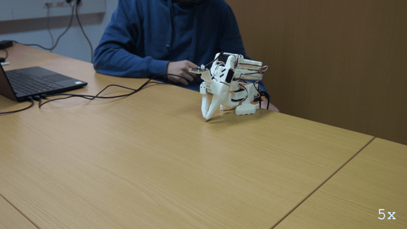
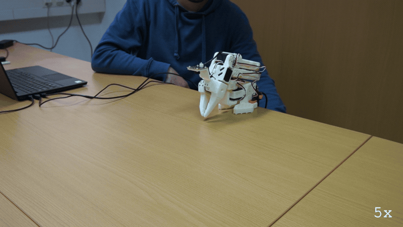
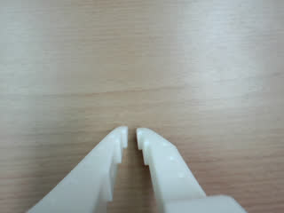
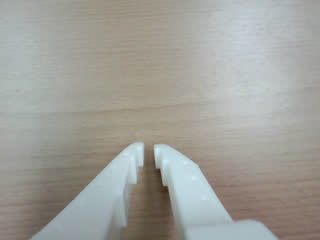

# E166: The power switch, first

**The power switch cut the arm during its lift, twice, and both times quackd ended the run saying the arm did not answer, with no traceback.**

**Part 1 of 2:** Cut, and left off



Filmed with an external camera. The GIF plays at 5x speed.

**Part 2 of 2:** Cut, then switched back on after the run had ended



Filmed with an external camera. The GIF plays at 5x speed.

| Category | Goal met | The run ended with | Date | quackd |
|---|---|---|---|---|
| Safety | Partly | ERROR / ABORTED | 2026-11-10 | 0.34.0 |

The numbers and the trace below are copied from the run's own record.
[All examples](../README.md)

## Why this matters

**Why this example exists:** An SO-101 has no emergency stop button, and quackd cannot give it one: cutting the servo supply is the one thing that stops this arm in every case, including the one where quackd itself has died. This example cuts it on purpose, mid-move, with the move small and a hand under the arm, to see the arm go limp and quackd end the run cleanly and say why, instead of crashing.

**Why this result is important:** The switch stopped the arm both times. quackd's first sign of it came within half a second of the last goal the arm answered, and each run ended saying `the arm did not answer`, with no Python traceback, about 1.7 s and 1.6 s after that goal. Neither asked a person anything, since the arm could not answer, and both closed by telling the person what to do, `hold it, and cut its power`. Part 1 ended on the run's own read of the arm, the path that on 0.31.2 and before ended in a traceback.

## The goal

Prove the only real emergency stop before any line moves a joint on purpose: cut the servo supply mid-move, on purpose, while the move is small and a hand is under the arm.

**What we expected:** The arm goes limp and falls when the supply goes, and the run ends in an error within about a second, saying the arm did not answer, whichever meets the silence first, the heartbeat or a read the move makes. Nothing is asked, and the close ends `so it kept whatever torque the arm has: hold it, and cut its power`. With the supply off and on again inside a second, the servos come back with torque off, and the fold at the end finds the arm that way.

## What the run showed

* In both parts the LLM read the arm, judged the lift `feasible` and sent `move_joints` with elbow_flex 76 over 10 s, from 96 at rest.
* In Part 1 the supply went near the end of the lift, 9.7 s into it: the last goal the arm answered was elbow_flex 76.6. 0.4 s later the move had failed, `Failed to sync read 'Present_Position' from motor IDs [1, 2, 3, 4, 5, 6] after 3 tries`, and the stop quackd sent after it was refused. The heartbeat failed next, and the run's own read of the arm ended it in an error, in one line and with no Python traceback: `the arm did not answer`.
* In Part 2 the supply went partway through, 6.4 s in: the last goal was elbow_flex 83.4, and 0.2 s later the heartbeat met the silence first, `heartbeat failed: the arm did not answer`. The move failed after it, and the run ended `ABORTED`.
* Every `stop` quackd sent after the cut was refused, `the hold did not reach the arm`, and the fold failed too, `the arm did not reach its rest pose`. Nothing asked the person anything, and both runs closed with `quackd cannot tell whether the arm is holding itself up`, telling them to hold it and cut its power.

## What the run did not show

* The GIFs do not show the power switch. The supply is under the table, out of frame. It was turned off in both parts, and in Part 2 turned back on as well, so the two GIFs look alike although the takes were not.
* It does not show the card's second take, off and on inside a second. In Part 2 the power came back only after the arm had fallen and the run had ended, so the servos never answered again mid-run and no fold found them with torque off.
* It misses the card's `within about a second`. From the last goal the arm answered to the end of the run took about 1.7 s in Part 1 and 1.6 s in Part 2.
* The same cut ended in an error once and was aborted once. Which one depends on whether the heartbeat had failed by the time the move gave up: in Part 2 it had, and in Part 1 the run's own read met the silence first. The card's `ends in an error` fits only Part 1.
* It does not show how far the arm fell, or whether the hand under it caught it. The record stops at the cut, with the last goals elbow_flex 76.6 and 83.4 from 96 at rest.
* It does not show the card's third line, `quackd doctor` with the switch off.

## How the run ended

**Part 1 of 2:** Cut, and left off

The run ended with **ERROR**. The reason on record:

> TransportError: the arm did not answer: ConnectionError: Failed to sync read 'Present_Position' from motor IDs [1, 2, 3, 4, 5, 6] after 3 tries. motor 1: Operation timed out

**Part 2 of 2:** Cut, then switched back on after the run had ended

The run ended with **ABORTED**. The reason on record:

> the arm did not answer: ConnectionError: Failed to sync read 'Present_Position' from motor IDs [1, 2, 3, 4, 5, 6] after 3 tries. motor 1: Operation timed out

## The exact command

**Part 1 of 2:** Cut, and left off

The following command was run with quackd 0.34.0:

```text
quackd run D:/Development/quackd-shoot/docs/examples/lerobot/e166/raise-for-the-switch.duck --robot arm-01 --camera-url 'opencv://1?name=arm' --llm openai:gpt-6-astra --max-steps 10 --no-memory
```

**Part 2 of 2:** Cut, then switched back on after the run had ended

The following command was run with quackd 0.34.0:

```text
quackd run D:/Development/quackd-shoot/docs/examples/lerobot/e166/raise-for-the-switch.duck --robot arm-01 --camera-url 'opencv://1?name=arm' --llm openai:gpt-6-astra --max-steps 10 --no-memory
```

## The numbers

| | Part 1 | Part 2 |
|---|---|---|
| quackd version | 0.34.0 | 0.34.0 |
| Started | 2026-11-10 13:10:36 UTC | 2026-11-10 13:16:28 UTC |
| Robot | `arm-01` (real) | `arm-01` (real) |
| LLM | `openai:gpt-6-astra` | `openai:gpt-6-astra` |
| Task file | [`raise-for-the-switch.duck`](raise-for-the-switch.duck) | [`raise-for-the-switch.duck`](raise-for-the-switch.duck) |
| Steps | 2 | 2 |
| LLM calls | 3 | 3 |
| Total time | 45.6 s | 32.0 s |
| Connecting | 11.6 s | 7.9 s |
| Waiting for the LLM | 22.0 s | 15.6 s |
| First motion | 34.2 s after the start | 24.0 s after the start |
| Tokens | 12,339 in, 211 out | 12,328 in, 204 out |
| Cost at list price | $0.0886 | $0.0533 |
| Speed cap | not recorded | not recorded |
| Run folder | `runs\20261110-131036-e166-raise-for-the-switch` | `runs\20261110-131628-e166-raise-for-the-switch` |

## What the robot saw

**Part 1 of 2:** Cut, and left off

| Start | Middle | End |
|---|---|---|
|  |  |  |

**Part 2 of 2:** Cut, then switched back on after the run had ended

| Start | Middle | End |
|---|---|---|
|  |  |  |

## Try it yourself

This runs the same task file with no arm attached, on `lerobot:mock`, an arm that lives in memory.
It shows the rules a run is held to and not the physics. Run it from a checkout of this repository
with quackd's `lerobot` extra and the LLM's own SDK and key. It costs what the LLM charges.

```bash
quackd run docs/examples/lerobot/e166/raise-for-the-switch.duck --robot lerobot:mock --llm openai:gpt-6-astra --no-memory
```

## Full terminal trace

<details>
<summary>Show the full terminal trace (272 lines)</summary>

```text
$ quackd run D:/Development/quackd-shoot/docs/examples/lerobot/e166/raise-for-the-switch.duck --robot arm-01 --camera-url 'opencv://1?name=arm' --llm openai:gpt-6-astra --max-steps 10 --no-memory
quackd 0.34.0, started 2026-11-10T13:10:29Z, cwd D:\Development\lerobot-test\.venv

╭─ 🦆 e166-raise-for-the-switch ───────────────────────────────────────────────────────────────────────────────────────────────────────────────────────────╮
│ provider  openai (gpt-6-astra)                                                                                                                           │
│ robot     arm-01 (lerobot:real)                                                                                                                          │
│ detector  color_blob on this machine  (once the body reports a camera)                                                                                   │
╰─ Ctrl-C or q stops the duck. Ctrl-C twice quits at once. ────────────────────────────────────────────────────────────────────────────────────────────────╯
WARNING  no camera field of view given for a real camera, so detections use the simulator's 90 degrees. Distances will be out by tens of percent: pass      
         --fov-deg (a Pi Camera Module 2 is about 62) once you know yours.                                                                                  
WARNING:quackd.perception:no camera field of view given for a real camera, so detections use the simulator's 90 degrees. Distances will be out by tens of 
percent: pass --fov-deg (a Pi Camera Module 2 is about 62) once you know yours.
   run     connected in 11.62 s
   tools   report_state, move_joints, gripper, place, stop, assess_task, declare_success, declare_failure
system prompt, 5658 chars, 72 lines (also in transcript.jsonl as run_start): ───────────────────────────────────────────────────────────────────────────────
   You are the brain of a six-joint desktop robot arm with a parallel gripper (an SO-101 class arm driven by LeRobot), bolted to a table. You are a high-level pilot:
   you choose ONE verb per turn; the robot's own controllers handle the motion. Do not micro-manage.

   ## Rules (enforced by the executor — not optional)
   - Call exactly one tool per turn. Never zero, never two.
   - Only these verbs are allowed: report_state, move_joints, gripper, place, stop. Anything else is refused.
   - Budgets: 10 steps, 4 minutes, 16 LLM calls. The run stops when any is hit.
   - Verbs marked confirm (none) ask a human before running.
   - Before the first verb that moves the body, call `assess_task` with your verdict on whether this body can do this task at all, judged against its datasheet below: `feasible`, `infeasible` (the run ends, nothing moves) or `uncertain` (a human is asked). The verdict is about the body, not the view: not having found the target yet is not by itself a reason for `uncertain`. It is one when a limit turns on that unseen thing's mass or size, or on a figure the datasheet does not publish. Until then only `report_state` and `stop` run. Assess again later if what you see changes your mind.
   - When a success criterion is met, call `declare_success`. If the task turns out impossible while doing it, call `declare_failure`.

   ## Success criteria
   - You have done what the task asks, as best you can tell from your joints and any camera pictures, or said plainly why this body cannot.

   ## Abort conditions you must respect yourself
   - (none beyond the enforced ones)

   ## Verbs
   - `report_state`: Report the arm: every joint in degrees, whether torque is on, how warm the servos are, and whether anything is held.
   - `move_joints`: Move one or more joints to goal angles in degrees (gripper 0..100) over duration_s seconds, and wait for them to arrive.
   - `gripper`: Open or close the gripper.
   - `place`: Release what is held by opening the gripper where the arm is.
   - `stop`: Stop moving immediately (zero velocity). Always allowed.

   ## Your body: what it can and cannot do
   Each number says how sure quackd is of it and who says so (official: the maker or a paper says so; estimate: one vendor, a community number or a reading off a photo; measured: somebody measured it and said how).
   - Height: 0.53 m (estimate: one vendor's listing; reaching straight up)
   - Actuated joints: 6 (official: the LeRobot SO-101 docs; five joints and a gripper)
   - Payload: 0.5 kg (estimate: one vendor's listing)
   - Reach: 0.4 m (estimate: the maker's URDF, TheRobotStudio/SO-ARM100 Simulation/SO101/so101_new_calib.urdf; link lengths from the shoulder to the gripper frame, summed with the arm straight and rounded down)
   - Manipulator: one arm with a gripper.
   - Not published: mass. Where a task turns on it, say uncertain and name it rather than guessing; do not decline on it alone.
   - Mains powered, so nothing runs down. It does not move: no base and no legs.
   - quackd clamps you to gripper 0 to 100.
   - Each joint's travel in degrees, read from its own calibration, and the only goals quackd will send: shoulder_pan -119.6 to 119.6, shoulder_lift -100.7 to 100.7, elbow_flex -96.7 to 96.7, wrist_flex -101.4 to 101.4, wrist_roll -180 to 180, gripper 0 to 100. A joint can read past its travel when it was folded or placed there with torque off, which is where a rest pose usually is; goals are still limited to the travel.
   - Senses: joint_state, camera.
   Whatever the task says, this body cannot:
   - go anywhere: it is bolted to a table and has no base
   - lift or hold more than about half a kilogram: a pen, an empty cup or a wooden block weighs far less than that, and a full bottle or a tool may weigh more
   - reach anything more than about 0.4 m from its shoulder: that is the arm held straight out, and any bent pose reaches less
   - feel what it holds: nothing reports grip force, so holding is inferred from the gripper stopping short of shut, which an empty hand that binds also does
   - know its own mass: vendor listings disagree by a factor of three
   Worth knowing:
   - How wide the gripper opens and how hard it grips are not published
   - No sensors beyond the servo positions unless a camera is configured, and the servo temperature, which quackd reads off the bus because LeRobot does not
   - Vendor listings give the mass as anything from 0.8 to 2.5 kg and nobody official publishes one, so it is listed as not published rather than picked from a hat
   - There are 7.4 V and 12 V builds of the same arm, with different stall torque and different supplies. Which one is on the desk is not something quackd can ask

   ## What is a stand-in on this robot
   The robot reported these itself, and they are in `extras.assumptions` in every observation.
   Each is something quackd stands in for or assumes, not something this robot does. Do not
   report one as the robot's own work, and do not read a success from one as evidence that the
   real skill works.
   - GRIPPER_OPEN_VALUE
   - HOLDING_INFERRED
   - TEMPERATURE_C

   ## Persona
   Practical and honest: say so when you cannot do something.

   ## Task file: e166-raise-for-the-switch — A small, slow lift of the forearm, for the power switch to cut.

   # Task

   Lift your forearm slowly by about twenty degrees from where it is, moving the elbow alone, over ten seconds, then report your state.

   ## Strategy

   1. Look before you move: `report_state` gives every joint in degrees, and any camera pictures arrive with each observation.
   2. Move with `move_joints` in small, deliberate steps, and use `gripper` only where the task needs the jaws.
   3. Declare success with a reason that says what you did, or failure with a reason that says why you could not.
────────────────────────────────────────────────────────────────────────────────────────────────────────────────────────────────────────────────────────────
·  note    moving to the rest pose
·  note    already at the rest pose
step 0/10 · LLM calls 0/16, 0.0/4 min ──────────────────────────────────────────────────────────────────────────────────────────────────────────────────────
   obs     state: posture=unknown policy=idle stand-ins=3-listed-in-extras.assumptions
           camera: nothing detected
           Choose exactly one tool.
           note: nothing detected yet. That is not by itself a reason for `uncertain`: the verdict is about this body's limits, not about where the target is. Answer `uncertain` only if a limit turns on that unseen thing's mass or size, or on a figure the datasheet does not publish.
   llm>    step 0: 1 messages (1 with image) to openai gpt-6-astra
   tool    report_state()
   tokens  in=3636 out=14 cache_write=3510 (run total in=3636 out=14 $0.0458) latency=9.2 s cost=$0.0458 stop=tool_calls
▶  verb    report_state()
✓  result  report_state ok: shoulder_pan -5, shoulder_lift -99, elbow_flex 96, wrist_flex 79, wrist_roll 1, gripper 2; torque on; hottest wrist_flex 32°C; holding nothing (0.0 s, 0 intents)
step 1/10 · LLM calls 1/16, 0.2/4 min ──────────────────────────────────────────────────────────────────────────────────────────────────────────────────────
   obs     state: posture=unknown policy=idle stand-ins=3-listed-in-extras.assumptions
           camera: nothing detected
           last verb `report_state`: ok — shoulder_pan -5, shoulder_lift -99, elbow_flex 96, wrist_flex 79, wrist_roll 1, gripper 2; torque on; hottest wrist_flex 32°C; holding nothing
           Choose exactly one tool.
           note: nothing detected yet. That is not by itself a reason for `uncertain`: the verdict is about this body's limits, not about where the target is. Answer `uncertain` only if a limit turns on that unseen thing's mass or size, or on a figure the datasheet does not publish.
   llm>    step 1: 2 messages (2 with image) to openai gpt-6-astra
   tool    assess_task(verdict='feasible', reason='The empty arm can make a slow, elbow-only twenty-degree m...', limits_consulted=['joint_limits.elbow_flex', 'actuated_joints'], estimates=[], needs={'payload_kg': 0, 'carries_kg': 0, 'reach_m': 0, 'endurance_min': 0, 'work_height_m': 0, 'arms': 1, 'manipulator': 'n...)
   tokens  in=4201 out=168 cached=3510 cache_write=565 reasoning=13 (run total in=7837 out=182 $0.0661) latency=9.5 s cost=$0.0202 stop=tool_calls
✓  assess  feasible: The empty arm can make a slow, elbow-only twenty-degree motion from elbow_flex 96° to 76°, within its -96.7° to 96.7° travel. The requested ten-second duration is supported; no payload or locomotion is required.
   needs   payload_kg=0, carries_kg=0, reach_m=0, endurance_min=0, work_height_m=0, arms=1, manipulator='none', mobility='none', terrain='indoor_flat'
step 1/10 · LLM calls 2/16, 0.3/4 min ──────────────────────────────────────────────────────────────────────────────────────────────────────────────────────
   obs     state: posture=unknown policy=idle stand-ins=3-listed-in-extras.assumptions
           camera: nothing detected
           last verb `assess_task`: ok — recorded feasible: The empty arm can make a slow, elbow-only twenty-degree motion from elbow_flex 96° to 76°, within its -96.7° to 96.7° travel. The requested ten-second duration is supported; no payload or locomotion is required.; verbs that move the body now run
           Choose exactly one tool.
   llm>    step 1: 3 messages (2 with image) to openai gpt-6-astra
   tool    move_joints(positions={'elbow_flex': 76}, duration_s=10)
   tokens  in=4502 out=29 cached=3029 cache_write=1347 (run total in=12339 out=211 $0.0886) latency=3.3 s cost=$0.0226 stop=tool_calls
▶  verb    move_joints(positions={'elbow_flex': 76}, duration_s=10)
→  send    joint x20 over 2.0 s (positions {'elbow_flex': 96.3}/{'elbow_flex': 96.1}/{'elbow_flex': 95.9}..., duration_s 10)
→  send    joint x20 over 2.0 s (positions {'elbow_flex': 92.0}/{'elbow_flex': 91.7}/{'elbow_flex': 91.5}..., duration_s 10)
→  send    joint x20 over 2.0 s (positions {'elbow_flex': 87.6}/{'elbow_flex': 87.4}/{'elbow_flex': 87.2}..., duration_s 10)
→  send    joint x20 over 2.0 s (positions {'elbow_flex': 83.3}/{'elbow_flex': 83.1}/{'elbow_flex': 82.9}..., duration_s 10)
→  send    joint x12 over 1.2 s (positions {'elbow_flex': 79.0}/{'elbow_flex': 78.8}/{'elbow_flex': 78.6}..., duration_s 10)
✗  send    stop REFUSED: the hold did not reach the arm: ConnectionError: Failed to sync read 'Present_Position' from motor IDs [1, 2, 3, 4, 5, 6] after 3 tries. motor 1: Operation timed out
✗  result  move_joints FAIL: move_joints raised TransportError: the arm did not answer: ConnectionError: Failed to sync read 'Present_Position' from motor IDs [1, 2, 3, 4, 5, 6] after 3 tries. motor 1: Operation timed out; the stop sent after it failed: the hold did not reach the arm: ConnectionError: Failed to sync read 'Present_Position' from motor IDs [1, 2, 3, 4, 5, 6] after 3 tries. motor 1: Operation timed out (10.1 s, 93 intents)
·  note    heartbeat failed: the arm did not answer: ConnectionError: Failed to sync read 'Present_Position' from motor IDs [1, 2, 3, 4, 5, 6] after 3 tries. motor 1: Operation timed out — sending stop
·  note    run ended with an error: TransportError: the arm did not answer: ConnectionError: Failed to sync read 'Present_Position' from motor IDs [1, 2, 3, 4, 5, 6] after 3 tries. motor 1: Operation timed out
✗  send    stop REFUSED: the hold did not reach the arm: ConnectionError: Failed to sync read 'Present_Position' from motor IDs [1, 2, 3, 4, 5, 6] after 3 tries. motor 1: Operation timed out
·  note    moving to the rest pose
·  note    the arm did not reach its rest pose: ConnectionError: Failed to sync read 'Present_Position' from motor IDs [1, 2, 3, 4, 5, 6] after 3 tries. motor 1: Operation timed out
·  note    quackd cannot tell whether the arm is holding itself up (the arm did not answer: ConnectionError: Failed to sync read 'Present_Position' from motor IDs [1, 2, 3, 4, 5, 6] after 3 tries. motor 1: Operation timed out), so it kept whatever torque the arm has: hold it, and cut its power
✗ error: the arm did not answer: ConnectionError: Failed to sync read 'Present_Position' from motor IDs [1, 2, 3, 4, 5, 6] after 3 tries. motor 1: Operation
timed out

$ quackd run D:/Development/quackd-shoot/docs/examples/lerobot/e166/raise-for-the-switch.duck --robot arm-01 --camera-url 'opencv://1?name=arm' --llm openai:gpt-6-astra --max-steps 10 --no-memory
quackd 0.34.0, started 2026-11-10T13:16:24Z, cwd D:\Development\lerobot-test\.venv

╭─ 🦆 e166-raise-for-the-switch ───────────────────────────────────────────────────────────────────────────────────────────────────────────────────────────╮
│ provider  openai (gpt-6-astra)                                                                                                                           │
│ robot     arm-01 (lerobot:real)                                                                                                                          │
│ detector  color_blob on this machine  (once the body reports a camera)                                                                                   │
╰─ Ctrl-C or q stops the duck. Ctrl-C twice quits at once. ────────────────────────────────────────────────────────────────────────────────────────────────╯
WARNING  no camera field of view given for a real camera, so detections use the simulator's 90 degrees. Distances will be out by tens of percent: pass      
         --fov-deg (a Pi Camera Module 2 is about 62) once you know yours.                                                                                  
WARNING:quackd.perception:no camera field of view given for a real camera, so detections use the simulator's 90 degrees. Distances will be out by tens of 
percent: pass --fov-deg (a Pi Camera Module 2 is about 62) once you know yours.
   run     connected in 7.89 s
   tools   report_state, move_joints, gripper, place, stop, assess_task, declare_success, declare_failure
system prompt, 5658 chars, 72 lines (also in transcript.jsonl as run_start): ───────────────────────────────────────────────────────────────────────────────
   You are the brain of a six-joint desktop robot arm with a parallel gripper (an SO-101 class arm driven by LeRobot), bolted to a table. You are a high-level pilot:
   you choose ONE verb per turn; the robot's own controllers handle the motion. Do not micro-manage.

   ## Rules (enforced by the executor — not optional)
   - Call exactly one tool per turn. Never zero, never two.
   - Only these verbs are allowed: report_state, move_joints, gripper, place, stop. Anything else is refused.
   - Budgets: 10 steps, 4 minutes, 16 LLM calls. The run stops when any is hit.
   - Verbs marked confirm (none) ask a human before running.
   - Before the first verb that moves the body, call `assess_task` with your verdict on whether this body can do this task at all, judged against its datasheet below: `feasible`, `infeasible` (the run ends, nothing moves) or `uncertain` (a human is asked). The verdict is about the body, not the view: not having found the target yet is not by itself a reason for `uncertain`. It is one when a limit turns on that unseen thing's mass or size, or on a figure the datasheet does not publish. Until then only `report_state` and `stop` run. Assess again later if what you see changes your mind.
   - When a success criterion is met, call `declare_success`. If the task turns out impossible while doing it, call `declare_failure`.

   ## Success criteria
   - You have done what the task asks, as best you can tell from your joints and any camera pictures, or said plainly why this body cannot.

   ## Abort conditions you must respect yourself
   - (none beyond the enforced ones)

   ## Verbs
   - `report_state`: Report the arm: every joint in degrees, whether torque is on, how warm the servos are, and whether anything is held.
   - `move_joints`: Move one or more joints to goal angles in degrees (gripper 0..100) over duration_s seconds, and wait for them to arrive.
   - `gripper`: Open or close the gripper.
   - `place`: Release what is held by opening the gripper where the arm is.
   - `stop`: Stop moving immediately (zero velocity). Always allowed.

   ## Your body: what it can and cannot do
   Each number says how sure quackd is of it and who says so (official: the maker or a paper says so; estimate: one vendor, a community number or a reading off a photo; measured: somebody measured it and said how).
   - Height: 0.53 m (estimate: one vendor's listing; reaching straight up)
   - Actuated joints: 6 (official: the LeRobot SO-101 docs; five joints and a gripper)
   - Payload: 0.5 kg (estimate: one vendor's listing)
   - Reach: 0.4 m (estimate: the maker's URDF, TheRobotStudio/SO-ARM100 Simulation/SO101/so101_new_calib.urdf; link lengths from the shoulder to the gripper frame, summed with the arm straight and rounded down)
   - Manipulator: one arm with a gripper.
   - Not published: mass. Where a task turns on it, say uncertain and name it rather than guessing; do not decline on it alone.
   - Mains powered, so nothing runs down. It does not move: no base and no legs.
   - quackd clamps you to gripper 0 to 100.
   - Each joint's travel in degrees, read from its own calibration, and the only goals quackd will send: shoulder_pan -119.6 to 119.6, shoulder_lift -100.7 to 100.7, elbow_flex -96.7 to 96.7, wrist_flex -101.4 to 101.4, wrist_roll -180 to 180, gripper 0 to 100. A joint can read past its travel when it was folded or placed there with torque off, which is where a rest pose usually is; goals are still limited to the travel.
   - Senses: joint_state, camera.
   Whatever the task says, this body cannot:
   - go anywhere: it is bolted to a table and has no base
   - lift or hold more than about half a kilogram: a pen, an empty cup or a wooden block weighs far less than that, and a full bottle or a tool may weigh more
   - reach anything more than about 0.4 m from its shoulder: that is the arm held straight out, and any bent pose reaches less
   - feel what it holds: nothing reports grip force, so holding is inferred from the gripper stopping short of shut, which an empty hand that binds also does
   - know its own mass: vendor listings disagree by a factor of three
   Worth knowing:
   - How wide the gripper opens and how hard it grips are not published
   - No sensors beyond the servo positions unless a camera is configured, and the servo temperature, which quackd reads off the bus because LeRobot does not
   - Vendor listings give the mass as anything from 0.8 to 2.5 kg and nobody official publishes one, so it is listed as not published rather than picked from a hat
   - There are 7.4 V and 12 V builds of the same arm, with different stall torque and different supplies. Which one is on the desk is not something quackd can ask

   ## What is a stand-in on this robot
   The robot reported these itself, and they are in `extras.assumptions` in every observation.
   Each is something quackd stands in for or assumes, not something this robot does. Do not
   report one as the robot's own work, and do not read a success from one as evidence that the
   real skill works.
   - GRIPPER_OPEN_VALUE
   - HOLDING_INFERRED
   - TEMPERATURE_C

   ## Persona
   Practical and honest: say so when you cannot do something.

   ## Task file: e166-raise-for-the-switch — A small, slow lift of the forearm, for the power switch to cut.

   # Task

   Lift your forearm slowly by about twenty degrees from where it is, moving the elbow alone, over ten seconds, then report your state.

   ## Strategy

   1. Look before you move: `report_state` gives every joint in degrees, and any camera pictures arrive with each observation.
   2. Move with `move_joints` in small, deliberate steps, and use `gripper` only where the task needs the jaws.
   3. Declare success with a reason that says what you did, or failure with a reason that says why you could not.
────────────────────────────────────────────────────────────────────────────────────────────────────────────────────────────────────────────────────────────
·  note    moving to the rest pose
·  note    already at the rest pose
step 0/10 · LLM calls 0/16, 0.0/4 min ──────────────────────────────────────────────────────────────────────────────────────────────────────────────────────
   obs     state: posture=unknown policy=idle stand-ins=3-listed-in-extras.assumptions
           camera: nothing detected
           Choose exactly one tool.
           note: nothing detected yet. That is not by itself a reason for `uncertain`: the verdict is about this body's limits, not about where the target is. Answer `uncertain` only if a limit turns on that unseen thing's mass or size, or on a figure the datasheet does not publish.
   llm>    step 0: 1 messages (1 with image) to openai gpt-6-astra
   tool    report_state()
   tokens  in=3636 out=14 cached=3029 cache_write=481 (run total in=3636 out=14 $0.0110) latency=5.6 s cost=$0.0110 stop=tool_calls
▶  verb    report_state()
✓  result  report_state ok: shoulder_pan -6, shoulder_lift -100, elbow_flex 96, wrist_flex 79, wrist_roll 0, gripper 2; torque on; hottest shoulder_lift 32°C; holding nothing (0.0 s, 0 intents)
step 1/10 · LLM calls 1/16, 0.1/4 min ──────────────────────────────────────────────────────────────────────────────────────────────────────────────────────
   obs     state: posture=unknown policy=idle stand-ins=3-listed-in-extras.assumptions
           camera: nothing detected
           last verb `report_state`: ok — shoulder_pan -6, shoulder_lift -100, elbow_flex 96, wrist_flex 79, wrist_roll 0, gripper 2; torque on; hottest shoulder_lift 32°C; holding nothing
           Choose exactly one tool.
           note: nothing detected yet. That is not by itself a reason for `uncertain`: the verdict is about this body's limits, not about where the target is. Answer `uncertain` only if a limit turns on that unseen thing's mass or size, or on a figure the datasheet does not publish.
   llm>    step 1: 2 messages (2 with image) to openai gpt-6-astra
   tool    assess_task(verdict='feasible', reason='The unloaded elbow can move from its reported 96° to 76°,...', limits_consulted=['elbow_flex', 'arms'], estimates=[], needs={'payload_kg': 0, 'carries_kg': 0, 'reach_m': 0, 'endurance_min': 0, 'work_height_m': 0, 'arms': 1, 'manipulator': 'n...)
   tokens  in=4201 out=161 cached=3510 cache_write=565 reasoning=14 (run total in=7837 out=175 $0.0309) latency=6.3 s cost=$0.0199 stop=tool_calls
✓  assess  feasible: The unloaded elbow can move from its reported 96° to 76°, a 20° change within its -96.7° to 96.7° travel. A ten-second elbow-only motion is supported; no payload or locomotion is needed.
   needs   payload_kg=0, carries_kg=0, reach_m=0, endurance_min=0, work_height_m=0, arms=1, manipulator='none', mobility='none', terrain='indoor_flat'
step 1/10 · LLM calls 2/16, 0.2/4 min ──────────────────────────────────────────────────────────────────────────────────────────────────────────────────────
   obs     state: posture=unknown policy=idle stand-ins=3-listed-in-extras.assumptions
           camera: nothing detected
           last verb `assess_task`: ok — recorded feasible: The unloaded elbow can move from its reported 96° to 76°, a 20° change within its -96.7° to 96.7° travel. A ten-second elbow-only motion is supported; no payload or locomotion is needed.; verbs that move the body now run
           Choose exactly one tool.
   llm>    step 1: 3 messages (2 with image) to openai gpt-6-astra
   tool    move_joints(positions={'elbow_flex': 76}, duration_s=10)
   tokens  in=4491 out=29 cached=3029 cache_write=1336 (run total in=12328 out=204 $0.0533) latency=3.6 s cost=$0.0224 stop=tool_calls
▶  verb    move_joints(positions={'elbow_flex': 76}, duration_s=10)
→  send    joint x20 over 2.1 s (positions {'elbow_flex': 96.4}/{'elbow_flex': 96.2}/{'elbow_flex': 96.0}..., duration_s 10)
→  send    joint x20 over 2.1 s (positions {'elbow_flex': 92.0}/{'elbow_flex': 91.8}/{'elbow_flex': 91.6}..., duration_s 10)
→  send    joint x20 over 2.0 s (positions {'elbow_flex': 87.6}/{'elbow_flex': 87.3}/{'elbow_flex': 87.1}..., duration_s 10)
·  note    heartbeat failed: the arm did not answer: ConnectionError: Failed to sync read 'Present_Position' from motor IDs [1, 2, 3, 4, 5, 6] after 3 tries. motor 1: Operation timed out — sending stop
✗  send    stop REFUSED: the hold did not reach the arm: ConnectionError: Failed to sync read 'Present_Position' from motor IDs [1, 2, 3, 4, 5, 6] after 3 tries. motor 1: Operation timed out
✗  send    stop REFUSED: the hold did not reach the arm: ConnectionError: Failed to sync read 'Present_Position' from motor IDs [1, 2, 3, 4, 5, 6] after 3 tries. motor 1: Operation timed out
✗  result  move_joints FAIL: move_joints raised TransportError: the arm did not answer: ConnectionError: Failed to sync read 'Present_Position' from motor IDs [1, 2, 3, 4, 5, 6] after 3 tries. motor 1: Operation timed out; the stop sent after it failed: the hold did not reach the arm: ConnectionError: Failed to sync read 'Present_Position' from motor IDs [1, 2, 3, 4, 5, 6] after 3 tries. motor 1: Operation timed out (7.0 s, 61 intents)
✗  send    stop REFUSED: the hold did not reach the arm: ConnectionError: Failed to sync read 'Present_Position' from motor IDs [1, 2, 3, 4, 5, 6] after 3 tries. motor 1: Operation timed out
·  note    moving to the rest pose
·  note    the arm did not reach its rest pose: ConnectionError: Failed to sync read 'Present_Position' from motor IDs [1, 2, 3, 4, 5, 6] after 3 tries. motor 1: Operation timed out
·  note    quackd cannot tell whether the arm is holding itself up (the arm did not answer: ConnectionError: Failed to sync read 'Present_Position' from motor IDs [1, 2, 3, 4, 5, 6] after 3 tries. motor 1: Operation timed out), so it kept whatever torque the arm has: hold it, and cut its power
╭─ ✗ ABORTED ──────────────────────────────────────────────────────────────────────────────────────────────────────────────────────────────────────────────╮
│ the arm did not answer: ConnectionError: Failed to sync read 'Present_Position' from motor IDs [1, 2, 3, 4, 5, 6] after 3 tries. motor 1: Operation      │
│ timed out                                                                                                                                                │
│ steps 2 · LLM calls 3 · tokens 12328+204 · time 32.0 s (LLM 15.6 s) · LLM calls p50 5.6 s, p90 6.3 s, max 6.3 s · first motion at 24.0 s, after 3 LLM    │
│ calls · cost $0.0533                                                                                                                                     │
│ run dir  runs\20261110-131628-e166-raise-for-the-switch                                                                                                  │
╰──────────────────────────────────────────────────────────────────────────────────────────────────────────────────────────────────────────────────────────╯
```

</details>
