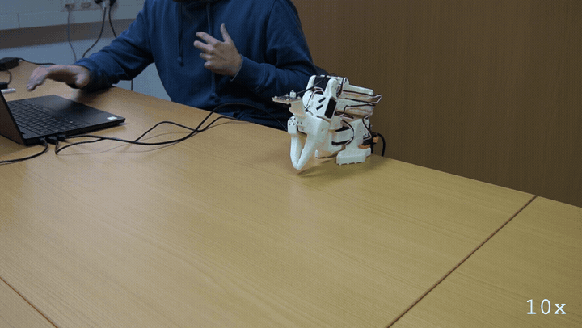

# E171: Let go means put it down first

**A hard kill left the arm holding itself up. `quackd robot release` then folded it to its rest pose and only let go once it was there.**



Filmed with an external camera. The GIF plays at 10x speed.

| Category | Goal met | The run ended with | Date | quackd |
|---|---|---|---|---|
| Safety | Yes | KILLED | 2026-11-11 | 0.34.0 |

The numbers and the trace below are copied from the run's own record.
[All examples](../README.md)

## Why this matters

**Why this example exists:** When a quackd run is killed, nothing is left to put the arm down. The SO-101's servos hold their last goal under torque until something cuts the torque or the power, so a raised arm stays raised. `quackd robot release` is the way back, and how it lets go matters: before 0.24.0 it took torque off wherever the arm stood, so a raised arm fell. Since 0.24.0 it folds the arm to its rest pose first and lets go there. This example leaves the arm raised on purpose, kills the run, and checks that the release puts the arm down.

**Why this result is important:** The release put the arm down rather than dropping it. It warned that connecting takes torque off every motor for a moment, asked first, read the arm within a degree of the pose it had been left holding, counted 3 s for hands to come away, folded the arm to its rest pose and only then let go, checking that every joint read torque off with the arm still at rest. For anyone whose run was killed with the arm up, that is the way back: support the arm while the release connects, then let it fold the arm down.

## The goal

Show `quackd robot release` on an arm left holding itself up after its run was killed. Since 0.24.0 the release folds the arm to its rest pose and lets go there, where 0.14.0's release took torque off wherever the arm stood and let it fall. It is the first of the nine bench steps 0.24.0 left for a real arm.

**What we expected:** The scripted pilot finishes at once, and the run waits up to two minutes, holding the arm, for a person to press Enter and take whatever is in the gripper, after which it folds the arm itself. `taskkill` ends the run during that wait, nothing runs any more, and the arm keeps holding. The release then warns that connecting takes torque off every motor for a moment, asks, connects, prints the joints, says `folding arm-01 to its rest pose in 3 s: take your hands away from it now. Ctrl-C or q stops it before it moves`, folds, closes its gripper, and ends with `✓ torque reads off on every joint of arm-01` and `the arm is limp at its rest pose, where it was folded and let go of because you asked for it`. The card set `QUACKD_LEROBOT_MAX_STEP_DEG` to 1 for this, a fold at 10 degrees a second, and asked whether it folds and whether it then rests there limp.

## What the run showed

* With no LLM and no key, `--llm fake` flew the task's scripted pilot. quackd connected in 5.92 s, found the arm already at its rest pose, took its torque off and handed it over: `the arm is yours`.
* The arm was lifted by hand into a raised pose and Enter pressed, and quackd held it there, `holding the pose you set, you can let go`, at shoulder_pan -8, shoulder_lift -14, elbow_flex 23, wrist_flex 49, wrist_roll 0 and gripper 1.
* The scripted pilot's three calls, `assess_task`, `report_state` and `declare_success`, were over about 0.2 s after the Enter, and the run began its wait to hand the arm back: `the run is over and the arm is holding where it ended`.
* During that wait `taskkill /F /IM quackd.exe`, from a second terminal, ended two quackd.exe processes. Nothing ran after it: no fold and no `summary.json`, and the run's terminal stops at the wait's message.
* The arm kept holding under torque. When `quackd robot release arm-01` connected, it read shoulder_pan -8.4, shoulder_lift -13.3, elbow_flex 23.4, wrist_flex 48.8, wrist_roll 0.5 and gripper 1.0, within a degree of the pose it had been set to hold.
* First the release warned that `connecting takes torque off every motor for a moment`, saying to support the arm while it connects, and asked `fold arm-01 to its rest pose, close its gripper and release torque there? [y/N]`. Once connected it printed the joints and counted down: `folding arm-01 to its rest pose in 3 s: take your hands away from it now. Ctrl-C or q stops it before it moves`.
* It folded the arm to its rest pose. On the way LeRobot printed 27 warnings that it had clamped a goal, because quackd has it hold each send to 5 degrees from where the arm stands. Then `✓ torque reads off on every joint of arm-01`, and `the arm is limp at its rest pose, where it was folded and let go of because you asked for it, and where it still reads`.
* In the video the arm comes down to the folded pose it started the take in, and is still there when the video ends.

## What the run did not show

* It did not run at the card's slow step. The card sets `QUACKD_LEROBOT_MAX_STEP_DEG` to 1 for this, a fold at 10 degrees a second with each goal 1 degree ahead. It was not set: the run's record gives the cap as 5 degrees per send, quackd's default and a ceiling of 50 degrees a second, and LeRobot's clamp warnings in the release show goals 5 degrees ahead.
* The card asks for a low raised pose, and this one was not low: shoulder_lift stood at -14, against -100.8 at the rest pose, so the fold had nearly 87 degrees to come down.
* The card asks for the arm to be supported while the release connects, and nobody did: in the video both hands stay at the laptop, and the arm stays up until the fold.
* It does not show the gripper closing: the jaws were already all but shut, at 1 of 100, when the release began.
* Nobody pressed `q` or Ctrl-C during the countdown, so it does not show either one stopping the fold before it moves.
* It does not show how long the arm would hold after a kill: the release came within the same take.
* The run's numbers stop at the kill. Its total time is not recorded, and the run itself moved nothing, so it has no first motion: the arm was lifted by hand, and the fold was the release's.
* No LLM read anything. The table's three LLM calls are the scripted pilot's turns, and its tokens are that pilot's own estimate, a quarter of the characters in the system prompt and the observation it was shown, with 16 out each turn. Nothing was billed.
* It does not show which quackd.exe processes the taskkill ended besides the run's own. It ends every one on the machine, and the card warns that an editor's MCP server can be among them.
* The GIF plays at 10x, so the countdown and the fold look far quicker than they were.

## How the run ended

The run did not end on its own: its process was killed, so it wrote no summary and recorded no
reason. What it did record up to then is in the numbers and the trace.

## The exact command

The following command was run with quackd 0.34.0:

```text
quackd run lerobot-lookout --robot arm-01 --by-hand --llm fake --max-steps 4 --no-memory
taskkill /F /IM quackd.exe
quackd robot release arm-01
```

## The numbers

| | |
|---|---|
| quackd version | 0.34.0 |
| Started | 2026-11-11 10:37:18 UTC |
| Robot | `arm-01` (real) |
| LLM | `fake:scripted:lerobot-lookout` |
| Task file | `lerobot-lookout`, which ships with quackd |
| Steps | 1 |
| LLM calls | 3 |
| Total time | not recorded |
| Connecting | 5.9 s |
| Waiting for the LLM | 0.0 s |
| First motion | no verb moved the arm |
| Tokens | 5,631 in, 48 out |
| Cost at list price | $0.0000 |
| Speed cap | 5° per send |
| Run folder | `runs\20261111-103718-lerobot-lookout` |

## What the robot saw

This run used no camera.

## Try it yourself

This runs the same task file with no arm attached, on `lerobot:mock`, an arm that lives in memory.
It shows the rules a run is held to and not the physics. Run it from a checkout of this repository
with quackd's `lerobot` extra.
Its pilot is a script that ships with quackd in place of an LLM, so it needs no key and costs nothing.

```bash
quackd run lerobot-lookout --robot lerobot:mock --llm fake --no-memory
```

## Full terminal trace

<details>
<summary>Show the full terminal trace (321 lines)</summary>

```text
$ quackd run lerobot-lookout --robot arm-01 --by-hand --llm fake --max-steps 4 --no-memory
quackd 0.34.0, started 2026-11-11T10:37:17Z, cwd D:\Development\lerobot-test\.venv

╭─ 🦆 lerobot-lookout ─────────────────────────────────────────────────────────────────────────────────────────────────────────────────────────────────────╮
│ provider  fake (scripted:lerobot-lookout)                                                                                                                │
│ robot     arm-01 (lerobot:real)                                                                                                                          │
│ detector  color_blob on this machine  (once the body reports a camera)                                                                                   │
╰─ Ctrl-C or q stops the duck. However often you press, the run ends properly. ────────────────────────────────────────────────────────────────────────────╯
   run     connected in 5.92 s
   tools   report_state, stop, assess_task, declare_success, declare_failure
system prompt, 7232 chars, 100 lines (also in transcript.jsonl as run_start): ──────────────────────────────────────────────────────────────────────────────
   You are the brain of a six-joint desktop robot arm with a parallel gripper (an SO-101 class arm driven by LeRobot), bolted to a table. You are a high-level pilot:
   you choose ONE verb per turn; the robot's own controllers handle the motion. Do not micro-manage.

   ## Rules (enforced by the executor — not optional)
   - Call exactly one tool per turn. Never zero, never two.
   - Only these verbs are allowed: report_state, stop. Anything else is refused.
   - Budgets: 4 steps, 3 minutes, 12 LLM calls. The run stops when any is hit.
   - Verbs marked confirm (none) ask a human before running.
   - Before the first verb that moves the body, call `assess_task` with your verdict on whether this body can do this task at all, judged against its datasheet below: `feasible`, `infeasible` (the run ends, nothing moves) or `uncertain` (a human is asked). The verdict is about the body, not the view: not having found the target yet is not by itself a reason for `uncertain`. It is one when a limit turns on that unseen thing's mass or size, or on a figure the datasheet does not publish. Until then only `report_state` and `stop` run. Assess again later if what you see changes your mind.
   - When a success criterion is met, call `declare_success`. If the task turns out impossible while doing it, call `declare_failure`.

   ## Success criteria
   - You have said where the joints are, whether torque is on, and whether anything reads hot.

   ## Abort conditions you must respect yourself
   - (none beyond the enforced ones)

   ## Verbs
   - `report_state`: Report the arm: every joint in degrees, whether torque is on, how warm the servos are, and whether anything is held.
   - `stop`: Stop moving immediately (zero velocity). Always allowed.

   ## Your body: what it can and cannot do
   Each number says how sure quackd is of it and who says so (official: the maker or a paper says so; estimate: one vendor, a community number or a reading off a photo; measured: somebody measured it and said how).
   - Height: 0.53 m (estimate: one vendor's listing; reaching straight up)
   - Actuated joints: 6 (official: the LeRobot SO-101 docs; five joints and a gripper)
   - Payload: 0.5 kg (estimate: one vendor's listing)
   - Reach: 0.4 m (estimate: the maker's URDF, TheRobotStudio/SO-ARM100 Simulation/SO101/so101_new_calib.urdf; link lengths from the shoulder to the gripper frame, summed with the arm straight and rounded down)
   - Manipulator: one arm with a gripper.
   - Not published: mass. Where a task turns on it, say uncertain and name it rather than guessing; do not decline on it alone.
   - Mains powered, so nothing runs down. It does not move: no base and no legs.
   - quackd clamps you to gripper 0 to 100.
   - Each joint's travel in degrees, read from its own calibration, and the only goals quackd will send: shoulder_pan -119.6 to 119.6, shoulder_lift -100.7 to 100.7, elbow_flex -96.7 to 96.7, wrist_flex -101.4 to 101.4, wrist_roll -180 to 180, gripper 0 to 100. A joint can read past its travel when it was folded or placed there with torque off, which is where a rest pose usually is; goals are still limited to the travel.
   - Senses: joint_state.
   Whatever the task says, this body cannot:
   - go anywhere: it is bolted to a table and has no base
   - lift or hold more than about half a kilogram: a pen, an empty cup or a wooden block weighs far less than that, and a full bottle or a tool may weigh more
   - reach anything more than about 0.4 m from its shoulder: that is the arm held straight out, and any bent pose reaches less
   - feel what it holds: nothing reports grip force, so holding is inferred from the gripper stopping short of shut, which an empty hand that binds also does
   - know its own mass: vendor listings disagree by a factor of three
   Worth knowing:
   - How wide the gripper opens and how hard it grips are not published
   - No sensors beyond the servo positions unless a camera is configured, and the servo temperature, which quackd reads off the bus because LeRobot does not
   - Vendor listings give the mass as anything from 0.8 to 2.5 kg and nobody official publishes one, so it is listed as not published rather than picked from a hat
   - There are 7.4 V and 12 V builds of the same arm, with different stall torque and different supplies. Which one is on the desk is not something quackd can ask

   ## Where this run starts
   A person placed this body by hand before your first turn, and quackd is holding it exactly
   where they left it. This run does **not** start from the recorded rest pose, so do not assume
   a folded arm or a known shape: read `report_state` and work from the joint angles it gives you. They
   are where somebody decided the work should begin.

   The gripper is where their fingers closed it, which is a position and not a grip. Nothing is
   reported as held, and nothing should be: this task cannot work the gripper, so whatever is between the jaws is held at the squeeze the person left and you cannot tighten it.

   When the run ends, the arm is handed back the same way: it holds where you left it, the person
   is asked to take whatever is in the gripper, and only then does quackd fold the arm up.

   ## What is a stand-in on this robot
   The robot reported these itself, and they are in `extras.assumptions` in every observation.
   Each is something quackd stands in for or assumes, not something this robot does. Do not
   report one as the robot's own work, and do not read a success from one as evidence that the
   real skill works.
   - GRIPPER_OPEN_VALUE
   - HOLDING_INFERRED
   - TEMPERATURE_C

   ## Persona
   A calm lookout. One clear sentence, then stop.

   ## Task file: lerobot-lookout — Move nothing, read the arm back, and report what it says about itself.

   # Task

   You are a six-joint robot arm bolted to a desk. Do not move. Read your own state and report
   what it says, so that a human can decide whether this arm is fit to be driven.

   ## Strategy

   1. `report_state` gives you every joint in degrees, whether torque is on, and the temperature
      of each servo.
   2. Say in one sentence where the joints are, whether torque is on, and whether any joint reads
      hot. A joint at or above 60 degrees Celsius is hot and worth naming.
   3. Declare success once you have said all three. Declare failure if `report_state` fails twice:
      an arm that does not answer is the thing a human needs to know about.

   ## Notes

   - **You cannot move in this task and you should not want to.** Every verb that moves a joint is
     outside your allowlist. If the reading looks wrong, saying so is the answer.
   - **You cannot ask for a picture, and you have no voice.** `observe` and `say` are not verbs
     you have. If somebody plugged a webcam in and named it, you will still see a camera line in
     your observations, because a frame is taken every step whatever your allowlist says: use it
     if it is there and do not wait for it if it is not. Reporting means writing it in the reason
     you declare with.
   - **Torque off is not a fault you can fix.** no verb can toggle torque either way. A servo
     that has tripped its own overload protection reads the same way, so name the joint and let a
     human look at it.
   - The temperatures come off the servos themselves, which is something the robot's own software
     does not read. They are the one early warning this body has, so do not skip them.
────────────────────────────────────────────────────────────────────────────────────────────────────────────────────────────────────────────────────────────
·  note    moving to the rest pose
·  note    already at the rest pose
·  hand    released: torque is off at the rest pose
the arm is yours: torque is off at its rest pose, so lift it, put whatever it needs in the gripper, close the gripper on that, hold it where you want the 
run to start, and press Enter
(Enter)
·  asked   hand_off: the arm is yours: torque is off at its rest pose, so lift it, put whatever it needs in the gripper, close the gripper on that, hold it where you want the run to start, and press Enter -> yes
·  hand    held: holding the pose you set (elbow_flex 23, gripper 1, shoulder_lift -14, shoulder_pan -8, wrist_flex 49, wrist_roll 0)
holding the pose you set, you can let go. It is at elbow_flex 23, gripper 1, shoulder_lift -14, shoulder_pan -8, wrist_flex 49, wrist_roll 0
step 0/4 · LLM calls 0/12, 0.0/3 min ───────────────────────────────────────────────────────────────────────────────────────────────────────────────────────
   obs     state: posture=unknown policy=idle stand-ins=3-listed-in-extras.assumptions
           camera: nothing detected
           Choose exactly one tool.
   llm>    step 0: 1 messages (0 with image) to fake scripted:lerobot-lookout
   think   [scripted] step 0: sees nothing it knows, so the rule picks assess_task
   tool    assess_task(verdict='feasible', reason='scripted pilot: a rule has no judgement of the body, so i...', limits_consulted=[], estimates=[], needs={})
   tokens  in=1849 out=16 (run total in=1849 out=16 $0) latency=0.0 s cost=$0 stop=tool_use
✓  assess  feasible: scripted pilot: a rule has no judgement of the body, so it assumes the task fits
step 0/4 · LLM calls 1/12, 0.0/3 min ───────────────────────────────────────────────────────────────────────────────────────────────────────────────────────
   obs     state: posture=unknown policy=idle stand-ins=3-listed-in-extras.assumptions
           camera: nothing detected
           last verb `assess_task`: ok — recorded feasible: scripted pilot: a rule has no judgement of the body, so it assumes the task fits; verbs that move the body now run
           Choose exactly one tool.
   llm>    step 0: 2 messages (0 with image) to fake scripted:lerobot-lookout
   think   [scripted] step 0: sees nothing it knows after assess_task ok, so the rule picks report_state
   tool    report_state()
   tokens  in=1890 out=16 (run total in=3739 out=32 $0) latency=0.0 s cost=$0 stop=tool_use
▶  verb    report_state()
✓  result  report_state ok: shoulder_pan -8, shoulder_lift -14, elbow_flex 23, wrist_flex 49, wrist_roll 0, gripper 1; torque on; hottest elbow_flex 28°C; holding nothing (0.0 s, 0 intents)
step 1/4 · LLM calls 2/12, 0.0/3 min ───────────────────────────────────────────────────────────────────────────────────────────────────────────────────────
   obs     state: posture=unknown policy=idle stand-ins=3-listed-in-extras.assumptions
           camera: nothing detected
           last verb `report_state`: ok — shoulder_pan -8, shoulder_lift -14, elbow_flex 23, wrist_flex 49, wrist_roll 0, gripper 1; torque on; hottest elbow_flex 28°C; holding nothing
           Choose exactly one tool.
   llm>    step 1: 3 messages (0 with image) to fake scripted:lerobot-lookout
   think   [scripted] step 1: sees nothing it knows after report_state ok, so the rule picks declare_success
   tool    declare_success(reason='elbow_flex 23, gripper 1, shoulder_lift -14, shoulder_pan...')
   tokens  in=1892 out=16 (run total in=5631 out=48 $0) latency=0.0 s cost=$0 stop=tool_use
✓  declare success: elbow_flex 23, gripper 1, shoulder_lift -14, shoulder_pan -8, wrist_flex 49, wrist_roll 0; torque on; nothing hot
the run is over and the arm is holding where it ended. Take hold of whatever is in the gripper and press Enter: the gripper opens all the way, and 3 s later
the arm folds up and the gripper closes again, so take your hands away as soon as it is open. Leave it and the arm folds up with the gripper shut

(lerobot-test) PS D:\Development\lerobot-test\.venv> taskkill /F /IM quackd.exe
SUCCESS: The process "quackd.exe" with PID 40448 has been terminated.
SUCCESS: The process "quackd.exe" with PID 9212 has been terminated.
(lerobot-test) PS D:\Development\lerobot-test\.venv>
(lerobot-test) PS D:\Development\lerobot-test\.venv> quackd robot release arm-01
⚠ connecting takes torque off every motor for a moment, because LeRobot configures them with it off, and the arm then folds to its rest pose, closes its
gripper and is let go of there: support it while it connects, then take your hands away when it says so, before it folds
fold arm-01 to its rest pose, close its gripper and release torque there? [y/N]: y
arm-01 (lerobot:real) is at
shoulder_pan   -8.4
shoulder_lift  -13.3
elbow_flex     23.4
wrist_flex     48.8
wrist_roll     0.5
gripper        1.0
folding arm-01 to its rest pose in 3 s: take your hands away from it now. Ctrl-C or q stops it before it moves
folding arm-01 to its rest pose and closing its gripper: keep your hands out of its way
WARNING:lerobot.robots.utils:Relative goal position magnitude had to be clamped to be safe.
{   'elbow_flex': {   'original goal_pos': 96.4,
                      'safe goal_pos': 28.47252747252747},
    'shoulder_lift': {   'original goal_pos': -100.79120879120879,
                         'safe goal_pos': -18.23076923076923},
    'wrist_flex': {   'original goal_pos': 79.2,
                      'safe goal_pos': 53.83516483516483}}
WARNING:lerobot.robots.utils:Relative goal position magnitude had to be clamped to be safe.
{   'elbow_flex': {   'original goal_pos': 96.4,
                      'safe goal_pos': 31.9010989010989},
    'shoulder_lift': {   'original goal_pos': -100.79120879120879,
                         'safe goal_pos': -20.252747252747255},
    'wrist_flex': {   'original goal_pos': 79.2,
                      'safe goal_pos': 56.64835164835165}}
WARNING:lerobot.robots.utils:Relative goal position magnitude had to be clamped to be safe.
{   'elbow_flex': {   'original goal_pos': 96.4,
                      'safe goal_pos': 35.94505494505495},
    'shoulder_lift': {   'original goal_pos': -100.79120879120879,
                         'safe goal_pos': -22.53846153846154},
    'wrist_flex': {   'original goal_pos': 79.2,
                      'safe goal_pos': 59.989010989010985}}
WARNING:lerobot.robots.utils:Relative goal position magnitude had to be clamped to be safe.
{   'elbow_flex': {   'original goal_pos': 96.4,
                      'safe goal_pos': 39.72527472527472},
    'shoulder_lift': {   'original goal_pos': -100.79120879120879,
                         'safe goal_pos': -25.0},
    'wrist_flex': {   'original goal_pos': 79.2,
                      'safe goal_pos': 63.32967032967033}}
WARNING:lerobot.robots.utils:Relative goal position magnitude had to be clamped to be safe.
{   'elbow_flex': {   'original goal_pos': 96.4,
                      'safe goal_pos': 43.505494505494504},
    'shoulder_lift': {   'original goal_pos': -100.79120879120879,
                         'safe goal_pos': -27.46153846153846},
    'wrist_flex': {   'original goal_pos': 79.2,
                      'safe goal_pos': 66.58241758241758}}
WARNING:lerobot.robots.utils:Relative goal position magnitude had to be clamped to be safe.
{   'elbow_flex': {   'original goal_pos': 96.4,
                      'safe goal_pos': 47.46153846153846},
    'shoulder_lift': {   'original goal_pos': -100.79120879120879,
                         'safe goal_pos': -30.0989010989011},
    'wrist_flex': {   'original goal_pos': 79.2,
                      'safe goal_pos': 69.92307692307692}}
WARNING:lerobot.robots.utils:Relative goal position magnitude had to be clamped to be safe.
{   'elbow_flex': {   'original goal_pos': 96.4,
                      'safe goal_pos': 51.24175824175824},
    'shoulder_lift': {   'original goal_pos': -100.79120879120879,
                         'safe goal_pos': -32.73626373626374},
    'wrist_flex': {   'original goal_pos': 79.2,
                      'safe goal_pos': 73.17582417582418}}
WARNING:lerobot.robots.utils:Relative goal position magnitude had to be clamped to be safe.
{   'elbow_flex': {   'original goal_pos': 96.4,
                      'safe goal_pos': 55.02197802197802},
    'shoulder_lift': {   'original goal_pos': -100.79120879120879,
                         'safe goal_pos': -35.549450549450555},
    'wrist_flex': {   'original goal_pos': 79.2,
                      'safe goal_pos': 76.42857142857143}}
WARNING:lerobot.robots.utils:Relative goal position magnitude had to be clamped to be safe.
{   'elbow_flex': {   'original goal_pos': 96.4,
                      'safe goal_pos': 58.89010989010989},
    'shoulder_lift': {   'original goal_pos': -100.79120879120879,
                         'safe goal_pos': -38.362637362637365}}
WARNING:lerobot.robots.utils:Relative goal position magnitude had to be clamped to be safe.
{   'elbow_flex': {   'original goal_pos': 96.4,
                      'safe goal_pos': 62.582417582417584},
    'shoulder_lift': {   'original goal_pos': -100.79120879120879,
                         'safe goal_pos': -41.175824175824175}}
WARNING:lerobot.robots.utils:Relative goal position magnitude had to be clamped to be safe.
{   'elbow_flex': {   'original goal_pos': 96.4,
                      'safe goal_pos': 66.36263736263737},
    'shoulder_lift': {   'original goal_pos': -100.79120879120879,
                         'safe goal_pos': -44.16483516483517}}
WARNING:lerobot.robots.utils:Relative goal position magnitude had to be clamped to be safe.
{   'elbow_flex': {   'original goal_pos': 96.4,
                      'safe goal_pos': 70.05494505494505},
    'shoulder_lift': {   'original goal_pos': -100.79120879120879,
                         'safe goal_pos': -47.15384615384615}}
WARNING:lerobot.robots.utils:Relative goal position magnitude had to be clamped to be safe.
{   'elbow_flex': {   'original goal_pos': 96.4,
                      'safe goal_pos': 73.83516483516483},
    'shoulder_lift': {   'original goal_pos': -100.79120879120879,
                         'safe goal_pos': -50.142857142857146}}
WARNING:lerobot.robots.utils:Relative goal position magnitude had to be clamped to be safe.
{   'elbow_flex': {   'original goal_pos': 96.4,
                      'safe goal_pos': 77.52747252747253},
    'shoulder_lift': {   'original goal_pos': -100.79120879120879,
                         'safe goal_pos': -53.21978021978022}}
WARNING:lerobot.robots.utils:Relative goal position magnitude had to be clamped to be safe.
{   'elbow_flex': {   'original goal_pos': 96.4,
                      'safe goal_pos': 81.21978021978022},
    'shoulder_lift': {   'original goal_pos': -100.79120879120879,
                         'safe goal_pos': -56.38461538461539}}
WARNING:lerobot.robots.utils:Relative goal position magnitude had to be clamped to be safe.
{   'elbow_flex': {   'original goal_pos': 96.4,
                      'safe goal_pos': 84.73626373626374},
    'shoulder_lift': {   'original goal_pos': -100.79120879120879,
                         'safe goal_pos': -59.637362637362635}}
WARNING:lerobot.robots.utils:Relative goal position magnitude had to be clamped to be safe.
{   'elbow_flex': {   'original goal_pos': 96.4,
                      'safe goal_pos': 87.02197802197803},
    'shoulder_lift': {   'original goal_pos': -100.79120879120879,
                         'safe goal_pos': -63.15384615384615}}
WARNING:lerobot.robots.utils:Relative goal position magnitude had to be clamped to be safe.
{   'elbow_flex': {   'original goal_pos': 96.4,
                      'safe goal_pos': 88.07692307692308},
    'shoulder_lift': {   'original goal_pos': -100.79120879120879,
                         'safe goal_pos': -66.58241758241758}}
WARNING:lerobot.robots.utils:Relative goal position magnitude had to be clamped to be safe.
{   'elbow_flex': {   'original goal_pos': 96.4,
                      'safe goal_pos': 88.78021978021978},
    'shoulder_lift': {   'original goal_pos': -100.79120879120879,
                         'safe goal_pos': -70.27472527472527}}
WARNING:lerobot.robots.utils:Relative goal position magnitude had to be clamped to be safe.
{   'elbow_flex': {   'original goal_pos': 96.4,
                      'safe goal_pos': 89.57142857142857},
    'shoulder_lift': {   'original goal_pos': -100.79120879120879,
                         'safe goal_pos': -73.79120879120879}}
WARNING:lerobot.robots.utils:Relative goal position magnitude had to be clamped to be safe.
{   'elbow_flex': {   'original goal_pos': 96.4,
                      'safe goal_pos': 90.27472527472527},
    'shoulder_lift': {   'original goal_pos': -100.79120879120879,
                         'safe goal_pos': -77.3956043956044}}
WARNING:lerobot.robots.utils:Relative goal position magnitude had to be clamped to be safe.
{   'elbow_flex': {   'original goal_pos': 96.4,
                      'safe goal_pos': 91.50549450549451},
    'shoulder_lift': {   'original goal_pos': -100.79120879120879,
                         'safe goal_pos': -81.0}}
WARNING:lerobot.robots.utils:Relative goal position magnitude had to be clamped to be safe.
{   'elbow_flex': {   'original goal_pos': 96.4,
                      'safe goal_pos': 92.91208791208791},
    'shoulder_lift': {   'original goal_pos': -100.79120879120879,
                         'safe goal_pos': -84.6923076923077}}
WARNING:lerobot.robots.utils:Relative goal position magnitude had to be clamped to be safe.
{   'elbow_flex': {   'original goal_pos': 96.4,
                      'safe goal_pos': 94.4065934065934},
    'shoulder_lift': {   'original goal_pos': -100.79120879120879,
                         'safe goal_pos': -88.47252747252747}}
WARNING:lerobot.robots.utils:Relative goal position magnitude had to be clamped to be safe.
{   'elbow_flex': {   'original goal_pos': 96.4,
                      'safe goal_pos': 96.07692307692308},
    'shoulder_lift': {   'original goal_pos': -100.79120879120879,
                         'safe goal_pos': -92.07692307692308}}
WARNING:lerobot.robots.utils:Relative goal position magnitude had to be clamped to be safe.
{   'shoulder_lift': {   'original goal_pos': -100.79120879120879,
                         'safe goal_pos': -95.94505494505495}}
WARNING:lerobot.robots.utils:Relative goal position magnitude had to be clamped to be safe.
{   'shoulder_lift': {   'original goal_pos': -100.79120879120879,
                         'safe goal_pos': -99.37362637362638}}
✓ torque reads off on every joint of arm-01
  the arm is limp at its rest pose, where it was folded and let go of because you asked for it, and where it still reads: it rests there with no torque, as
it does at the end of every run
(lerobot-test) PS D:\Development\lerobot-test\.venv>
```

</details>
