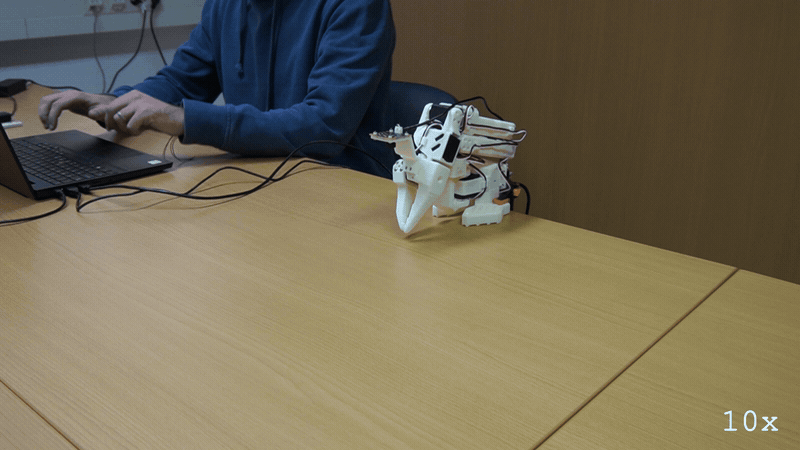

# E172: Something soft in the fold's way

**A hand on the arm slowed its fold to rest until the fold ran out of time, and quackd kept the arm up there and asked before folding again. Do not try this with a hand: the card says foam.**



Filmed with an external camera. The GIF plays at 10x speed.

| Category | Goal met | The run ended with | Date | quackd |
|---|---|---|---|---|
| Safety | Partly | SUCCESS | 2026-11-11 | 0.34.0 |

The numbers and the trace below are copied from the run's own record.
[All examples](../README.md)

## Why this matters

**Why this example exists:** An arm folding back to its rest pose can meet something in its way: a cable, a cup, a hand. A fold that misses must not end with the arm dropping where it stands. Until 0.24.0, the end of a run whose fold missed offered a single Enter that let go of the arm where it stood. Since then a fold that misses keeps the arm up and asks first: clear its way and press Enter, and it tries the fold once more. This example puts something in the fold's way on purpose, to see the miss, the question and the second try.

**Why this result is important:** The hand slowed the fold until its time ran out short of the pose, and quackd kept the arm up under torque there rather than letting go, until a person said its way was clear. With the hand gone, one Enter started the second fold, and it reached the rest pose a third of a second later. That is what keeps a missed fold from dropping the arm onto whatever is in its way: it holds, and it asks. It also shows why the card wants foam and not a hand: the arm never stopped for the hand, and pushed on at every send until its time ran out.

## The goal

Show a fold that misses, and the first of the two questions a miss asks before anything drops: clear the arm's way and press Enter, and it tries the fold once more. It is the second of the nine bench steps 0.24.0 left for a real arm.

**What we expected:** The fold stops against what is in its way, and quackd says `the arm did not reach its rest pose (...), so it is holding itself up where it stopped. Clear whatever is in its way and keep your hands out of its path, then press Enter and it tries the fold once more. Leave it, and after 60 s it stays that way`. With its way cleared and Enter pressed, the second fold arrives and lets go at the pose. The card does this with `quackd robot release` and a block of foam, at E171's slow step, and asks whether the arm stalled where expected and whether the second fold set off from there.

## What the run showed

* This take did not follow the card's lines. The fold was the run's own, at its end, where the card runs `quackd robot release`, and a hand held it back where the card puts foam. That is in effect 0.24.0's sixth bench step, which E176 carries, more than its second. A run's last fold asks the same question as the release's, word for word.
* The first connect failed on one servo, `connect attempt 1 of 3 failed on wrist_roll (id 5)`, when turning its torque on timed out. quackd closed the port without a write to any motor and tried again, and the run was `connected in 4.29 s`.
* With no LLM and no key, `--llm fake` flew the task's scripted pilot. The arm was lifted by hand and held, `holding the pose you set, you can let go`, at shoulder_pan -6, shoulder_lift -6, elbow_flex 18, wrist_flex 42, wrist_roll 0 and gripper 1, and the pilot's three calls ended in its `declare_success`.
* Ctrl-C at the wait to hand the arm back ended that wait, `(the kill switch ended the wait, without an Enter)`, and quackd left the gripper as it was and counted down: `folding the arm to its rest pose in 3 s: take your hands away from it now. Ctrl-C or q stops it before it moves`. The `stop` the trace prints after the press is the one the run sent when the pilot declared, 14.75 s earlier.
* A hand went onto the arm at its wrist during that countdown, and went down with the arm, holding the fold back from its start. The arm never stopped for it. LeRobot clamped all 36 of the fold's goals to 5 degrees from where the arm stood, and the elbow and the shoulder moved at every send, the elbow by at least 0.97 degrees, slower than E171's free fold of the same arm, until the time ran out: `elbow_flex is at 82 with a goal of 96 when the time ran out (4 s)`. That is quackd's time limit; its stall check, which says `and it has stopped moving`, never fired.
* quackd held the arm there and asked, in the card's words: `the arm did not reach its rest pose (...), so it is holding itself up where it stopped. Clear whatever is in its way and keep your hands out of its path, then press Enter and it tries the fold once more. Leave it, and after 60 s it stays that way`.
* The hand came away, and Enter, 8 s after the question, started the second fold: `release refold: Enter, to fold it once more`. It set off from where the arm had been held, and it was `at the rest pose` 0.34 s after the Enter, with three goals clamped on the way.
* Then `the arm reached its rest pose this time, so it is let go of there when the run disconnects from it, as at the end of every run that folds`. The run ended SUCCESS, the scripted pilot's own verdict: the Ctrl-C ended only the wait, not the run's outcome.
* In the video a hand goes onto the arm during the countdown, goes down with it, is still on it when the fold's time runs out, and is gone well before the Enter, after which the arm folds the rest of the way.

## What the run did not show

* Do not try this with a hand. The card says foam because the five body joints have no torque cap, and this record shows why: the arm never stopped for the hand, and pushed on at every one of its 36 sends until its time ran out. The take also ran at quackd's default step, 5 degrees per send and up to 50 degrees a second, where the card's slow step is 1 degree per send and 10 degrees a second. E176 is the one card that holds a fold back by hand, and it asks for the slow step, a palm under the forearm in the air, never between two links, and the other hand on the power switch.
* It does not show a stall, which the card asks about: the hand never held a joint still long enough for quackd's stall check, so whether the fold stalled where expected has no answer here.
* It does not show foam in the fold's way. The person reports that the foam they had was too soft: in an earlier try the arm squeezed it hard before it stopped, and it could not be pulled out while torque was on. That try is not logged. Firmer foam, not a hand, is the way to run it again.
* It does not show the release's fold meeting something, which is what the card runs: this fold was the run's own, at its end.
* It does not show the question left for its 60 s, or the second question a fold that misses twice asks: the second fold arrived.
* The trace prints no reading of the torque after the run let go of the arm at its disconnect, so the arm resting limp at its pose is quackd's word here. The summary's final state, which reads torque on, was taken after the second fold and before the disconnect.
* No LLM read anything. The three LLM calls in the table are the scripted pilot's turns, and its tokens are that pilot's own estimate. Nothing was billed. The table gives no first motion because no verb moved the arm: the person lifted it, and the fold was the run's own close.
* The GIF plays at 10x, so the countdown, the fold and the hold look far quicker than they were.

## How the run ended

The run ended with **SUCCESS**. The reason on record:

> elbow_flex 18, gripper 1, shoulder_lift -6, shoulder_pan -6, wrist_flex 42, wrist_roll 0; torque on; nothing hot

## The exact command

The following command was run with quackd 0.34.0:

```text
quackd run lerobot-lookout --robot arm-01 --by-hand --llm fake --max-steps 4 --no-memory
```

## The numbers

| | |
|---|---|
| quackd version | 0.34.0 |
| Started | 2026-11-11 11:33:32 UTC |
| Robot | `arm-01` (real) |
| LLM | `fake:scripted:lerobot-lookout` |
| Task file | `lerobot-lookout`, which ships with quackd |
| Steps | 1 |
| LLM calls | 3 |
| Total time | 42.9 s |
| Connecting | 4.3 s |
| Waiting for the LLM | 0.0 s |
| First motion | no verb moved the arm |
| Tokens | 5,630 in, 48 out |
| Cost at list price | $0.0000 |
| Speed cap | 5° per send |
| Run folder | `runs\20261111-113332-lerobot-lookout` |

## What the robot saw

This run used no camera.

## Try it yourself

This runs the same task file with no arm attached, on `lerobot:mock`, an arm that lives in memory.
It shows the rules a run is held to and not the physics. Run it from a checkout of this repository
with quackd's `lerobot` extra.
Its pilot is a script that ships with quackd in place of an LLM, so it needs no key and costs nothing.

```bash
quackd run lerobot-lookout --robot lerobot:mock --llm fake --no-memory
```

## Full terminal trace

<details>
<summary>Show the full terminal trace (399 lines)</summary>

```text
$ quackd run lerobot-lookout --robot arm-01 --by-hand --llm fake --max-steps 4 --no-memory
quackd 0.34.0, started 2026-11-11T11:33:31Z, cwd D:\Development\lerobot-test\.venv

╭─ 🦆 lerobot-lookout ─────────────────────────────────────────────────────────────────────────────────────────────────────────────────────────────────────╮
│ provider  fake (scripted:lerobot-lookout)                                                                                                                │
│ robot     arm-01 (lerobot:real)                                                                                                                          │
│ detector  color_blob on this machine  (once the body reports a camera)                                                                                   │
╰─ Ctrl-C or q stops the duck. However often you press, the run ends properly. ────────────────────────────────────────────────────────────────────────────╯
WARNING  connect attempt 1 of 3 failed on wrist_roll (id 5): Failed to enable torque after 1 tries on 'wrist_roll' (motor ID 5): Operation timed out. The   
         port was closed without a write to any motor, and connect runs again                                                                               
WARNING:quackd.lerobot:connect attempt 1 of 3 failed on wrist_roll (id 5): Failed to enable torque after 1 tries on 'wrist_roll' (motor ID 5): Operation 
timed out. The port was closed without a write to any motor, and connect runs again
·  note    connect attempt 1 of 3 failed on wrist_roll (id 5): Failed to enable torque after 1 tries on 'wrist_roll' (motor ID 5): Operation timed out. The port was closed without a write to any motor, and connect runs again
   run     connected in 4.29 s
   tools   report_state, stop, assess_task, declare_success, declare_failure
system prompt, 7232 chars, 100 lines (also in transcript.jsonl as run_start): ──────────────────────────────────────────────────────────────────────────────
   You are the brain of a six-joint desktop robot arm with a parallel gripper (an SO-101 class arm driven by LeRobot), bolted to a table. You are a high-level pilot:
   you choose ONE verb per turn; the robot's own controllers handle the motion. Do not micro-manage.

   ## Rules (enforced by the executor — not optional)
   - Call exactly one tool per turn. Never zero, never two.
   - Only these verbs are allowed: report_state, stop. Anything else is refused.
   - Budgets: 4 steps, 3 minutes, 12 LLM calls. The run stops when any is hit.
   - Verbs marked confirm (none) ask a human before running.
   - Before the first verb that moves the body, call `assess_task` with your verdict on whether this body can do this task at all, judged against its datasheet below: `feasible`, `infeasible` (the run ends, nothing moves) or `uncertain` (a human is asked). The verdict is about the body, not the view: not having found the target yet is not by itself a reason for `uncertain`. It is one when a limit turns on that unseen thing's mass or size, or on a figure the datasheet does not publish. Until then only `report_state` and `stop` run. Assess again later if what you see changes your mind.
   - When a success criterion is met, call `declare_success`. If the task turns out impossible while doing it, call `declare_failure`.

   ## Success criteria
   - You have said where the joints are, whether torque is on, and whether anything reads hot.

   ## Abort conditions you must respect yourself
   - (none beyond the enforced ones)

   ## Verbs
   - `report_state`: Report the arm: every joint in degrees, whether torque is on, how warm the servos are, and whether anything is held.
   - `stop`: Stop moving immediately (zero velocity). Always allowed.

   ## Your body: what it can and cannot do
   Each number says how sure quackd is of it and who says so (official: the maker or a paper says so; estimate: one vendor, a community number or a reading off a photo; measured: somebody measured it and said how).
   - Height: 0.53 m (estimate: one vendor's listing; reaching straight up)
   - Actuated joints: 6 (official: the LeRobot SO-101 docs; five joints and a gripper)
   - Payload: 0.5 kg (estimate: one vendor's listing)
   - Reach: 0.4 m (estimate: the maker's URDF, TheRobotStudio/SO-ARM100 Simulation/SO101/so101_new_calib.urdf; link lengths from the shoulder to the gripper frame, summed with the arm straight and rounded down)
   - Manipulator: one arm with a gripper.
   - Not published: mass. Where a task turns on it, say uncertain and name it rather than guessing; do not decline on it alone.
   - Mains powered, so nothing runs down. It does not move: no base and no legs.
   - quackd clamps you to gripper 0 to 100.
   - Each joint's travel in degrees, read from its own calibration, and the only goals quackd will send: shoulder_pan -119.6 to 119.6, shoulder_lift -100.7 to 100.7, elbow_flex -96.7 to 96.7, wrist_flex -101.4 to 101.4, wrist_roll -180 to 180, gripper 0 to 100. A joint can read past its travel when it was folded or placed there with torque off, which is where a rest pose usually is; goals are still limited to the travel.
   - Senses: joint_state.
   Whatever the task says, this body cannot:
   - go anywhere: it is bolted to a table and has no base
   - lift or hold more than about half a kilogram: a pen, an empty cup or a wooden block weighs far less than that, and a full bottle or a tool may weigh more
   - reach anything more than about 0.4 m from its shoulder: that is the arm held straight out, and any bent pose reaches less
   - feel what it holds: nothing reports grip force, so holding is inferred from the gripper stopping short of shut, which an empty hand that binds also does
   - know its own mass: vendor listings disagree by a factor of three
   Worth knowing:
   - How wide the gripper opens and how hard it grips are not published
   - No sensors beyond the servo positions unless a camera is configured, and the servo temperature, which quackd reads off the bus because LeRobot does not
   - Vendor listings give the mass as anything from 0.8 to 2.5 kg and nobody official publishes one, so it is listed as not published rather than picked from a hat
   - There are 7.4 V and 12 V builds of the same arm, with different stall torque and different supplies. Which one is on the desk is not something quackd can ask

   ## Where this run starts
   A person placed this body by hand before your first turn, and quackd is holding it exactly
   where they left it. This run does **not** start from the recorded rest pose, so do not assume
   a folded arm or a known shape: read `report_state` and work from the joint angles it gives you. They
   are where somebody decided the work should begin.

   The gripper is where their fingers closed it, which is a position and not a grip. Nothing is
   reported as held, and nothing should be: this task cannot work the gripper, so whatever is between the jaws is held at the squeeze the person left and you cannot tighten it.

   When the run ends, the arm is handed back the same way: it holds where you left it, the person
   is asked to take whatever is in the gripper, and only then does quackd fold the arm up.

   ## What is a stand-in on this robot
   The robot reported these itself, and they are in `extras.assumptions` in every observation.
   Each is something quackd stands in for or assumes, not something this robot does. Do not
   report one as the robot's own work, and do not read a success from one as evidence that the
   real skill works.
   - GRIPPER_OPEN_VALUE
   - HOLDING_INFERRED
   - TEMPERATURE_C

   ## Persona
   A calm lookout. One clear sentence, then stop.

   ## Task file: lerobot-lookout — Move nothing, read the arm back, and report what it says about itself.

   # Task

   You are a six-joint robot arm bolted to a desk. Do not move. Read your own state and report
   what it says, so that a human can decide whether this arm is fit to be driven.

   ## Strategy

   1. `report_state` gives you every joint in degrees, whether torque is on, and the temperature
      of each servo.
   2. Say in one sentence where the joints are, whether torque is on, and whether any joint reads
      hot. A joint at or above 60 degrees Celsius is hot and worth naming.
   3. Declare success once you have said all three. Declare failure if `report_state` fails twice:
      an arm that does not answer is the thing a human needs to know about.

   ## Notes

   - **You cannot move in this task and you should not want to.** Every verb that moves a joint is
     outside your allowlist. If the reading looks wrong, saying so is the answer.
   - **You cannot ask for a picture, and you have no voice.** `observe` and `say` are not verbs
     you have. If somebody plugged a webcam in and named it, you will still see a camera line in
     your observations, because a frame is taken every step whatever your allowlist says: use it
     if it is there and do not wait for it if it is not. Reporting means writing it in the reason
     you declare with.
   - **Torque off is not a fault you can fix.** no verb can toggle torque either way. A servo
     that has tripped its own overload protection reads the same way, so name the joint and let a
     human look at it.
   - The temperatures come off the servos themselves, which is something the robot's own software
     does not read. They are the one early warning this body has, so do not skip them.
────────────────────────────────────────────────────────────────────────────────────────────────────────────────────────────────────────────────────────────
·  note    moving to the rest pose
·  note    already at the rest pose
·  hand    released: torque is off at the rest pose
the arm is yours: torque is off at its rest pose, so lift it, put whatever it needs in the gripper, close the gripper on that, hold it where you want the 
run to start, and press Enter
(Enter)
·  asked   hand_off: the arm is yours: torque is off at its rest pose, so lift it, put whatever it needs in the gripper, close the gripper on that, hold it where you want the run to start, and press Enter -> yes
·  hand    held: holding the pose you set (elbow_flex 18, gripper 1, shoulder_lift -6, shoulder_pan -6, wrist_flex 42, wrist_roll 0)
holding the pose you set, you can let go. It is at elbow_flex 18, gripper 1, shoulder_lift -6, shoulder_pan -6, wrist_flex 42, wrist_roll 0
step 0/4 · LLM calls 0/12, 0.0/3 min ───────────────────────────────────────────────────────────────────────────────────────────────────────────────────────
   obs     state: posture=unknown policy=idle stand-ins=3-listed-in-extras.assumptions
           camera: nothing detected
           Choose exactly one tool.
   llm>    step 0: 1 messages (0 with image) to fake scripted:lerobot-lookout
   think   [scripted] step 0: sees nothing it knows, so the rule picks assess_task
   tool    assess_task(verdict='feasible', reason='scripted pilot: a rule has no judgement of the body, so i...', limits_consulted=[], estimates=[], needs={})
   tokens  in=1849 out=16 (run total in=1849 out=16 $0) latency=0.0 s cost=$0 stop=tool_use
✓  assess  feasible: scripted pilot: a rule has no judgement of the body, so it assumes the task fits
step 0/4 · LLM calls 1/12, 0.0/3 min ───────────────────────────────────────────────────────────────────────────────────────────────────────────────────────
   obs     state: posture=unknown policy=idle stand-ins=3-listed-in-extras.assumptions
           camera: nothing detected
           last verb `assess_task`: ok — recorded feasible: scripted pilot: a rule has no judgement of the body, so it assumes the task fits; verbs that move the body now run
           Choose exactly one tool.
   llm>    step 0: 2 messages (0 with image) to fake scripted:lerobot-lookout
   think   [scripted] step 0: sees nothing it knows after assess_task ok, so the rule picks report_state
   tool    report_state()
   tokens  in=1890 out=16 (run total in=3739 out=32 $0) latency=0.0 s cost=$0 stop=tool_use
▶  verb    report_state()
✓  result  report_state ok: shoulder_pan -6, shoulder_lift -6, elbow_flex 18, wrist_flex 42, wrist_roll 0, gripper 1; torque on; hottest gripper 32°C; holding nothing (0.0 s, 0 intents)
step 1/4 · LLM calls 2/12, 0.0/3 min ───────────────────────────────────────────────────────────────────────────────────────────────────────────────────────
   obs     state: posture=unknown policy=idle stand-ins=3-listed-in-extras.assumptions
           camera: nothing detected
           last verb `report_state`: ok — shoulder_pan -6, shoulder_lift -6, elbow_flex 18, wrist_flex 42, wrist_roll 0, gripper 1; torque on; hottest gripper 32°C; holding nothing
           Choose exactly one tool.
   llm>    step 1: 3 messages (0 with image) to fake scripted:lerobot-lookout
   think   [scripted] step 1: sees nothing it knows after report_state ok, so the rule picks declare_success
   tool    declare_success(reason='elbow_flex 18, gripper 1, shoulder_lift -6, shoulder_pan ...')
   tokens  in=1891 out=16 (run total in=5630 out=48 $0) latency=0.0 s cost=$0 stop=tool_use
✓  declare success: elbow_flex 18, gripper 1, shoulder_lift -6, shoulder_pan -6, wrist_flex 42, wrist_roll 0; torque on; nothing hot
the run is over and the arm is holding where it ended. Take hold of whatever is in the gripper and press Enter: the gripper opens all the way, and 3 s later
the arm folds up and the gripper closes again, so take your hands away as soon as it is open. Leave it and the arm folds up with the gripper shut
kill switch: Ctrl-C — cancelling the verb and stopping the robot
(the kill switch ended the wait, without an Enter)
→  send    stop
⚠  asked   hand_off: the run is over and the arm is holding where it ended. Take hold of whatever is in the gripper and press Enter: the gripper opens all the way, and 3 s later the arm folds up and the gripper closes again, so take your hands away as soon as it is open. Leave it and the arm folds up with the gripper shut -> no
·  hand    skipped: interrupted while waiting
·  note    the gripper was left as it is, and the arm still folds up
folding the arm to its rest pose in 3 s: take your hands away from it now. Ctrl-C or q stops it before it moves
·  note    folding the arm to its rest pose in 3 s: take your hands away from it now. Ctrl-C or q stops it before it moves
·  note    moving to the rest pose
WARNING:lerobot.robots.utils:Relative goal position magnitude had to be clamped to be safe.
{   'elbow_flex': {   'original goal_pos': 96.4,
                      'safe goal_pos': 23.285714285714285},
    'shoulder_lift': {   'original goal_pos': -100.79120879120879,
                         'safe goal_pos': -10.494505494505495},
    'wrist_flex': {   'original goal_pos': 79.2,
                      'safe goal_pos': 47.32967032967033}}
WARNING:lerobot.robots.utils:Relative goal position magnitude had to be clamped to be safe.
{   'elbow_flex': {   'original goal_pos': 96.4,
                      'safe goal_pos': 26.53846153846154},
    'shoulder_lift': {   'original goal_pos': -100.79120879120879,
                         'safe goal_pos': -12.34065934065934},
    'wrist_flex': {   'original goal_pos': 79.2,
                      'safe goal_pos': 50.23076923076923}}
WARNING:lerobot.robots.utils:Relative goal position magnitude had to be clamped to be safe.
{   'elbow_flex': {   'original goal_pos': 96.4,
                      'safe goal_pos': 30.67032967032967},
    'shoulder_lift': {   'original goal_pos': -100.79120879120879,
                         'safe goal_pos': -14.362637362637363},
    'wrist_flex': {   'original goal_pos': 79.2,
                      'safe goal_pos': 53.65934065934066}}
WARNING:lerobot.robots.utils:Relative goal position magnitude had to be clamped to be safe.
{   'elbow_flex': {   'original goal_pos': 96.4,
                      'safe goal_pos': 34.18681318681318},
    'shoulder_lift': {   'original goal_pos': -100.79120879120879,
                         'safe goal_pos': -16.560439560439562},
    'wrist_flex': {   'original goal_pos': 79.2,
                      'safe goal_pos': 56.73626373626374}}
WARNING:lerobot.robots.utils:Relative goal position magnitude had to be clamped to be safe.
{   'elbow_flex': {   'original goal_pos': 96.4,
                      'safe goal_pos': 37.08791208791209},
    'shoulder_lift': {   'original goal_pos': -100.79120879120879,
                         'safe goal_pos': -19.021978021978022},
    'wrist_flex': {   'original goal_pos': 79.2,
                      'safe goal_pos': 59.54945054945055}}
WARNING:lerobot.robots.utils:Relative goal position magnitude had to be clamped to be safe.
{   'elbow_flex': {   'original goal_pos': 96.4,
                      'safe goal_pos': 39.54945054945055},
    'shoulder_lift': {   'original goal_pos': -100.79120879120879,
                         'safe goal_pos': -21.923076923076923},
    'wrist_flex': {   'original goal_pos': 79.2,
                      'safe goal_pos': 62.362637362637365}}
WARNING:lerobot.robots.utils:Relative goal position magnitude had to be clamped to be safe.
{   'elbow_flex': {   'original goal_pos': 96.4,
                      'safe goal_pos': 41.83516483516483},
    'shoulder_lift': {   'original goal_pos': -100.79120879120879,
                         'safe goal_pos': -24.47252747252747},
    'wrist_flex': {   'original goal_pos': 79.2,
                      'safe goal_pos': 64.91208791208791}}
WARNING:lerobot.robots.utils:Relative goal position magnitude had to be clamped to be safe.
{   'elbow_flex': {   'original goal_pos': 96.4,
                      'safe goal_pos': 43.76923076923077},
    'shoulder_lift': {   'original goal_pos': -100.79120879120879,
                         'safe goal_pos': -27.10989010989011},
    'wrist_flex': {   'original goal_pos': 79.2,
                      'safe goal_pos': 67.19780219780219}}
WARNING:lerobot.robots.utils:Relative goal position magnitude had to be clamped to be safe.
{   'elbow_flex': {   'original goal_pos': 96.4,
                      'safe goal_pos': 45.35164835164835},
    'shoulder_lift': {   'original goal_pos': -100.79120879120879,
                         'safe goal_pos': -29.483516483516482},
    'wrist_flex': {   'original goal_pos': 79.2,
                      'safe goal_pos': 69.3956043956044}}
WARNING:lerobot.robots.utils:Relative goal position magnitude had to be clamped to be safe.
{   'elbow_flex': {   'original goal_pos': 96.4,
                      'safe goal_pos': 46.934065934065934},
    'shoulder_lift': {   'original goal_pos': -100.79120879120879,
                         'safe goal_pos': -31.857142857142858},
    'wrist_flex': {   'original goal_pos': 79.2,
                      'safe goal_pos': 71.41758241758242}}
WARNING:lerobot.robots.utils:Relative goal position magnitude had to be clamped to be safe.
{   'elbow_flex': {   'original goal_pos': 96.4,
                      'safe goal_pos': 48.51648351648352},
    'shoulder_lift': {   'original goal_pos': -100.79120879120879,
                         'safe goal_pos': -34.05494505494505},
    'wrist_flex': {   'original goal_pos': 79.2,
                      'safe goal_pos': 73.35164835164835}}
WARNING:lerobot.robots.utils:Relative goal position magnitude had to be clamped to be safe.
{   'elbow_flex': {   'original goal_pos': 96.4,
                      'safe goal_pos': 49.92307692307692},
    'shoulder_lift': {   'original goal_pos': -100.79120879120879,
                         'safe goal_pos': -36.252747252747255},
    'wrist_flex': {   'original goal_pos': 79.2,
                      'safe goal_pos': 75.1978021978022}}
WARNING:lerobot.robots.utils:Relative goal position magnitude had to be clamped to be safe.
{   'elbow_flex': {   'original goal_pos': 96.4,
                      'safe goal_pos': 51.24175824175824},
    'shoulder_lift': {   'original goal_pos': -100.79120879120879,
                         'safe goal_pos': -38.362637362637365},
    'wrist_flex': {   'original goal_pos': 79.2,
                      'safe goal_pos': 77.04395604395604}}
WARNING:lerobot.robots.utils:Relative goal position magnitude had to be clamped to be safe.
{   'elbow_flex': {   'original goal_pos': 96.4,
                      'safe goal_pos': 52.56043956043956},
    'shoulder_lift': {   'original goal_pos': -100.79120879120879,
                         'safe goal_pos': -40.2967032967033},
    'wrist_flex': {   'original goal_pos': 79.2,
                      'safe goal_pos': 78.71428571428571}}
WARNING:lerobot.robots.utils:Relative goal position magnitude had to be clamped to be safe.
{   'elbow_flex': {   'original goal_pos': 96.4,
                      'safe goal_pos': 53.79120879120879},
    'shoulder_lift': {   'original goal_pos': -100.79120879120879,
                         'safe goal_pos': -42.142857142857146}}
WARNING:lerobot.robots.utils:Relative goal position magnitude had to be clamped to be safe.
{   'elbow_flex': {   'original goal_pos': 96.4,
                      'safe goal_pos': 55.46153846153846},
    'shoulder_lift': {   'original goal_pos': -100.79120879120879,
                         'safe goal_pos': -43.989010989010985}}
WARNING:lerobot.robots.utils:Relative goal position magnitude had to be clamped to be safe.
{   'elbow_flex': {   'original goal_pos': 96.4,
                      'safe goal_pos': 57.30769230769231},
    'shoulder_lift': {   'original goal_pos': -100.79120879120879,
                         'safe goal_pos': -45.65934065934066}}
WARNING:lerobot.robots.utils:Relative goal position magnitude had to be clamped to be safe.
{   'elbow_flex': {   'original goal_pos': 96.4,
                      'safe goal_pos': 58.97802197802198},
    'shoulder_lift': {   'original goal_pos': -100.79120879120879,
                         'safe goal_pos': -47.505494505494504}}
WARNING:lerobot.robots.utils:Relative goal position magnitude had to be clamped to be safe.
{   'elbow_flex': {   'original goal_pos': 96.4,
                      'safe goal_pos': 60.2967032967033},
    'shoulder_lift': {   'original goal_pos': -100.79120879120879,
                         'safe goal_pos': -49.43956043956044}}
WARNING:lerobot.robots.utils:Relative goal position magnitude had to be clamped to be safe.
{   'elbow_flex': {   'original goal_pos': 96.4,
                      'safe goal_pos': 61.7032967032967},
    'shoulder_lift': {   'original goal_pos': -100.79120879120879,
                         'safe goal_pos': -51.72527472527472}}
WARNING:lerobot.robots.utils:Relative goal position magnitude had to be clamped to be safe.
{   'elbow_flex': {   'original goal_pos': 96.4,
                      'safe goal_pos': 63.10989010989011},
    'shoulder_lift': {   'original goal_pos': -100.79120879120879,
                         'safe goal_pos': -54.010989010989015}}
WARNING:lerobot.robots.utils:Relative goal position magnitude had to be clamped to be safe.
{   'elbow_flex': {   'original goal_pos': 96.4,
                      'safe goal_pos': 64.42857142857143},
    'shoulder_lift': {   'original goal_pos': -100.79120879120879,
                         'safe goal_pos': -56.2967032967033}}
WARNING:lerobot.robots.utils:Relative goal position magnitude had to be clamped to be safe.
{   'elbow_flex': {   'original goal_pos': 96.4,
                      'safe goal_pos': 65.74725274725274},
    'shoulder_lift': {   'original goal_pos': -100.79120879120879,
                         'safe goal_pos': -58.582417582417584}}
WARNING:lerobot.robots.utils:Relative goal position magnitude had to be clamped to be safe.
{   'elbow_flex': {   'original goal_pos': 96.4,
                      'safe goal_pos': 66.8901098901099},
    'shoulder_lift': {   'original goal_pos': -100.79120879120879,
                         'safe goal_pos': -60.956043956043956}}
WARNING:lerobot.robots.utils:Relative goal position magnitude had to be clamped to be safe.
{   'elbow_flex': {   'original goal_pos': 96.4,
                      'safe goal_pos': 67.85714285714286},
    'shoulder_lift': {   'original goal_pos': -100.79120879120879,
                         'safe goal_pos': -63.15384615384615}}
WARNING:lerobot.robots.utils:Relative goal position magnitude had to be clamped to be safe.
{   'elbow_flex': {'original goal_pos': 96.4, 'safe goal_pos': 69.0},
    'shoulder_lift': {   'original goal_pos': -100.79120879120879,
                         'safe goal_pos': -65.35164835164835}}
WARNING:lerobot.robots.utils:Relative goal position magnitude had to be clamped to be safe.
{   'elbow_flex': {   'original goal_pos': 96.4,
                      'safe goal_pos': 70.05494505494505},
    'shoulder_lift': {   'original goal_pos': -100.79120879120879,
                         'safe goal_pos': -67.54945054945054}}
WARNING:lerobot.robots.utils:Relative goal position magnitude had to be clamped to be safe.
{   'elbow_flex': {   'original goal_pos': 96.4,
                      'safe goal_pos': 71.28571428571429},
    'shoulder_lift': {   'original goal_pos': -100.79120879120879,
                         'safe goal_pos': -69.92307692307692}}
WARNING:lerobot.robots.utils:Relative goal position magnitude had to be clamped to be safe.
{   'elbow_flex': {   'original goal_pos': 96.4,
                      'safe goal_pos': 72.34065934065934},
    'shoulder_lift': {   'original goal_pos': -100.79120879120879,
                         'safe goal_pos': -72.56043956043956}}
WARNING:lerobot.robots.utils:Relative goal position magnitude had to be clamped to be safe.
{   'elbow_flex': {   'original goal_pos': 96.4,
                      'safe goal_pos': 73.74725274725274},
    'shoulder_lift': {   'original goal_pos': -100.79120879120879,
                         'safe goal_pos': -75.28571428571429}}
WARNING:lerobot.robots.utils:Relative goal position magnitude had to be clamped to be safe.
{   'elbow_flex': {   'original goal_pos': 96.4,
                      'safe goal_pos': 75.50549450549451},
    'shoulder_lift': {   'original goal_pos': -100.79120879120879,
                         'safe goal_pos': -78.01098901098901}}
WARNING:lerobot.robots.utils:Relative goal position magnitude had to be clamped to be safe.
{   'elbow_flex': {'original goal_pos': 96.4, 'safe goal_pos': 77.0},
    'shoulder_lift': {   'original goal_pos': -100.79120879120879,
                         'safe goal_pos': -80.91208791208791}}
WARNING:lerobot.robots.utils:Relative goal position magnitude had to be clamped to be safe.
{   'elbow_flex': {   'original goal_pos': 96.4,
                      'safe goal_pos': 78.14285714285714},
    'shoulder_lift': {   'original goal_pos': -100.79120879120879,
                         'safe goal_pos': -83.9010989010989}}
WARNING:lerobot.robots.utils:Relative goal position magnitude had to be clamped to be safe.
{   'elbow_flex': {   'original goal_pos': 96.4,
                      'safe goal_pos': 79.46153846153847},
    'shoulder_lift': {   'original goal_pos': -100.79120879120879,
                         'safe goal_pos': -87.15384615384616}}
WARNING:lerobot.robots.utils:Relative goal position magnitude had to be clamped to be safe.
{   'elbow_flex': {   'original goal_pos': 96.4,
                      'safe goal_pos': 81.65934065934066},
    'shoulder_lift': {   'original goal_pos': -100.79120879120879,
                         'safe goal_pos': -90.58241758241758}}
WARNING:lerobot.robots.utils:Relative goal position magnitude had to be clamped to be safe.
{   'elbow_flex': {   'original goal_pos': 96.4,
                      'safe goal_pos': 84.38461538461539},
    'shoulder_lift': {   'original goal_pos': -100.79120879120879,
                         'safe goal_pos': -93.83516483516483}}
·  note    the arm did not reach its rest pose: elbow_flex is at 82 with a goal of 96 when the time ran out (4 s)
the arm did not reach its rest pose (elbow_flex is at 82 with a goal of 96 when the time ran out (4 s)), so it is holding itself up where it stopped. Clear 
whatever is in its way and keep your hands out of its path, then press Enter and it tries the fold once more. Leave it, and after 60 s it stays that way
(Enter)
·  asked   release: the arm did not reach its rest pose (elbow_flex is at 82 with a goal of 96 when the time ran out (4 s)), so it is holding itself up where it stopped. Clear whatever is in its way and keep your hands out of its path, then press Enter and it tries the fold once more. Leave it, and after 60 s it stays that way -> yes
·  release refold: Enter, to fold it once more
·  note    moving to the rest pose
WARNING:lerobot.robots.utils:Relative goal position magnitude had to be clamped to be safe.
{   'elbow_flex': {   'original goal_pos': 96.4,
                      'safe goal_pos': 87.9010989010989},
    'shoulder_lift': {   'original goal_pos': -100.79120879120879,
                         'safe goal_pos': -97.52747252747253}}
WARNING:lerobot.robots.utils:Relative goal position magnitude had to be clamped to be safe.
{   'elbow_flex': {   'original goal_pos': 96.4,
                      'safe goal_pos': 91.06593406593407},
    'shoulder_lift': {   'original goal_pos': -100.79120879120879,
                         'safe goal_pos': -99.98901098901099}}
WARNING:lerobot.robots.utils:Relative goal position magnitude had to be clamped to be safe.
{'elbow_flex': {'original goal_pos': 96.4, 'safe goal_pos': 95.1978021978022}}
·  note    at the rest pose
·  release folded: moved to the rest pose
the arm reached its rest pose this time, so it is let go of there when the run disconnects from it, as at the end of every run that folds
╭─ ✓ SUCCESS ──────────────────────────────────────────────────────────────────────────────────────────────────────────────────────────────────────────────╮
│ elbow_flex 18, gripper 1, shoulder_lift -6, shoulder_pan -6, wrist_flex 42, wrist_roll 0; torque on; nothing hot                                         │
│ steps 1 · LLM calls 3 · tokens 5630+48 · time 42.9 s (LLM 0.0 s) · LLM calls p50 0.0 s, p90 0.0 s, max 0.0 s · cost $0                                   │
│ run dir  runs\20261111-113332-lerobot-lookout                                                                                                            │
╰──────────────────────────────────────────────────────────────────────────────────────────────────────────────────────────────────────────────────────────╯
```

</details>
