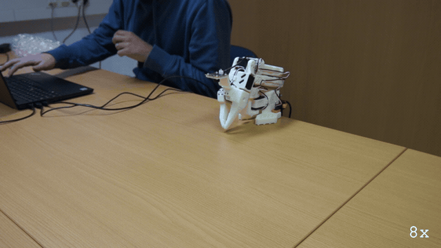

# E173: Blocked twice, then into your hand

**Two folds in a row missed against a soft roll in the arm's way, and quackd let go of the arm where it stood only when a person pressed Enter at a question that said it would drop.**



Filmed with an external camera. The GIF plays at 8x speed.

| Category | Goal met | The run ended with | Date | quackd |
|---|---|---|---|---|
| Safety | Partly | SUCCESS | 2026-11-11 | 0.34.0 |

The numbers and the trace below are copied from the run's own record.
[All examples](../README.md)

## Why this matters

**Why this example exists:** Dropping a robot arm can break it or hurt the hand under it. For an arm with a rest pose recorded, quackd drops it where it stands in one way only: its fold has to miss twice, and a person has to press Enter at a question that says the arm will drop and to hold it first. Until then torque stays on and the arm stays up. This example blocks both folds on purpose, to walk that one path to its end.

**Why this result is important:** It took both misses and an Enter at the question that warns the arm will drop. The first fold missed and quackd only asked to clear the way; the second missed too, and only then came that question, word for word as the card has it, and torque came off at an Enter pressed 7.3 s after it. The question asks for the arm to be held first, and here nobody held it: the roll it lay on is what kept it from dropping. Two misses and a key press stand between the arm and a drop, and the person pressing that key still has to be ready to catch it.

## The goal

Show the only way quackd drops an arm where it stands: two folds missed, and a person pressing Enter at a question that says the arm will drop. It is the third of the nine bench steps 0.24.0 left for a real arm.

**What we expected:** Something soft stays in the fold's way through both folds. The first miss asks to clear the way and press Enter for one more fold; the second miss asks instead `the arm did not reach its rest pose the second time either (...), so it is holding itself up where it stopped. Pressing Enter now takes torque off where it stands, and the arm will drop: hold it first, or it can be damaged. Leave it, and after 60 s torque stays on`. Holding the arm's weight and pressing Enter lets it go limp into the hand, with `✓ torque reads off on every joint of arm-01` and `the arm is limp and in your hands (torque was taken off where it stood, because you asked for it): put it down before you let go of it, because nothing is holding it up`. The card does this with `quackd robot release` and foam, at E171's slow step, and asks how far the arm dropped and whether one hand caught it.

## What the run showed

* Like E172, this take used the run's own closing fold, started by Ctrl-C at the wait to hand the arm back, where the card runs `quackd robot release`. A soft roll of clear packing plastic lay across the fold's path, under the forearm, and stayed there through both folds.
* With no LLM and no key, `--llm fake` flew the task's scripted pilot. quackd was `connected in 8.02 s`, the arm was lifted by hand and held, `holding the pose you set, you can let go`, and the pilot's three calls ended in its `declare_success`.
* Ctrl-C at the wait to hand the arm back ended that wait, `(the kill switch ended the wait, without an Enter)`, and quackd counted down: `folding the arm to its rest pose in 3 s: take your hands away from it now. Ctrl-C or q stops it before it moves`. The `stop` the trace prints after the press is the one the run sent when the pilot declared, 10.5 s earlier.
* A hand went to the wrist about a second into that countdown, stayed there for about the first 2 s of the 4 s fold, and came away more than 1.5 s before the fold missed.
* The first fold met the roll and missed when its time ran out: `elbow_flex is at 62 with a goal of 96 when the time ran out (4 s)`. The elbow came to rest against the roll, moving under half a degree a send for the fold's last two seconds, but the shoulder kept moving to its rest angle, so quackd's time limit ended the fold and not its stall check, which wants every joint still. quackd held the arm up and asked to clear the way: the first question.
* Enter, 7.7 s later, with the roll left where it was, started the second fold, which stalled against the roll 0.66 s later: `elbow_flex is at 61 with a goal of 96, and it has stopped moving`. Only then came the second question, in the card's words: `the arm did not reach its rest pose the second time either (...), so it is holding itself up where it stopped. Pressing Enter now takes torque off where it stands, and the arm will drop: hold it first, or it can be damaged. Leave it, and after 60 s torque stays on`.
* A hand was on the gripper for about 2 s of that question's wait and came away less than 2 s before the Enter. Enter at the question, 7.3 s after it, took torque off where the arm stood, with shoulder_lift at -100.5, elbow_flex at 60.6 and wrist_flex at 75.5: `torque is off where the arm stands: the arm is in your hands, so put it down before you let go of it`. The release read the torque back and every joint read off, and the run's close printed the card's second line word for word: `the arm is limp and in your hands (torque was taken off where it stood, because you asked for it): put it down before you let go of it, because nothing is holding it up`.
* Nothing dropped. At that Enter both hands were at the laptop and the forearm lay on the roll, which held it, so the arm barely moved as torque came off. A hand then took hold of the arm, the roll came out from under it, and the arm was laid down at its rest pose by hand.
* The run ended SUCCESS, the scripted pilot's own verdict. Its reason's `torque on` is the pilot's reading at its first step, before the folds: the arm ended with torque off.

## What the run did not show

* It does not answer the card's question, how far the arm dropped and whether one hand caught it: no hand held the arm at the Enter, and the roll it lay on kept it from dropping.
* Keep your hands off a fold: the countdown says so, and the five body joints have no torque cap. A hand was on this one for most of the countdown and the first half of the fold. The take also ran at quackd's default step, 5 degrees per send and up to 50 degrees a second, where the card's slow step is 1 degree per send and 10 degrees a second.
* It does not show `quackd robot release`, which the card runs. A run's release reads the torque back as the command does, and here every joint read off, but a run prints no `✓ torque reads off on every joint of arm-01` line for it.
* It does not show an Enter typed too soon being refused, or Ctrl-C or `q` stopping the drop after the Enter: neither was tried. Nor does it show the second question left for its 60 s.
* No LLM read anything. The three LLM calls in the table are the scripted pilot's turns, its tokens are that pilot's own estimate, and nothing was billed. The table gives no first motion because no verb moved the arm: the person lifted it, and the folds were the run's own close.
* The GIF plays at 8x, so the countdown, the folds and the waits at the questions look far quicker than they were.

## How the run ended

The run ended with **SUCCESS**. The reason on record:

> elbow_flex 18, gripper 1, shoulder_lift -6, shoulder_pan -6, wrist_flex 40, wrist_roll 1; torque on; nothing hot

## The exact command

The following command was run with quackd 0.34.0:

```text
quackd run lerobot-lookout --robot arm-01 --by-hand --llm fake --max-steps 4 --no-memory
```

## The numbers

| | |
|---|---|
| quackd version | 0.34.0 |
| Started | 2026-11-11 14:36:33 UTC |
| Robot | `arm-01` (real) |
| LLM | `fake:scripted:lerobot-lookout` |
| Task file | `lerobot-lookout`, which ships with quackd |
| Steps | 1 |
| LLM calls | 3 |
| Total time | 51.6 s |
| Connecting | 8.0 s |
| Waiting for the LLM | 0.0 s |
| First motion | no verb moved the arm |
| Tokens | 5,631 in, 48 out |
| Cost at list price | $0.0000 |
| Speed cap | 5° per send |
| Run folder | `runs\20261111-143633-lerobot-lookout` |

## What the robot saw

This run used no camera.

## Try it yourself

This runs the same task file with no arm attached, on `lerobot:mock`, an arm that lives in memory.
It shows the rules a run is held to and not the physics. Run it from a checkout of this repository
with quackd's `lerobot` extra.
Its pilot is a script that ships with quackd in place of an LLM, so it needs no key and costs nothing.

```bash
quackd run lerobot-lookout --robot lerobot:mock --llm fake --no-memory
```

## Full terminal trace

<details>
<summary>Show the full terminal trace (389 lines)</summary>

```text
$ quackd run lerobot-lookout --robot arm-01 --by-hand --llm fake --max-steps 4 --no-memory
quackd 0.34.0, started 2026-11-11T14:36:32Z, cwd D:\Development\lerobot-test\.venv

╭─ 🦆 lerobot-lookout ─────────────────────────────────────────────────────────────────────────────────────────────────────────────────────────────────────╮
│ provider  fake (scripted:lerobot-lookout)                                                                                                                │
│ robot     arm-01 (lerobot:real)                                                                                                                          │
│ detector  color_blob on this machine  (once the body reports a camera)                                                                                   │
╰─ Ctrl-C or q stops the duck. However often you press, the run ends properly. ────────────────────────────────────────────────────────────────────────────╯
   run     connected in 8.02 s
   tools   report_state, stop, assess_task, declare_success, declare_failure
system prompt, 7232 chars, 100 lines (also in transcript.jsonl as run_start): ──────────────────────────────────────────────────────────────────────────────
   You are the brain of a six-joint desktop robot arm with a parallel gripper (an SO-101 class arm driven by LeRobot), bolted to a table. You are a high-level pilot:
   you choose ONE verb per turn; the robot's own controllers handle the motion. Do not micro-manage.

   ## Rules (enforced by the executor — not optional)
   - Call exactly one tool per turn. Never zero, never two.
   - Only these verbs are allowed: report_state, stop. Anything else is refused.
   - Budgets: 4 steps, 3 minutes, 12 LLM calls. The run stops when any is hit.
   - Verbs marked confirm (none) ask a human before running.
   - Before the first verb that moves the body, call `assess_task` with your verdict on whether this body can do this task at all, judged against its datasheet below: `feasible`, `infeasible` (the run ends, nothing moves) or `uncertain` (a human is asked). The verdict is about the body, not the view: not having found the target yet is not by itself a reason for `uncertain`. It is one when a limit turns on that unseen thing's mass or size, or on a figure the datasheet does not publish. Until then only `report_state` and `stop` run. Assess again later if what you see changes your mind.
   - When a success criterion is met, call `declare_success`. If the task turns out impossible while doing it, call `declare_failure`.

   ## Success criteria
   - You have said where the joints are, whether torque is on, and whether anything reads hot.

   ## Abort conditions you must respect yourself
   - (none beyond the enforced ones)

   ## Verbs
   - `report_state`: Report the arm: every joint in degrees, whether torque is on, how warm the servos are, and whether anything is held.
   - `stop`: Stop moving immediately (zero velocity). Always allowed.

   ## Your body: what it can and cannot do
   Each number says how sure quackd is of it and who says so (official: the maker or a paper says so; estimate: one vendor, a community number or a reading off a photo; measured: somebody measured it and said how).
   - Height: 0.53 m (estimate: one vendor's listing; reaching straight up)
   - Actuated joints: 6 (official: the LeRobot SO-101 docs; five joints and a gripper)
   - Payload: 0.5 kg (estimate: one vendor's listing)
   - Reach: 0.4 m (estimate: the maker's URDF, TheRobotStudio/SO-ARM100 Simulation/SO101/so101_new_calib.urdf; link lengths from the shoulder to the gripper frame, summed with the arm straight and rounded down)
   - Manipulator: one arm with a gripper.
   - Not published: mass. Where a task turns on it, say uncertain and name it rather than guessing; do not decline on it alone.
   - Mains powered, so nothing runs down. It does not move: no base and no legs.
   - quackd clamps you to gripper 0 to 100.
   - Each joint's travel in degrees, read from its own calibration, and the only goals quackd will send: shoulder_pan -119.6 to 119.6, shoulder_lift -100.7 to 100.7, elbow_flex -96.7 to 96.7, wrist_flex -101.4 to 101.4, wrist_roll -180 to 180, gripper 0 to 100. A joint can read past its travel when it was folded or placed there with torque off, which is where a rest pose usually is; goals are still limited to the travel.
   - Senses: joint_state.
   Whatever the task says, this body cannot:
   - go anywhere: it is bolted to a table and has no base
   - lift or hold more than about half a kilogram: a pen, an empty cup or a wooden block weighs far less than that, and a full bottle or a tool may weigh more
   - reach anything more than about 0.4 m from its shoulder: that is the arm held straight out, and any bent pose reaches less
   - feel what it holds: nothing reports grip force, so holding is inferred from the gripper stopping short of shut, which an empty hand that binds also does
   - know its own mass: vendor listings disagree by a factor of three
   Worth knowing:
   - How wide the gripper opens and how hard it grips are not published
   - No sensors beyond the servo positions unless a camera is configured, and the servo temperature, which quackd reads off the bus because LeRobot does not
   - Vendor listings give the mass as anything from 0.8 to 2.5 kg and nobody official publishes one, so it is listed as not published rather than picked from a hat
   - There are 7.4 V and 12 V builds of the same arm, with different stall torque and different supplies. Which one is on the desk is not something quackd can ask

   ## Where this run starts
   A person placed this body by hand before your first turn, and quackd is holding it exactly
   where they left it. This run does **not** start from the recorded rest pose, so do not assume
   a folded arm or a known shape: read `report_state` and work from the joint angles it gives you. They
   are where somebody decided the work should begin.

   The gripper is where their fingers closed it, which is a position and not a grip. Nothing is
   reported as held, and nothing should be: this task cannot work the gripper, so whatever is between the jaws is held at the squeeze the person left and you cannot tighten it.

   When the run ends, the arm is handed back the same way: it holds where you left it, the person
   is asked to take whatever is in the gripper, and only then does quackd fold the arm up.

   ## What is a stand-in on this robot
   The robot reported these itself, and they are in `extras.assumptions` in every observation.
   Each is something quackd stands in for or assumes, not something this robot does. Do not
   report one as the robot's own work, and do not read a success from one as evidence that the
   real skill works.
   - GRIPPER_OPEN_VALUE
   - HOLDING_INFERRED
   - TEMPERATURE_C

   ## Persona
   A calm lookout. One clear sentence, then stop.

   ## Task file: lerobot-lookout — Move nothing, read the arm back, and report what it says about itself.

   # Task

   You are a six-joint robot arm bolted to a desk. Do not move. Read your own state and report
   what it says, so that a human can decide whether this arm is fit to be driven.

   ## Strategy

   1. `report_state` gives you every joint in degrees, whether torque is on, and the temperature
      of each servo.
   2. Say in one sentence where the joints are, whether torque is on, and whether any joint reads
      hot. A joint at or above 60 degrees Celsius is hot and worth naming.
   3. Declare success once you have said all three. Declare failure if `report_state` fails twice:
      an arm that does not answer is the thing a human needs to know about.

   ## Notes

   - **You cannot move in this task and you should not want to.** Every verb that moves a joint is
     outside your allowlist. If the reading looks wrong, saying so is the answer.
   - **You cannot ask for a picture, and you have no voice.** `observe` and `say` are not verbs
     you have. If somebody plugged a webcam in and named it, you will still see a camera line in
     your observations, because a frame is taken every step whatever your allowlist says: use it
     if it is there and do not wait for it if it is not. Reporting means writing it in the reason
     you declare with.
   - **Torque off is not a fault you can fix.** no verb can toggle torque either way. A servo
     that has tripped its own overload protection reads the same way, so name the joint and let a
     human look at it.
   - The temperatures come off the servos themselves, which is something the robot's own software
     does not read. They are the one early warning this body has, so do not skip them.
────────────────────────────────────────────────────────────────────────────────────────────────────────────────────────────────────────────────────────────
·  note    moving to the rest pose
·  note    already at the rest pose
·  hand    released: torque is off at the rest pose
the arm is yours: torque is off at its rest pose, so lift it, put whatever it needs in the gripper, close the gripper on that, hold it where you want the 
run to start, and press Enter
(Enter)
·  asked   hand_off: the arm is yours: torque is off at its rest pose, so lift it, put whatever it needs in the gripper, close the gripper on that, hold it where you want the run to start, and press Enter -> yes
·  hand    held: holding the pose you set (elbow_flex 18, gripper 1, shoulder_lift -6, shoulder_pan -6, wrist_flex 40, wrist_roll 1)
holding the pose you set, you can let go. It is at elbow_flex 18, gripper 1, shoulder_lift -6, shoulder_pan -6, wrist_flex 40, wrist_roll 1
step 0/4 · LLM calls 0/12, 0.0/3 min ───────────────────────────────────────────────────────────────────────────────────────────────────────────────────────
   obs     state: posture=unknown policy=idle stand-ins=3-listed-in-extras.assumptions
           camera: nothing detected
           Choose exactly one tool.
   llm>    step 0: 1 messages (0 with image) to fake scripted:lerobot-lookout
   think   [scripted] step 0: sees nothing it knows, so the rule picks assess_task
   tool    assess_task(verdict='feasible', reason='scripted pilot: a rule has no judgement of the body, so i...', limits_consulted=[], estimates=[], needs={})
   tokens  in=1849 out=16 (run total in=1849 out=16 $0) latency=0.0 s cost=$0 stop=tool_use
✓  assess  feasible: scripted pilot: a rule has no judgement of the body, so it assumes the task fits
step 0/4 · LLM calls 1/12, 0.0/3 min ───────────────────────────────────────────────────────────────────────────────────────────────────────────────────────
   obs     state: posture=unknown policy=idle stand-ins=3-listed-in-extras.assumptions
           camera: nothing detected
           last verb `assess_task`: ok — recorded feasible: scripted pilot: a rule has no judgement of the body, so it assumes the task fits; verbs that move the body now run
           Choose exactly one tool.
   llm>    step 0: 2 messages (0 with image) to fake scripted:lerobot-lookout
   think   [scripted] step 0: sees nothing it knows after assess_task ok, so the rule picks report_state
   tool    report_state()
   tokens  in=1890 out=16 (run total in=3739 out=32 $0) latency=0.0 s cost=$0 stop=tool_use
▶  verb    report_state()
✓  result  report_state ok: shoulder_pan -6, shoulder_lift -6, elbow_flex 18, wrist_flex 40, wrist_roll 1, gripper 1; torque on; hottest wrist_roll 33°C; holding nothing (0.0 s, 0 intents)
step 1/4 · LLM calls 2/12, 0.0/3 min ───────────────────────────────────────────────────────────────────────────────────────────────────────────────────────
   obs     state: posture=unknown policy=idle stand-ins=3-listed-in-extras.assumptions
           camera: nothing detected
           last verb `report_state`: ok — shoulder_pan -6, shoulder_lift -6, elbow_flex 18, wrist_flex 40, wrist_roll 1, gripper 1; torque on; hottest wrist_roll 33°C; holding nothing
           Choose exactly one tool.
   llm>    step 1: 3 messages (0 with image) to fake scripted:lerobot-lookout
   think   [scripted] step 1: sees nothing it knows after report_state ok, so the rule picks declare_success
   tool    declare_success(reason='elbow_flex 18, gripper 1, shoulder_lift -6, shoulder_pan ...')
   tokens  in=1892 out=16 (run total in=5631 out=48 $0) latency=0.0 s cost=$0 stop=tool_use
✓  declare success: elbow_flex 18, gripper 1, shoulder_lift -6, shoulder_pan -6, wrist_flex 40, wrist_roll 1; torque on; nothing hot
the run is over and the arm is holding where it ended. Take hold of whatever is in the gripper and press Enter: the gripper opens all the way, and 3 s later
the arm folds up and the gripper closes again, so take your hands away as soon as it is open. Leave it and the arm folds up with the gripper shut
kill switch: Ctrl-C — cancelling the verb and stopping the robot
(the kill switch ended the wait, without an Enter)
→  send    stop
⚠  asked   hand_off: the run is over and the arm is holding where it ended. Take hold of whatever is in the gripper and press Enter: the gripper opens all the way, and 3 s later the arm folds up and the gripper closes again, so take your hands away as soon as it is open. Leave it and the arm folds up with the gripper shut -> no
·  hand    skipped: interrupted while waiting
·  note    the gripper was left as it is, and the arm still folds up
folding the arm to its rest pose in 3 s: take your hands away from it now. Ctrl-C or q stops it before it moves
·  note    folding the arm to its rest pose in 3 s: take your hands away from it now. Ctrl-C or q stops it before it moves
·  note    moving to the rest pose
WARNING:lerobot.robots.utils:Relative goal position magnitude had to be clamped to be safe.
{   'elbow_flex': {   'original goal_pos': 96.4,
                      'safe goal_pos': 23.021978021978022},
    'shoulder_lift': {   'original goal_pos': -100.79120879120879,
                         'safe goal_pos': -10.934065934065934},
    'wrist_flex': {   'original goal_pos': 79.2,
                      'safe goal_pos': 45.48351648351648}}
WARNING:lerobot.robots.utils:Relative goal position magnitude had to be clamped to be safe.
{   'elbow_flex': {   'original goal_pos': 96.4,
                      'safe goal_pos': 26.36263736263736},
    'shoulder_lift': {   'original goal_pos': -100.79120879120879,
                         'safe goal_pos': -12.780219780219781},
    'wrist_flex': {   'original goal_pos': 79.2,
                      'safe goal_pos': 48.2967032967033}}
WARNING:lerobot.robots.utils:Relative goal position magnitude had to be clamped to be safe.
{   'elbow_flex': {   'original goal_pos': 96.4,
                      'safe goal_pos': 30.406593406593405},
    'shoulder_lift': {   'original goal_pos': -100.79120879120879,
                         'safe goal_pos': -14.802197802197803},
    'wrist_flex': {   'original goal_pos': 79.2,
                      'safe goal_pos': 51.81318681318681}}
WARNING:lerobot.robots.utils:Relative goal position magnitude had to be clamped to be safe.
{   'elbow_flex': {   'original goal_pos': 96.4,
                      'safe goal_pos': 34.18681318681318},
    'shoulder_lift': {   'original goal_pos': -100.79120879120879,
                         'safe goal_pos': -17.087912087912088},
    'wrist_flex': {   'original goal_pos': 79.2,
                      'safe goal_pos': 55.065934065934066}}
WARNING:lerobot.robots.utils:Relative goal position magnitude had to be clamped to be safe.
{   'elbow_flex': {   'original goal_pos': 96.4,
                      'safe goal_pos': 38.05494505494506},
    'shoulder_lift': {   'original goal_pos': -100.79120879120879,
                         'safe goal_pos': -19.285714285714285},
    'wrist_flex': {   'original goal_pos': 79.2,
                      'safe goal_pos': 58.40659340659341}}
WARNING:lerobot.robots.utils:Relative goal position magnitude had to be clamped to be safe.
{   'elbow_flex': {   'original goal_pos': 96.4,
                      'safe goal_pos': 41.92307692307692},
    'shoulder_lift': {   'original goal_pos': -100.79120879120879,
                         'safe goal_pos': -21.65934065934066},
    'wrist_flex': {   'original goal_pos': 79.2,
                      'safe goal_pos': 61.747252747252745}}
WARNING:lerobot.robots.utils:Relative goal position magnitude had to be clamped to be safe.
{   'elbow_flex': {   'original goal_pos': 96.4,
                      'safe goal_pos': 45.7032967032967},
    'shoulder_lift': {   'original goal_pos': -100.79120879120879,
                         'safe goal_pos': -24.12087912087912},
    'wrist_flex': {   'original goal_pos': 79.2,
                      'safe goal_pos': 65.08791208791209}}
WARNING:lerobot.robots.utils:Relative goal position magnitude had to be clamped to be safe.
{   'elbow_flex': {   'original goal_pos': 96.4,
                      'safe goal_pos': 49.48351648351648},
    'shoulder_lift': {   'original goal_pos': -100.79120879120879,
                         'safe goal_pos': -26.67032967032967},
    'wrist_flex': {   'original goal_pos': 79.2,
                      'safe goal_pos': 68.34065934065934}}
WARNING:lerobot.robots.utils:Relative goal position magnitude had to be clamped to be safe.
{   'elbow_flex': {   'original goal_pos': 96.4,
                      'safe goal_pos': 53.08791208791209},
    'shoulder_lift': {   'original goal_pos': -100.79120879120879,
                         'safe goal_pos': -29.307692307692307},
    'wrist_flex': {   'original goal_pos': 79.2,
                      'safe goal_pos': 71.41758241758242}}
WARNING:lerobot.robots.utils:Relative goal position magnitude had to be clamped to be safe.
{   'elbow_flex': {   'original goal_pos': 96.4,
                      'safe goal_pos': 55.989010989010985},
    'shoulder_lift': {   'original goal_pos': -100.79120879120879,
                         'safe goal_pos': -31.945054945054945},
    'wrist_flex': {   'original goal_pos': 79.2,
                      'safe goal_pos': 74.14285714285714}}
WARNING:lerobot.robots.utils:Relative goal position magnitude had to be clamped to be safe.
{   'elbow_flex': {   'original goal_pos': 96.4,
                      'safe goal_pos': 58.53846153846154},
    'shoulder_lift': {   'original goal_pos': -100.79120879120879,
                         'safe goal_pos': -34.582417582417584},
    'wrist_flex': {   'original goal_pos': 79.2,
                      'safe goal_pos': 76.51648351648352}}
WARNING:lerobot.robots.utils:Relative goal position magnitude had to be clamped to be safe.
{   'elbow_flex': {   'original goal_pos': 96.4,
                      'safe goal_pos': 60.2967032967033},
    'shoulder_lift': {   'original goal_pos': -100.79120879120879,
                         'safe goal_pos': -37.30769230769231},
    'wrist_flex': {   'original goal_pos': 79.2,
                      'safe goal_pos': 78.45054945054945}}
WARNING:lerobot.robots.utils:Relative goal position magnitude had to be clamped to be safe.
{   'elbow_flex': {   'original goal_pos': 96.4,
                      'safe goal_pos': 61.35164835164835},
    'shoulder_lift': {   'original goal_pos': -100.79120879120879,
                         'safe goal_pos': -39.94505494505494}}
WARNING:lerobot.robots.utils:Relative goal position magnitude had to be clamped to be safe.
{   'elbow_flex': {   'original goal_pos': 96.4,
                      'safe goal_pos': 62.05494505494506},
    'shoulder_lift': {   'original goal_pos': -100.79120879120879,
                         'safe goal_pos': -42.67032967032967}}
WARNING:lerobot.robots.utils:Relative goal position magnitude had to be clamped to be safe.
{   'elbow_flex': {   'original goal_pos': 96.4,
                      'safe goal_pos': 62.75824175824176},
    'shoulder_lift': {   'original goal_pos': -100.79120879120879,
                         'safe goal_pos': -45.30769230769231}}
WARNING:lerobot.robots.utils:Relative goal position magnitude had to be clamped to be safe.
{   'elbow_flex': {   'original goal_pos': 96.4,
                      'safe goal_pos': 63.1978021978022},
    'shoulder_lift': {   'original goal_pos': -100.79120879120879,
                         'safe goal_pos': -47.94505494505494}}
WARNING:lerobot.robots.utils:Relative goal position magnitude had to be clamped to be safe.
{   'elbow_flex': {   'original goal_pos': 96.4,
                      'safe goal_pos': 63.637362637362635},
    'shoulder_lift': {   'original goal_pos': -100.79120879120879,
                         'safe goal_pos': -50.582417582417584}}
WARNING:lerobot.robots.utils:Relative goal position magnitude had to be clamped to be safe.
{   'elbow_flex': {   'original goal_pos': 96.4,
                      'safe goal_pos': 64.07692307692308},
    'shoulder_lift': {   'original goal_pos': -100.79120879120879,
                         'safe goal_pos': -53.395604395604394}}
WARNING:lerobot.robots.utils:Relative goal position magnitude had to be clamped to be safe.
{   'elbow_flex': {   'original goal_pos': 96.4,
                      'safe goal_pos': 64.42857142857143},
    'shoulder_lift': {   'original goal_pos': -100.79120879120879,
                         'safe goal_pos': -56.20879120879121}}
WARNING:lerobot.robots.utils:Relative goal position magnitude had to be clamped to be safe.
{   'elbow_flex': {   'original goal_pos': 96.4,
                      'safe goal_pos': 64.6043956043956},
    'shoulder_lift': {   'original goal_pos': -100.79120879120879,
                         'safe goal_pos': -59.02197802197802}}
WARNING:lerobot.robots.utils:Relative goal position magnitude had to be clamped to be safe.
{   'elbow_flex': {   'original goal_pos': 96.4,
                      'safe goal_pos': 64.95604395604396},
    'shoulder_lift': {   'original goal_pos': -100.79120879120879,
                         'safe goal_pos': -62.0989010989011}}
WARNING:lerobot.robots.utils:Relative goal position magnitude had to be clamped to be safe.
{   'elbow_flex': {   'original goal_pos': 96.4,
                      'safe goal_pos': 65.13186813186813},
    'shoulder_lift': {   'original goal_pos': -100.79120879120879,
                         'safe goal_pos': -65.0}}
WARNING:lerobot.robots.utils:Relative goal position magnitude had to be clamped to be safe.
{   'elbow_flex': {   'original goal_pos': 96.4,
                      'safe goal_pos': 65.21978021978022},
    'shoulder_lift': {   'original goal_pos': -100.79120879120879,
                         'safe goal_pos': -68.07692307692308}}
WARNING:lerobot.robots.utils:Relative goal position magnitude had to be clamped to be safe.
{   'elbow_flex': {   'original goal_pos': 96.4,
                      'safe goal_pos': 65.48351648351648},
    'shoulder_lift': {   'original goal_pos': -100.79120879120879,
                         'safe goal_pos': -71.15384615384616}}
WARNING:lerobot.robots.utils:Relative goal position magnitude had to be clamped to be safe.
{   'elbow_flex': {   'original goal_pos': 96.4,
                      'safe goal_pos': 65.65934065934066},
    'shoulder_lift': {   'original goal_pos': -100.79120879120879,
                         'safe goal_pos': -74.05494505494505}}
WARNING:lerobot.robots.utils:Relative goal position magnitude had to be clamped to be safe.
{   'elbow_flex': {   'original goal_pos': 96.4,
                      'safe goal_pos': 65.74725274725274},
    'shoulder_lift': {   'original goal_pos': -100.79120879120879,
                         'safe goal_pos': -77.21978021978022}}
WARNING:lerobot.robots.utils:Relative goal position magnitude had to be clamped to be safe.
{   'elbow_flex': {   'original goal_pos': 96.4,
                      'safe goal_pos': 66.01098901098902},
    'shoulder_lift': {   'original goal_pos': -100.79120879120879,
                         'safe goal_pos': -80.20879120879121}}
WARNING:lerobot.robots.utils:Relative goal position magnitude had to be clamped to be safe.
{   'elbow_flex': {   'original goal_pos': 96.4,
                      'safe goal_pos': 66.1868131868132},
    'shoulder_lift': {   'original goal_pos': -100.79120879120879,
                         'safe goal_pos': -83.37362637362638}}
WARNING:lerobot.robots.utils:Relative goal position magnitude had to be clamped to be safe.
{   'elbow_flex': {   'original goal_pos': 96.4,
                      'safe goal_pos': 66.1868131868132},
    'shoulder_lift': {   'original goal_pos': -100.79120879120879,
                         'safe goal_pos': -86.62637362637362}}
WARNING:lerobot.robots.utils:Relative goal position magnitude had to be clamped to be safe.
{   'elbow_flex': {   'original goal_pos': 96.4,
                      'safe goal_pos': 66.1868131868132},
    'shoulder_lift': {   'original goal_pos': -100.79120879120879,
                         'safe goal_pos': -89.87912087912088}}
WARNING:lerobot.robots.utils:Relative goal position magnitude had to be clamped to be safe.
{   'elbow_flex': {   'original goal_pos': 96.4,
                      'safe goal_pos': 66.45054945054946},
    'shoulder_lift': {   'original goal_pos': -100.79120879120879,
                         'safe goal_pos': -93.04395604395604}}
WARNING:lerobot.robots.utils:Relative goal position magnitude had to be clamped to be safe.
{   'elbow_flex': {   'original goal_pos': 96.4,
                      'safe goal_pos': 66.45054945054946},
    'shoulder_lift': {   'original goal_pos': -100.79120879120879,
                         'safe goal_pos': -96.2967032967033}}
WARNING:lerobot.robots.utils:Relative goal position magnitude had to be clamped to be safe.
{   'elbow_flex': {   'original goal_pos': 96.4,
                      'safe goal_pos': 66.53846153846155},
    'shoulder_lift': {   'original goal_pos': -100.79120879120879,
                         'safe goal_pos': -99.28571428571429}}
WARNING:lerobot.robots.utils:Relative goal position magnitude had to be clamped to be safe.
{'elbow_flex': {'original goal_pos': 96.4, 'safe goal_pos': 66.53846153846155}}
WARNING:lerobot.robots.utils:Relative goal position magnitude had to be clamped to be safe.
{'elbow_flex': {'original goal_pos': 96.4, 'safe goal_pos': 66.53846153846155}}
WARNING:lerobot.robots.utils:Relative goal position magnitude had to be clamped to be safe.
{'elbow_flex': {'original goal_pos': 96.4, 'safe goal_pos': 66.53846153846155}}
·  note    the arm did not reach its rest pose: elbow_flex is at 62 with a goal of 96 when the time ran out (4 s)
the arm did not reach its rest pose (elbow_flex is at 62 with a goal of 96 when the time ran out (4 s)), so it is holding itself up where it stopped. Clear 
whatever is in its way and keep your hands out of its path, then press Enter and it tries the fold once more. Leave it, and after 60 s it stays that way
(Enter)
·  asked   release: the arm did not reach its rest pose (elbow_flex is at 62 with a goal of 96 when the time ran out (4 s)), so it is holding itself up where it stopped. Clear whatever is in its way and keep your hands out of its path, then press Enter and it tries the fold once more. Leave it, and after 60 s it stays that way -> yes
·  release refold: Enter, to fold it once more
·  note    moving to the rest pose
WARNING:lerobot.robots.utils:Relative goal position magnitude had to be clamped to be safe.
{'elbow_flex': {'original goal_pos': 96.4, 'safe goal_pos': 65.57142857142857}}
WARNING:lerobot.robots.utils:Relative goal position magnitude had to be clamped to be safe.
{'elbow_flex': {'original goal_pos': 96.4, 'safe goal_pos': 66.45054945054946}}
WARNING:lerobot.robots.utils:Relative goal position magnitude had to be clamped to be safe.
{'elbow_flex': {'original goal_pos': 96.4, 'safe goal_pos': 66.45054945054946}}
WARNING:lerobot.robots.utils:Relative goal position magnitude had to be clamped to be safe.
{'elbow_flex': {'original goal_pos': 96.4, 'safe goal_pos': 66.45054945054946}}
WARNING:lerobot.robots.utils:Relative goal position magnitude had to be clamped to be safe.
{'elbow_flex': {'original goal_pos': 96.4, 'safe goal_pos': 66.45054945054946}}
WARNING:lerobot.robots.utils:Relative goal position magnitude had to be clamped to be safe.
{'elbow_flex': {'original goal_pos': 96.4, 'safe goal_pos': 66.45054945054946}}
·  note    the arm did not reach its rest pose: elbow_flex is at 61 with a goal of 96, and it has stopped moving
the arm did not reach its rest pose the second time either (elbow_flex is at 61 with a goal of 96, and it has stopped moving), so it is holding itself up 
where it stopped. Pressing Enter now takes torque off where it stands, and the arm will drop: hold it first, or it can be damaged. Leave it, and after 60 s 
torque stays on
(Enter)
·  asked   release: the arm did not reach its rest pose the second time either (elbow_flex is at 61 with a goal of 96, and it has stopped moving), so it is holding itself up where it stopped. Pressing Enter now takes torque off where it stands, and the arm will drop: hold it first, or it can be damaged. Leave it, and after 60 s torque stays on -> yes
·  release released: torque is off where the arm stands
torque is off where the arm stands: the arm is in your hands, so put it down before you let go of it
·  note    the arm is limp and in your hands (torque was taken off where it stood, because you asked for it): put it down before you let go of it, because nothing is holding it up
╭─ ✓ SUCCESS ──────────────────────────────────────────────────────────────────────────────────────────────────────────────────────────────────────────────╮
│ elbow_flex 18, gripper 1, shoulder_lift -6, shoulder_pan -6, wrist_flex 40, wrist_roll 1; torque on; nothing hot                                         │
│ steps 1 · LLM calls 3 · tokens 5631+48 · time 51.6 s (LLM 0.0 s) · LLM calls p50 0.0 s, p90 0.0 s, max 0.0 s · cost $0                                   │
│ run dir  runs\20261111-143633-lerobot-lookout                                                                                                            │
╰──────────────────────────────────────────────────────────────────────────────────────────────────────────────────────────────────────────────────────────╯
```

</details>
