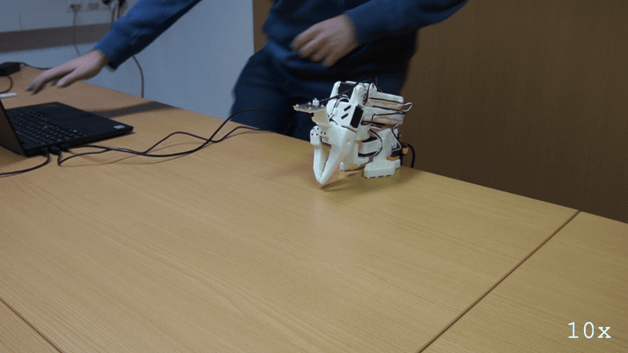

# E175: Ctrl-C during the release's fold

**Ctrl-C stopped the run's own fold to rest partway, and the arm held there with torque on until the next release connected, which found it about half a degree from where it was read right after the stop and folded it the rest of the way.**



Filmed with an external camera. The GIF plays at 10x speed.

| Category | Goal met | The run ended with | Date | quackd |
|---|---|---|---|---|
| Safety | Partly | SUCCESS | 2026-11-11 | 0.34.0 |

The numbers and the trace below are copied from the run's own record.
[All examples](../README.md)

## Why this matters

**Why this example exists:** A fold to the rest pose is quackd moving the arm on its own, and a person has to be able to stop it partway, for a hand, a cable or a cup in its way. Since 0.24.0 Ctrl-C or `q` during a fold stops it where it is and keeps torque on, where a run's fold used to finish first. This example presses Ctrl-C while the arm is on its way down, to see it stop and hold, and how far it carries on after the press.

**Why this result is important:** The fold stopped and the arm held: `the fold was stopped where it was, and nothing was released: torque is as the fold left it`. A reading right after the stop found the arm short of the goal the fold had last sent it, so it ran on less than one step after the press, and the next release found it about half a degree from there. A person can stop a fold partway and leave the arm safely up, then finish the fold once its way is clear.

## The goal

Show that a fold you asked for is one you can stop, and give a first number for how far the arm runs on after the press. It is the fifth of the nine bench steps 0.24.0 left for a real arm.

**What we expected:** Ctrl-C pressed while the arm is on its way down stops the fold, and the arm holds with torque on, at most a step past where the press found it: `the fold was stopped where it was, and nothing was released: torque is as the fold left it`. A second release then finishes the fold. The card does this during `quackd robot release`'s fold, after a run left the arm raised, at E171's slow step.

## What the run showed

* The fold that was stopped was the run's own, not the release's. The video's caption names `quackd robot release arm-01` as both hands type, at the moment the run's record has a `q` end its wait to hand the arm back: the command went into the run's own terminal, and its first letter, `q`, is a run's stop key, `kill switch: 'q' pressed`. It ended that wait and started the run's fold, and the command itself never ran.
* With no LLM and no key, `--llm fake` flew the task's scripted pilot. quackd was `connected in 3.30 s`, the arm was lifted by hand into a raised pose leaning forward over the desk, `holding the pose you set, you can let go`, at shoulder_lift 44 and elbow_flex -21, and the pilot's three calls ended in its `declare_success`.
* The `q` ended the wait, `(the kill switch ended the wait, without an Enter)`, and after a 3 s count the fold set off. The `stop` the trace prints after the `q` is the one the run sent when the pilot declared, 11.7 s earlier.
* Ctrl-C, 2.16 s into the fold, stopped it: a `stop` went out, then `the fold was stopped where it was, and nothing was released: torque is as the fold left it`. LeRobot had clamped the fold's goals to 5 degrees from where the arm stood 20 times; at the last of them the arm read elbow_flex 46.1 and shoulder_lift 2.2 and was sent toward 51.1 and -2.8. A reading right after the stop, stamped 8 ms after it on the arm's own clock, found elbow_flex at 49.3 and shoulder_lift at -0.1, short of that goal, and the fold sent no goal after it.
* The arm held where it stopped. The run's last note read it again, `the arm is not at its rest pose (shoulder_lift is at -0 with a goal of -101; a fold to it was stopped partway), so torque was left on and it will not fall as it stands`, and the run ended SUCCESS, the scripted pilot's own verdict.
* `quackd robot release arm-01`, run once the run had ended, warned that connecting takes torque off every motor for a moment and to support the arm while it connects. Nobody did: both hands stayed at the laptop, and the arm stayed where it was. It read the arm at shoulder_lift 0.4 and elbow_flex 49.8, about half a degree from the reading right after the stop, counted 3 s, folded the arm the rest of the way, with LeRobot clamping 29 of its goals, and let go: `✓ torque reads off on every joint of arm-01`, then `the arm is limp at its rest pose, where it was folded and let go of because you asked for it`.
* In the video the arm stops partway through its fold, its upper arm upright, and stands there, with both hands at the laptop, until the release folds it.

## What the run did not show

* It does not give the card's number exactly: nothing read the arm at the press itself. The press came after the fold's last goal, which the trace prints before the Ctrl-C, so from the press to the reading right after the stop the arm moved at most 3.2 degrees at the elbow and 2.3 at the shoulder, less than one step.
* It does not show Ctrl-C during `quackd robot release`'s fold, which the card asks for: the fold stopped was the run's own, started by the stray `q`. What it showed instead is the ninth bench step, E179's case, in a `--by-hand` run: a run that ended by itself, and Ctrl-C during its fold. The release says the same line when its own fold is stopped.
* Type a command only where nothing is running. A run reads every key as it is pressed until it ends: a `q` ends its wait at once, and so does a line typed and entered, and either way the arm folds 3 s later.
* The take ran at quackd's default step, 5 degrees per send and up to 50 degrees a second, where the card's slow step is 1 degree per send and 10 degrees a second.
* No LLM read anything. The three LLM calls in the table are the scripted pilot's turns, its tokens are that pilot's own estimate, and nothing was billed. The table gives no first motion because no verb moved the arm: the person lifted it, and the fold was the run's own, at its end.
* The GIF plays at 10x, so the countdown, the fold and the stop look far quicker than they were.

## How the run ended

The run ended with **SUCCESS**. The reason on record:

> elbow_flex -21, gripper 1, shoulder_lift 44, shoulder_pan -5, wrist_flex 33, wrist_roll 0; torque on; nothing hot

## The exact command

The following command was run with quackd 0.34.0:

```text
quackd run lerobot-lookout --robot arm-01 --by-hand --llm fake --max-steps 4 --no-memory
quackd robot release arm-01
```

## The numbers

| | |
|---|---|
| quackd version | 0.34.0 |
| Started | 2026-11-11 14:55:09 UTC |
| Robot | `arm-01` (real) |
| LLM | `fake:scripted:lerobot-lookout` |
| Task file | `lerobot-lookout`, which ships with quackd |
| Steps | 1 |
| LLM calls | 3 |
| Total time | 30.4 s |
| Connecting | 3.3 s |
| Waiting for the LLM | 0.0 s |
| First motion | no verb moved the arm |
| Tokens | 5,631 in, 48 out |
| Cost at list price | $0.0000 |
| Speed cap | 5° per send |
| Run folder | `runs\20261111-145509-lerobot-lookout` |

## What the robot saw

This run used no camera.

## Try it yourself

This runs the same task file with no arm attached, on `lerobot:mock`, an arm that lives in memory.
It shows the rules a run is held to and not the physics. Run it from a checkout of this repository
with quackd's `lerobot` extra.
Its pilot is a script that ships with quackd in place of an LLM, so it needs no key and costs nothing.

```bash
quackd run lerobot-lookout --robot lerobot:mock --llm fake --no-memory
```

## Full terminal trace

<details>
<summary>Show the full terminal trace (458 lines)</summary>

```text
$ quackd run lerobot-lookout --robot arm-01 --by-hand --llm fake --max-steps 4 --no-memory
quackd 0.34.0, started 2026-11-11T14:55:09Z, cwd D:\Development\lerobot-test\.venv

╭─ 🦆 lerobot-lookout ─────────────────────────────────────────────────────────────────────────────────────────────────────────────────────────────────────╮
│ provider  fake (scripted:lerobot-lookout)                                                                                                                │
│ robot     arm-01 (lerobot:real)                                                                                                                          │
│ detector  color_blob on this machine  (once the body reports a camera)                                                                                   │
╰─ Ctrl-C or q stops the duck. However often you press, the run ends properly. ────────────────────────────────────────────────────────────────────────────╯
   run     connected in 3.30 s
   tools   report_state, stop, assess_task, declare_success, declare_failure
system prompt, 7232 chars, 100 lines (also in transcript.jsonl as run_start): ──────────────────────────────────────────────────────────────────────────────
   You are the brain of a six-joint desktop robot arm with a parallel gripper (an SO-101 class arm driven by LeRobot), bolted to a table. You are a high-level pilot:
   you choose ONE verb per turn; the robot's own controllers handle the motion. Do not micro-manage.

   ## Rules (enforced by the executor — not optional)
   - Call exactly one tool per turn. Never zero, never two.
   - Only these verbs are allowed: report_state, stop. Anything else is refused.
   - Budgets: 4 steps, 3 minutes, 12 LLM calls. The run stops when any is hit.
   - Verbs marked confirm (none) ask a human before running.
   - Before the first verb that moves the body, call `assess_task` with your verdict on whether this body can do this task at all, judged against its datasheet below: `feasible`, `infeasible` (the run ends, nothing moves) or `uncertain` (a human is asked). The verdict is about the body, not the view: not having found the target yet is not by itself a reason for `uncertain`. It is one when a limit turns on that unseen thing's mass or size, or on a figure the datasheet does not publish. Until then only `report_state` and `stop` run. Assess again later if what you see changes your mind.
   - When a success criterion is met, call `declare_success`. If the task turns out impossible while doing it, call `declare_failure`.

   ## Success criteria
   - You have said where the joints are, whether torque is on, and whether anything reads hot.

   ## Abort conditions you must respect yourself
   - (none beyond the enforced ones)

   ## Verbs
   - `report_state`: Report the arm: every joint in degrees, whether torque is on, how warm the servos are, and whether anything is held.
   - `stop`: Stop moving immediately (zero velocity). Always allowed.

   ## Your body: what it can and cannot do
   Each number says how sure quackd is of it and who says so (official: the maker or a paper says so; estimate: one vendor, a community number or a reading off a photo; measured: somebody measured it and said how).
   - Height: 0.53 m (estimate: one vendor's listing; reaching straight up)
   - Actuated joints: 6 (official: the LeRobot SO-101 docs; five joints and a gripper)
   - Payload: 0.5 kg (estimate: one vendor's listing)
   - Reach: 0.4 m (estimate: the maker's URDF, TheRobotStudio/SO-ARM100 Simulation/SO101/so101_new_calib.urdf; link lengths from the shoulder to the gripper frame, summed with the arm straight and rounded down)
   - Manipulator: one arm with a gripper.
   - Not published: mass. Where a task turns on it, say uncertain and name it rather than guessing; do not decline on it alone.
   - Mains powered, so nothing runs down. It does not move: no base and no legs.
   - quackd clamps you to gripper 0 to 100.
   - Each joint's travel in degrees, read from its own calibration, and the only goals quackd will send: shoulder_pan -119.6 to 119.6, shoulder_lift -100.7 to 100.7, elbow_flex -96.7 to 96.7, wrist_flex -101.4 to 101.4, wrist_roll -180 to 180, gripper 0 to 100. A joint can read past its travel when it was folded or placed there with torque off, which is where a rest pose usually is; goals are still limited to the travel.
   - Senses: joint_state.
   Whatever the task says, this body cannot:
   - go anywhere: it is bolted to a table and has no base
   - lift or hold more than about half a kilogram: a pen, an empty cup or a wooden block weighs far less than that, and a full bottle or a tool may weigh more
   - reach anything more than about 0.4 m from its shoulder: that is the arm held straight out, and any bent pose reaches less
   - feel what it holds: nothing reports grip force, so holding is inferred from the gripper stopping short of shut, which an empty hand that binds also does
   - know its own mass: vendor listings disagree by a factor of three
   Worth knowing:
   - How wide the gripper opens and how hard it grips are not published
   - No sensors beyond the servo positions unless a camera is configured, and the servo temperature, which quackd reads off the bus because LeRobot does not
   - Vendor listings give the mass as anything from 0.8 to 2.5 kg and nobody official publishes one, so it is listed as not published rather than picked from a hat
   - There are 7.4 V and 12 V builds of the same arm, with different stall torque and different supplies. Which one is on the desk is not something quackd can ask

   ## Where this run starts
   A person placed this body by hand before your first turn, and quackd is holding it exactly
   where they left it. This run does **not** start from the recorded rest pose, so do not assume
   a folded arm or a known shape: read `report_state` and work from the joint angles it gives you. They
   are where somebody decided the work should begin.

   The gripper is where their fingers closed it, which is a position and not a grip. Nothing is
   reported as held, and nothing should be: this task cannot work the gripper, so whatever is between the jaws is held at the squeeze the person left and you cannot tighten it.

   When the run ends, the arm is handed back the same way: it holds where you left it, the person
   is asked to take whatever is in the gripper, and only then does quackd fold the arm up.

   ## What is a stand-in on this robot
   The robot reported these itself, and they are in `extras.assumptions` in every observation.
   Each is something quackd stands in for or assumes, not something this robot does. Do not
   report one as the robot's own work, and do not read a success from one as evidence that the
   real skill works.
   - GRIPPER_OPEN_VALUE
   - HOLDING_INFERRED
   - TEMPERATURE_C

   ## Persona
   A calm lookout. One clear sentence, then stop.

   ## Task file: lerobot-lookout — Move nothing, read the arm back, and report what it says about itself.

   # Task

   You are a six-joint robot arm bolted to a desk. Do not move. Read your own state and report
   what it says, so that a human can decide whether this arm is fit to be driven.

   ## Strategy

   1. `report_state` gives you every joint in degrees, whether torque is on, and the temperature
      of each servo.
   2. Say in one sentence where the joints are, whether torque is on, and whether any joint reads
      hot. A joint at or above 60 degrees Celsius is hot and worth naming.
   3. Declare success once you have said all three. Declare failure if `report_state` fails twice:
      an arm that does not answer is the thing a human needs to know about.

   ## Notes

   - **You cannot move in this task and you should not want to.** Every verb that moves a joint is
     outside your allowlist. If the reading looks wrong, saying so is the answer.
   - **You cannot ask for a picture, and you have no voice.** `observe` and `say` are not verbs
     you have. If somebody plugged a webcam in and named it, you will still see a camera line in
     your observations, because a frame is taken every step whatever your allowlist says: use it
     if it is there and do not wait for it if it is not. Reporting means writing it in the reason
     you declare with.
   - **Torque off is not a fault you can fix.** no verb can toggle torque either way. A servo
     that has tripped its own overload protection reads the same way, so name the joint and let a
     human look at it.
   - The temperatures come off the servos themselves, which is something the robot's own software
     does not read. They are the one early warning this body has, so do not skip them.
────────────────────────────────────────────────────────────────────────────────────────────────────────────────────────────────────────────────────────────
·  note    moving to the rest pose
·  note    already at the rest pose
·  hand    released: torque is off at the rest pose
the arm is yours: torque is off at its rest pose, so lift it, put whatever it needs in the gripper, close the gripper on that, hold it where you want the 
run to start, and press Enter
(Enter)
·  asked   hand_off: the arm is yours: torque is off at its rest pose, so lift it, put whatever it needs in the gripper, close the gripper on that, hold it where you want the run to start, and press Enter -> yes
·  hand    held: holding the pose you set (elbow_flex -21, gripper 1, shoulder_lift 44, shoulder_pan -5, wrist_flex 33, wrist_roll 0)
holding the pose you set, you can let go. It is at elbow_flex -21, gripper 1, shoulder_lift 44, shoulder_pan -5, wrist_flex 33, wrist_roll 0
step 0/4 · LLM calls 0/12, 0.0/3 min ───────────────────────────────────────────────────────────────────────────────────────────────────────────────────────
   obs     state: posture=unknown policy=idle stand-ins=3-listed-in-extras.assumptions
           camera: nothing detected
           Choose exactly one tool.
   llm>    step 0: 1 messages (0 with image) to fake scripted:lerobot-lookout
   think   [scripted] step 0: sees nothing it knows, so the rule picks assess_task
   tool    assess_task(verdict='feasible', reason='scripted pilot: a rule has no judgement of the body, so i...', limits_consulted=[], estimates=[], needs={})
   tokens  in=1849 out=16 (run total in=1849 out=16 $0) latency=0.0 s cost=$0 stop=tool_use
✓  assess  feasible: scripted pilot: a rule has no judgement of the body, so it assumes the task fits
step 0/4 · LLM calls 1/12, 0.0/3 min ───────────────────────────────────────────────────────────────────────────────────────────────────────────────────────
   obs     state: posture=unknown policy=idle stand-ins=3-listed-in-extras.assumptions
           camera: nothing detected
           last verb `assess_task`: ok — recorded feasible: scripted pilot: a rule has no judgement of the body, so it assumes the task fits; verbs that move the body now run
           Choose exactly one tool.
   llm>    step 0: 2 messages (0 with image) to fake scripted:lerobot-lookout
   think   [scripted] step 0: sees nothing it knows after assess_task ok, so the rule picks report_state
   tool    report_state()
   tokens  in=1890 out=16 (run total in=3739 out=32 $0) latency=0.0 s cost=$0 stop=tool_use
▶  verb    report_state()
✓  result  report_state ok: shoulder_pan -5, shoulder_lift 44, elbow_flex -21, wrist_flex 33, wrist_roll 0, gripper 1; torque on; hottest wrist_roll 33°C; holding nothing (0.0 s, 0 intents)
step 1/4 · LLM calls 2/12, 0.0/3 min ───────────────────────────────────────────────────────────────────────────────────────────────────────────────────────
   obs     state: posture=unknown policy=idle stand-ins=3-listed-in-extras.assumptions
           camera: nothing detected
           last verb `report_state`: ok — shoulder_pan -5, shoulder_lift 44, elbow_flex -21, wrist_flex 33, wrist_roll 0, gripper 1; torque on; hottest wrist_roll 33°C; holding nothing
           Choose exactly one tool.
   llm>    step 1: 3 messages (0 with image) to fake scripted:lerobot-lookout
   think   [scripted] step 1: sees nothing it knows after report_state ok, so the rule picks declare_success
   tool    declare_success(reason='elbow_flex -21, gripper 1, shoulder_lift 44, shoulder_pan...')
   tokens  in=1892 out=16 (run total in=5631 out=48 $0) latency=0.0 s cost=$0 stop=tool_use
✓  declare success: elbow_flex -21, gripper 1, shoulder_lift 44, shoulder_pan -5, wrist_flex 33, wrist_roll 0; torque on; nothing hot
the run is over and the arm is holding where it ended. Take hold of whatever is in the gripper and press Enter: the gripper opens all the way, and 3 s later
the arm folds up and the gripper closes again, so take your hands away as soon as it is open. Leave it and the arm folds up with the gripper shut
(the kill switch ended the wait, without an Enter)
kill switch: 'q' pressed — cancelling the verb and stopping the robot
→  send    stop
⚠  asked   hand_off: the run is over and the arm is holding where it ended. Take hold of whatever is in the gripper and press Enter: the gripper opens all the way, and 3 s later the arm folds up and the gripper closes again, so take your hands away as soon as it is open. Leave it and the arm folds up with the gripper shut -> no
·  hand    skipped: interrupted while waiting
·  note    the gripper was left as it is, and the arm still folds up
folding the arm to its rest pose in 3 s: take your hands away from it now. Ctrl-C or q stops it before it moves
·  note    folding the arm to its rest pose in 3 s: take your hands away from it now. Ctrl-C or q stops it before it moves
·  note    moving to the rest pose
WARNING:lerobot.robots.utils:Relative goal position magnitude had to be clamped to be safe.
{   'elbow_flex': {   'original goal_pos': 96.4,
                      'safe goal_pos': -15.483516483516482},
    'shoulder_lift': {   'original goal_pos': -100.79120879120879,
                         'safe goal_pos': 39.61538461538461},
    'wrist_flex': {   'original goal_pos': 79.2,
                      'safe goal_pos': 38.27472527472528}}
WARNING:lerobot.robots.utils:Relative goal position magnitude had to be clamped to be safe.
{   'elbow_flex': {   'original goal_pos': 96.4,
                      'safe goal_pos': -12.142857142857142},
    'shoulder_lift': {   'original goal_pos': -100.79120879120879,
                         'safe goal_pos': 38.2967032967033},
    'wrist_flex': {   'original goal_pos': 79.2,
                      'safe goal_pos': 41.175824175824175}}
WARNING:lerobot.robots.utils:Relative goal position magnitude had to be clamped to be safe.
{   'elbow_flex': {   'original goal_pos': 96.4,
                      'safe goal_pos': -8.186813186813186},
    'shoulder_lift': {   'original goal_pos': -100.79120879120879,
                         'safe goal_pos': 37.76923076923077},
    'wrist_flex': {   'original goal_pos': 79.2,
                      'safe goal_pos': 44.604395604395606}}
WARNING:lerobot.robots.utils:Relative goal position magnitude had to be clamped to be safe.
{   'elbow_flex': {   'original goal_pos': 96.4,
                      'safe goal_pos': -4.67032967032967},
    'shoulder_lift': {   'original goal_pos': -100.79120879120879,
                         'safe goal_pos': 36.714285714285715},
    'wrist_flex': {   'original goal_pos': 79.2,
                      'safe goal_pos': 47.68131868131868}}
WARNING:lerobot.robots.utils:Relative goal position magnitude had to be clamped to be safe.
{   'elbow_flex': {   'original goal_pos': 96.4,
                      'safe goal_pos': -1.3296703296703294},
    'shoulder_lift': {   'original goal_pos': -100.79120879120879,
                         'safe goal_pos': 34.34065934065934},
    'wrist_flex': {   'original goal_pos': 79.2,
                      'safe goal_pos': 50.75824175824176}}
WARNING:lerobot.robots.utils:Relative goal position magnitude had to be clamped to be safe.
{   'elbow_flex': {   'original goal_pos': 96.4,
                      'safe goal_pos': 2.010989010989011},
    'shoulder_lift': {   'original goal_pos': -100.79120879120879,
                         'safe goal_pos': 31.615384615384613},
    'wrist_flex': {   'original goal_pos': 79.2,
                      'safe goal_pos': 53.65934065934066}}
WARNING:lerobot.robots.utils:Relative goal position magnitude had to be clamped to be safe.
{   'elbow_flex': {   'original goal_pos': 96.4,
                      'safe goal_pos': 5.263736263736264},
    'shoulder_lift': {   'original goal_pos': -100.79120879120879,
                         'safe goal_pos': 28.802197802197803},
    'wrist_flex': {   'original goal_pos': 79.2,
                      'safe goal_pos': 56.56043956043956}}
WARNING:lerobot.robots.utils:Relative goal position magnitude had to be clamped to be safe.
{   'elbow_flex': {   'original goal_pos': 96.4,
                      'safe goal_pos': 8.516483516483516},
    'shoulder_lift': {   'original goal_pos': -100.79120879120879,
                         'safe goal_pos': 25.98901098901099},
    'wrist_flex': {   'original goal_pos': 79.2,
                      'safe goal_pos': 59.37362637362637}}
WARNING:lerobot.robots.utils:Relative goal position magnitude had to be clamped to be safe.
{   'elbow_flex': {   'original goal_pos': 96.4,
                      'safe goal_pos': 11.857142857142858},
    'shoulder_lift': {   'original goal_pos': -100.79120879120879,
                         'safe goal_pos': 23.175824175824175},
    'wrist_flex': {   'original goal_pos': 79.2,
                      'safe goal_pos': 62.362637362637365}}
WARNING:lerobot.robots.utils:Relative goal position magnitude had to be clamped to be safe.
{   'elbow_flex': {   'original goal_pos': 96.4,
                      'safe goal_pos': 15.10989010989011},
    'shoulder_lift': {   'original goal_pos': -100.79120879120879,
                         'safe goal_pos': 20.45054945054945},
    'wrist_flex': {   'original goal_pos': 79.2,
                      'safe goal_pos': 65.26373626373626}}
WARNING:lerobot.robots.utils:Relative goal position magnitude had to be clamped to be safe.
{   'elbow_flex': {   'original goal_pos': 96.4,
                      'safe goal_pos': 18.53846153846154},
    'shoulder_lift': {   'original goal_pos': -100.79120879120879,
                         'safe goal_pos': 17.725274725274726},
    'wrist_flex': {   'original goal_pos': 79.2,
                      'safe goal_pos': 68.42857142857143}}
WARNING:lerobot.robots.utils:Relative goal position magnitude had to be clamped to be safe.
{   'elbow_flex': {   'original goal_pos': 96.4,
                      'safe goal_pos': 22.054945054945055},
    'shoulder_lift': {   'original goal_pos': -100.79120879120879,
                         'safe goal_pos': 15.087912087912088},
    'wrist_flex': {   'original goal_pos': 79.2,
                      'safe goal_pos': 71.5934065934066}}
WARNING:lerobot.robots.utils:Relative goal position magnitude had to be clamped to be safe.
{   'elbow_flex': {   'original goal_pos': 96.4,
                      'safe goal_pos': 25.571428571428573},
    'shoulder_lift': {   'original goal_pos': -100.79120879120879,
                         'safe goal_pos': 12.626373626373628},
    'wrist_flex': {   'original goal_pos': 79.2,
                      'safe goal_pos': 74.84615384615384}}
WARNING:lerobot.robots.utils:Relative goal position magnitude had to be clamped to be safe.
{   'elbow_flex': {   'original goal_pos': 96.4,
                      'safe goal_pos': 29.175824175824175},
    'shoulder_lift': {   'original goal_pos': -100.79120879120879,
                         'safe goal_pos': 10.428571428571429},
    'wrist_flex': {   'original goal_pos': 79.2,
                      'safe goal_pos': 78.18681318681318}}
WARNING:lerobot.robots.utils:Relative goal position magnitude had to be clamped to be safe.
{   'elbow_flex': {   'original goal_pos': 96.4,
                      'safe goal_pos': 32.956043956043956},
    'shoulder_lift': {   'original goal_pos': -100.79120879120879,
                         'safe goal_pos': 8.31868131868132}}
WARNING:lerobot.robots.utils:Relative goal position magnitude had to be clamped to be safe.
{   'elbow_flex': {   'original goal_pos': 96.4,
                      'safe goal_pos': 36.64835164835165},
    'shoulder_lift': {   'original goal_pos': -100.79120879120879,
                         'safe goal_pos': 6.1208791208791204}}
WARNING:lerobot.robots.utils:Relative goal position magnitude had to be clamped to be safe.
{   'elbow_flex': {   'original goal_pos': 96.4,
                      'safe goal_pos': 40.252747252747255},
    'shoulder_lift': {   'original goal_pos': -100.79120879120879,
                         'safe goal_pos': 4.0989010989010985}}
WARNING:lerobot.robots.utils:Relative goal position magnitude had to be clamped to be safe.
{   'elbow_flex': {   'original goal_pos': 96.4,
                      'safe goal_pos': 43.857142857142854},
    'shoulder_lift': {   'original goal_pos': -100.79120879120879,
                         'safe goal_pos': 1.9010989010989015}}
WARNING:lerobot.robots.utils:Relative goal position magnitude had to be clamped to be safe.
{   'elbow_flex': {   'original goal_pos': 96.4,
                      'safe goal_pos': 47.46153846153846},
    'shoulder_lift': {   'original goal_pos': -100.79120879120879,
                         'safe goal_pos': -0.4725274725274726}}
WARNING:lerobot.robots.utils:Relative goal position magnitude had to be clamped to be safe.
{   'elbow_flex': {   'original goal_pos': 96.4,
                      'safe goal_pos': 51.065934065934066},
    'shoulder_lift': {   'original goal_pos': -100.79120879120879,
                         'safe goal_pos': -2.8461538461538463}}
kill switch: Ctrl-C — cancelling the verb and stopping the robot
→  send    stop
·  note    the fold was stopped where it was, and nothing was released: torque is as the fold left it
the fold was stopped where it was, and nothing was released: torque is as the fold left it
·  note    the arm is not at its rest pose (shoulder_lift is at -0 with a goal of -101; a fold to it was stopped partway), so torque was left on and it will not fall as it stands. To put it down, clear whatever is in its way and run quackd robot release arm-01, which folds it to its rest pose and lets go of it there: support the arm while that connects, because connecting takes torque off every motor for a moment. Or hold it and cut its power
╭─ ✓ SUCCESS ──────────────────────────────────────────────────────────────────────────────────────────────────────────────────────────────────────────────╮
│ elbow_flex -21, gripper 1, shoulder_lift 44, shoulder_pan -5, wrist_flex 33, wrist_roll 0; torque on; nothing hot                                        │
│ steps 1 · LLM calls 3 · tokens 5631+48 · time 30.4 s (LLM 0.0 s) · LLM calls p50 0.0 s, p90 0.0 s, max 0.0 s · cost $0                                   │
│ run dir  runs\20261111-145509-lerobot-lookout                                                                                                            │
╰──────────────────────────────────────────────────────────────────────────────────────────────────────────────────────────────────────────────────────────╯

(lerobot-test) PS D:\Development\lerobot-test\.venv> quackd robot release arm-01
⚠ connecting takes torque off every motor for a moment, because LeRobot configures them with it off, and the arm then folds to its rest pose, closes its
gripper and is let go of there: support it while it connects, then take your hands away when it says so, before it folds
fold arm-01 to its rest pose, close its gripper and release torque there? [y/N]: y
arm-01 (lerobot:real) is at
shoulder_pan   -5.5
shoulder_lift  0.4
elbow_flex     49.8
wrist_flex     78.6
wrist_roll     0.7
gripper        1.0
folding arm-01 to its rest pose in 3 s: take your hands away from it now. Ctrl-C or q stops it before it moves
folding arm-01 to its rest pose and closing its gripper: keep your hands out of its way
WARNING:lerobot.robots.utils:Relative goal position magnitude had to be clamped to be safe.
{   'elbow_flex': {   'original goal_pos': 96.4,
                      'safe goal_pos': 54.75824175824176},
    'shoulder_lift': {   'original goal_pos': -100.79120879120879,
                         'safe goal_pos': -4.604395604395604}}
WARNING:lerobot.robots.utils:Relative goal position magnitude had to be clamped to be safe.
{   'elbow_flex': {   'original goal_pos': 96.4,
                      'safe goal_pos': 58.010989010989015},
    'shoulder_lift': {   'original goal_pos': -100.79120879120879,
                         'safe goal_pos': -6.626373626373626}}
WARNING:lerobot.robots.utils:Relative goal position magnitude had to be clamped to be safe.
{   'elbow_flex': {   'original goal_pos': 96.4,
                      'safe goal_pos': 61.7032967032967},
    'shoulder_lift': {   'original goal_pos': -100.79120879120879,
                         'safe goal_pos': -9.35164835164835}}
WARNING:lerobot.robots.utils:Relative goal position magnitude had to be clamped to be safe.
{   'elbow_flex': {   'original goal_pos': 96.4,
                      'safe goal_pos': 65.21978021978022},
    'shoulder_lift': {   'original goal_pos': -100.79120879120879,
                         'safe goal_pos': -11.989010989010989}}
WARNING:lerobot.robots.utils:Relative goal position magnitude had to be clamped to be safe.
{   'elbow_flex': {   'original goal_pos': 96.4,
                      'safe goal_pos': 68.73626373626374},
    'shoulder_lift': {   'original goal_pos': -100.79120879120879,
                         'safe goal_pos': -14.714285714285714}}
WARNING:lerobot.robots.utils:Relative goal position magnitude had to be clamped to be safe.
{   'elbow_flex': {   'original goal_pos': 96.4,
                      'safe goal_pos': 72.25274725274726},
    'shoulder_lift': {   'original goal_pos': -100.79120879120879,
                         'safe goal_pos': -17.527472527472526}}
WARNING:lerobot.robots.utils:Relative goal position magnitude had to be clamped to be safe.
{   'elbow_flex': {   'original goal_pos': 96.4,
                      'safe goal_pos': 74.97802197802197},
    'shoulder_lift': {   'original goal_pos': -100.79120879120879,
                         'safe goal_pos': -20.956043956043956}}
WARNING:lerobot.robots.utils:Relative goal position magnitude had to be clamped to be safe.
{   'elbow_flex': {   'original goal_pos': 96.4,
                      'safe goal_pos': 76.82417582417582},
    'shoulder_lift': {   'original goal_pos': -100.79120879120879,
                         'safe goal_pos': -24.47252747252747}}
WARNING:lerobot.robots.utils:Relative goal position magnitude had to be clamped to be safe.
{   'elbow_flex': {   'original goal_pos': 96.4,
                      'safe goal_pos': 78.05494505494505},
    'shoulder_lift': {   'original goal_pos': -100.79120879120879,
                         'safe goal_pos': -27.9010989010989}}
WARNING:lerobot.robots.utils:Relative goal position magnitude had to be clamped to be safe.
{   'elbow_flex': {   'original goal_pos': 96.4,
                      'safe goal_pos': 79.1978021978022},
    'shoulder_lift': {   'original goal_pos': -100.79120879120879,
                         'safe goal_pos': -31.32967032967033}}
WARNING:lerobot.robots.utils:Relative goal position magnitude had to be clamped to be safe.
{   'elbow_flex': {   'original goal_pos': 96.4,
                      'safe goal_pos': 80.16483516483517},
    'shoulder_lift': {   'original goal_pos': -100.79120879120879,
                         'safe goal_pos': -34.75824175824176}}
WARNING:lerobot.robots.utils:Relative goal position magnitude had to be clamped to be safe.
{   'elbow_flex': {   'original goal_pos': 96.4,
                      'safe goal_pos': 81.21978021978022},
    'shoulder_lift': {   'original goal_pos': -100.79120879120879,
                         'safe goal_pos': -38.27472527472528}}
WARNING:lerobot.robots.utils:Relative goal position magnitude had to be clamped to be safe.
{   'elbow_flex': {   'original goal_pos': 96.4,
                      'safe goal_pos': 82.0989010989011},
    'shoulder_lift': {   'original goal_pos': -100.79120879120879,
                         'safe goal_pos': -41.7032967032967}}
WARNING:lerobot.robots.utils:Relative goal position magnitude had to be clamped to be safe.
{   'elbow_flex': {   'original goal_pos': 96.4,
                      'safe goal_pos': 83.15384615384616},
    'shoulder_lift': {   'original goal_pos': -100.79120879120879,
                         'safe goal_pos': -45.21978021978022}}
WARNING:lerobot.robots.utils:Relative goal position magnitude had to be clamped to be safe.
{   'elbow_flex': {   'original goal_pos': 96.4,
                      'safe goal_pos': 84.12087912087912},
    'shoulder_lift': {   'original goal_pos': -100.79120879120879,
                         'safe goal_pos': -48.64835164835165}}
WARNING:lerobot.robots.utils:Relative goal position magnitude had to be clamped to be safe.
{   'elbow_flex': {   'original goal_pos': 96.4,
                      'safe goal_pos': 85.08791208791209},
    'shoulder_lift': {   'original goal_pos': -100.79120879120879,
                         'safe goal_pos': -52.16483516483517}}
WARNING:lerobot.robots.utils:Relative goal position magnitude had to be clamped to be safe.
{   'elbow_flex': {   'original goal_pos': 96.4,
                      'safe goal_pos': 85.87912087912088},
    'shoulder_lift': {   'original goal_pos': -100.79120879120879,
                         'safe goal_pos': -55.59340659340659}}
WARNING:lerobot.robots.utils:Relative goal position magnitude had to be clamped to be safe.
{   'elbow_flex': {   'original goal_pos': 96.4,
                      'safe goal_pos': 86.58241758241758},
    'shoulder_lift': {   'original goal_pos': -100.79120879120879,
                         'safe goal_pos': -59.10989010989011}}
WARNING:lerobot.robots.utils:Relative goal position magnitude had to be clamped to be safe.
{   'elbow_flex': {   'original goal_pos': 96.4,
                      'safe goal_pos': 87.37362637362638},
    'shoulder_lift': {   'original goal_pos': -100.79120879120879,
                         'safe goal_pos': -62.714285714285715}}
WARNING:lerobot.robots.utils:Relative goal position magnitude had to be clamped to be safe.
{   'elbow_flex': {   'original goal_pos': 96.4,
                      'safe goal_pos': 87.98901098901099},
    'shoulder_lift': {   'original goal_pos': -100.79120879120879,
                         'safe goal_pos': -66.14285714285714}}
WARNING:lerobot.robots.utils:Relative goal position magnitude had to be clamped to be safe.
{   'elbow_flex': {   'original goal_pos': 96.4,
                      'safe goal_pos': 88.6043956043956},
    'shoulder_lift': {   'original goal_pos': -100.79120879120879,
                         'safe goal_pos': -69.74725274725274}}
WARNING:lerobot.robots.utils:Relative goal position magnitude had to be clamped to be safe.
{   'elbow_flex': {   'original goal_pos': 96.4,
                      'safe goal_pos': 89.3956043956044},
    'shoulder_lift': {   'original goal_pos': -100.79120879120879,
                         'safe goal_pos': -73.26373626373626}}
WARNING:lerobot.robots.utils:Relative goal position magnitude had to be clamped to be safe.
{   'elbow_flex': {   'original goal_pos': 96.4,
                      'safe goal_pos': 90.18681318681318},
    'shoulder_lift': {   'original goal_pos': -100.79120879120879,
                         'safe goal_pos': -76.86813186813187}}
WARNING:lerobot.robots.utils:Relative goal position magnitude had to be clamped to be safe.
{   'elbow_flex': {   'original goal_pos': 96.4,
                      'safe goal_pos': 90.97802197802197},
    'shoulder_lift': {   'original goal_pos': -100.79120879120879,
                         'safe goal_pos': -80.47252747252747}}
WARNING:lerobot.robots.utils:Relative goal position magnitude had to be clamped to be safe.
{   'elbow_flex': {   'original goal_pos': 96.4,
                      'safe goal_pos': 92.47252747252747},
    'shoulder_lift': {   'original goal_pos': -100.79120879120879,
                         'safe goal_pos': -84.07692307692308}}
WARNING:lerobot.robots.utils:Relative goal position magnitude had to be clamped to be safe.
{   'elbow_flex': {   'original goal_pos': 96.4,
                      'safe goal_pos': 93.96703296703296},
    'shoulder_lift': {   'original goal_pos': -100.79120879120879,
                         'safe goal_pos': -87.85714285714286}}
WARNING:lerobot.robots.utils:Relative goal position magnitude had to be clamped to be safe.
{   'elbow_flex': {   'original goal_pos': 96.4,
                      'safe goal_pos': 95.02197802197803},
    'shoulder_lift': {   'original goal_pos': -100.79120879120879,
                         'safe goal_pos': -91.46153846153847}}
WARNING:lerobot.robots.utils:Relative goal position magnitude had to be clamped to be safe.
{   'shoulder_lift': {   'original goal_pos': -100.79120879120879,
                         'safe goal_pos': -95.32967032967034}}
WARNING:lerobot.robots.utils:Relative goal position magnitude had to be clamped to be safe.
{   'shoulder_lift': {   'original goal_pos': -100.79120879120879,
                         'safe goal_pos': -98.75824175824175}}
✓ torque reads off on every joint of arm-01
  the arm is limp at its rest pose, where it was folded and let go of because you asked for it, and where it still reads: it rests there with no torque, as
it does at the end of every run
(lerobot-test) PS D:\Development\lerobot-test\.venv>
```

</details>
