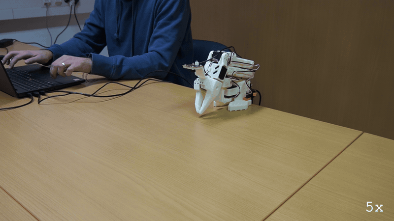
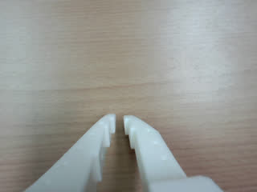
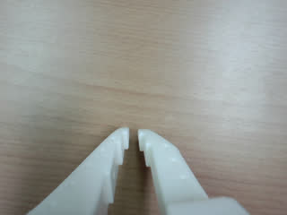

# E186: The brake, with no LLM in the way

**An empty Enter stopped the arm partway through a move, with no LLM in the way. It was routed in 0.208 ms, and the stop went out 20.4 ms after the press.**



Filmed with an external camera. The GIF plays at 5x speed.

| Category | Goal met | The run ended with | Date | quackd |
|---|---|---|---|---|
| Safety | Partly | SUCCESS | 2026-11-10 | 0.34.0 |

The numbers and the trace below are copied from the run's own record.
[All examples](../README.md)

## Why this matters

**Why this example exists:** In E118 an LLM was asked to stop the arm, and its stop could only land between moves, seconds late. `quackd drive` gives the person a brake that does not go through the LLM at all: an empty Enter drops whatever is waiting, ends the verb moving the arm and sends the stop straight to it. This example presses it during a move on the real arm, then cuts a second move short with a newer command, to see how fast the brake is and how far the arm carries on.

**Why this result is important:** The brake is the fast path the card promised. Enter was routed in 0.208 ms and the stop went out 20.4 ms after the press, without asking the LLM anything. Right after the stop the arm read shoulder_pan -17.0, short of the last goal the move had sent, and stayed there. The number the card is after, how many degrees the arm carries on past the press, needs its position at the press, which nothing recorded, so it is still open. A newer command did the same job: `gripper false`, typed during the second move, ended it and then ran. For a person beside the arm, that is a brake that answers in milliseconds without waiting on the LLM.

## The goal

The other half of E118: an empty Enter brakes at once, with no LLM in the way. It drops every line that has not started, ends the verb moving the arm, and sends the stop straight to the body.

**What we expected:** A brake line ending `Enter (0.2 ms)` for quackd's part, and `brake_ms` in the session's `summary.json` from the press to the stop, 15 ms on the arm's twin. The number to measure is how many degrees the arm carries on past the press, against E118's. Typed mid-sweep, `gripper false` is a newer command: it ends the verb it finds moving, waits for its stop, then runs, so the sweep ends and the jaws close.

## What the run showed

* The first line went to the pilot as goal 1. The LLM read the arm and began the sweep with its first move, the pan to -40 over 5 s.
* Enter on an empty line, 1.8 s into that move, braked, its line ending `Enter (0.208 ms)`. The stop went out 20.4 ms after the press, the session's `brake_ms`, and the goal ended `aborted mid-verb; the verb was cancelled and a stop was sent`.
* A stop makes the arm's present position its goal. Right after it the arm read shoulder_pan -17.0, short of -17.3, the last goal the move had sent before the press, and the second goal began from -16.9.
* The same line again began a second sweep, and `gripper false`, typed 3.5 s into its first move, ended it as a newer command, `aborted: a newer command, gripper false`. Then it ran, starting 21 ms after it was typed. The jaws were already all but shut, at 2.5 of 100, so it found nothing to close: `gripper closed on nothing (stopped at 1/100)`.
* `quit` ended the session, `ok: goodbye`, and its close moved the pan back toward its rest pose, -5.7.
* The prompt worked in PowerShell, though a camera warning landed after a `drive>` prompt once per goal, and LeRobot printed seven clamp warnings as the close moved the arm.

## What the run did not show

* It does not give the card's number, how many degrees the arm carried on past the press. Nothing read the arm at the press itself, and no protractor was in frame.
* It does not show the brake dropping lines that had not started: nothing was waiting when Enter was pressed.
* Neither press stopped the sweep itself. Both landed during the first move, toward -40, and the sweep from -40 to +40 never began.
* It is one press: 20.4 ms on the real arm against the twin's 15 ms is a single sample, not the brake's spread.
* It does not show Ctrl-C as a brake, or a second press within 1.5 s ending the session, both on the card.
* The cost and the wait for the LLM in the table are the session's two goals added up, because the session's own summary records neither.

## How the run ended

The run ended with **SUCCESS**. The reason on record:

> the session ended

## The exact command

The following command was run with quackd 0.34.0:

```text
quackd drive --robot arm-01 --camera-url "opencv://1?name=arm" --llm openai:gpt-6-astra
drive> Sweep your shoulder pan slowly from minus 40 to plus 40 degrees over twelve seconds.
drive>
drive> Sweep your shoulder pan slowly from minus 40 to plus 40 degrees over twelve seconds.
drive> gripper false
drive> quit
```

## The numbers

| | |
|---|---|
| quackd version | 0.34.0 |
| Started | 2026-11-10 14:36:06 UTC |
| Robot | `arm-01` (real) |
| LLM | `openai:gpt-6-astra` |
| Task file | none, a person types the goals |
| Steps | 8 |
| LLM calls | 8 |
| Total time | 60.3 s |
| Connecting | not recorded |
| Waiting for the LLM | 28.7 s |
| First motion | not recorded |
| Tokens | 33,480 in, 398 out |
| Cost at list price | $0.1824 |
| Speed cap | 5° per send |
| Run folder | `runs\20261110-143606-drive` |

## What the robot saw

| Start | Middle | End |
|---|---|---|
|  |  |  |

## Try it yourself

This starts the same session with no arm attached, on `lerobot:mock`, an arm that lives in memory:
type the lines under The exact command at its `drive>` prompt, a bare Enter where one is empty. It
shows the rules a session is held to and not the physics. Run it from a checkout of this repository
with quackd's `lerobot` extra and the LLM's own SDK and key. It costs what the LLM charges.

```bash
quackd drive --robot lerobot:mock --llm openai:gpt-6-astra
```

## Full terminal trace

<details>
<summary>Show the full terminal trace (41 lines)</summary>

```text
(lerobot-test) PS D:\Development\lerobot-test\.venv> quackd drive --robot arm-01 --camera-url "opencv://1?name=arm" --llm openai:gpt-6-astra
drive    arm-01: type a command, a goal, or help; Enter brakes
drive> Sweep your shoulder pan slowly from minus 40 to plus 40 degrees over twelve seconds.
drive> WARNING:quackd.perception:no camera field of view given for a real camera, so detections use the simulator's 90 degrees. Distances will be out by tens of percent: pass --fov-deg (a Pi Camera Module 2 is about 62) once you know yours.
drive>
brake    Enter (0.208 ms)
pilot    goal 1 (5.339 ms)
result   aborted: the brake, Enter; aborted mid-verb; the verb was cancelled and a stop was sent
drive> Sweep your shoulder pan slowly from minus 40 to plus 40 degrees over twelve seconds.
drive> WARNING:quackd.perception:no camera field of view given for a real camera, so detections use the simulator's 90 degrees. Distances will be out by tens of percent: pass --fov-deg (a Pi Camera Module 2 is about 62) once you know yours.
drive> gripper false
pilot    goal 2 (2.657 ms)
result   aborted: a newer command, gripper false; aborted mid-verb; the verb was cancelled and a stop was sent
exact    gripper(open=false) (2.28 ms)
result   ok: gripper closed on nothing (stopped at 1/100)
drive> quit
session  quit (0.08 ms)
result   ok: goodbye
WARNING:lerobot.robots.utils:Relative goal position magnitude had to be clamped to be safe.
{   'shoulder_pan': {   'original goal_pos': -5.7,
                        'safe goal_pos': -27.21978021978022}}
WARNING:lerobot.robots.utils:Relative goal position magnitude had to be clamped to be safe.
{   'shoulder_pan': {   'original goal_pos': -5.7,
                        'safe goal_pos': -24.67032967032967}}
WARNING:lerobot.robots.utils:Relative goal position magnitude had to be clamped to be safe.
{   'shoulder_pan': {   'original goal_pos': -5.7,
                        'safe goal_pos': -21.24175824175824}}
WARNING:lerobot.robots.utils:Relative goal position magnitude had to be clamped to be safe.
{   'shoulder_pan': {   'original goal_pos': -5.7,
                        'safe goal_pos': -17.98901098901099}}
WARNING:lerobot.robots.utils:Relative goal position magnitude had to be clamped to be safe.
{   'shoulder_pan': {   'original goal_pos': -5.7,
                        'safe goal_pos': -14.64835164835165}}
WARNING:lerobot.robots.utils:Relative goal position magnitude had to be clamped to be safe.
{   'shoulder_pan': {   'original goal_pos': -5.7,
                        'safe goal_pos': -11.395604395604394}}
WARNING:lerobot.robots.utils:Relative goal position magnitude had to be clamped to be safe.
{   'shoulder_pan': {   'original goal_pos': -5.7,
                        'safe goal_pos': -7.967032967032967}}
record   runs\20261110-143606-drive
(lerobot-test) PS D:\Development\lerobot-test\.venv>
```

</details>
