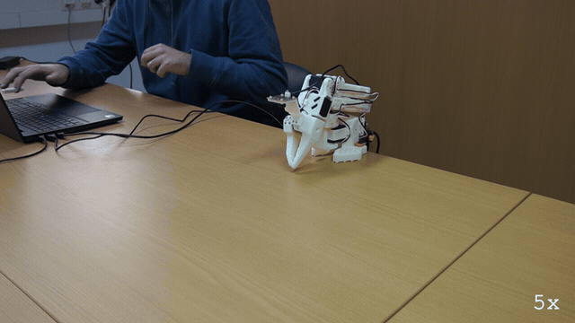

# E210: A press while it connects

**With the arm's power on this time, unlike E211, Ctrl-C pressed while quackd was still connecting meant no fold and no move: the arm sagged a little as the connect switched its torque off and on, then stayed where a hand had raised it, holding itself up.**



Filmed with an external camera. The GIF plays at 5x speed.

| Category | Goal met | The run ended with | Date | quackd |
|---|---|---|---|---|
| Safety | Yes | ABORTED | 2026-11-13 | 0.34.0 |

The numbers and the trace below are copied from the run's own record.
[All examples](../README.md)

## Why this matters

**Why this example exists:** A by-hand run starts by folding the arm to its rest pose, and connecting takes torque off every motor for a moment, so a raised arm needs a hand under it while quackd connects. A person who presses Ctrl-C then, with a hand under the arm, means nothing should move after that. Until 0.30.2 the fold started all the same. This example presses during the connect, with the arm powered and answering, to see that nothing moves after the press.

**Why this result is important:** quackd sent no move after the press. The run never folded and never handed the arm over, ended `✗ ABORTED` on `kill switch` with no step taken, and its close kept torque on, so the arm stayed up where it had been held instead of dropping. The only movement was a small sag as the connect switched torque off and on, the one the card allows for. With the arm powered and answering, which E211's was not, a press during the connect keeps the arm where it is.

## The goal

Show that Ctrl-C pressed while a by-hand run is still connecting to a powered arm keeps the arm still afterwards, with no fold and no hand-over, as it has since 0.30.2.

**What we expected:** `kill switch: Ctrl-C` comes up while it still says `connecting to arm-01`. No fold, and nothing says the arm is yours. The panel says `✗ ABORTED`, `kill switch`, `steps 0`, and the exit code is 1. The card has the arm held where it is through the connect, and asks whether any joint moved after the press, other than sagging as torque went off and came back.

## What the run showed

* The arm's power was on this time, unlike in E211, where it was off and nothing answered. Here the arm answered: quackd was `connected in 2.57 s`.
* The arm was lifted by hand into a raised pose and held there while the run started, and Ctrl-C landed during the connect: the trace prints `kill switch: Ctrl-C` before `connected in 2.57 s`.
* quackd sent no move after it. `moving to the rest pose` never came up, nothing folded, and nothing said the arm was yours. The only command the run logged was a `stop`, which holds the arm where it is, and the panel says `✗ ABORTED`, `kill switch`, `steps 0`, 2.9 s after the start.
* Its close kept torque on: `the arm is not at its rest pose (shoulder_lift is at -13 with a goal of -101; nothing moved it there), so torque was left on and it will not fall as it stands`.
* In the video the arm sinks a little under the hand near the end of the connect, about a fifteenth of the gripper's height, as the connect switches torque off and on: the sag the card allows for. Then the hand lets go, and the arm holds still where it is, holding itself up, until the release folds it.
* The arm held there. The run's last reading had shoulder_lift at -13.2 and elbow_flex at 28.0. `quackd robot release arm-01`, run afterwards with nobody supporting the arm through its connect, read -12.9 and 28.8, under a degree away, then counted 3 s, folded the arm to its rest pose with LeRobot clamping 27 of its goals, and let go: `✓ torque reads off on every joint of arm-01`.
* A limp arm cannot hold itself up, so the connect had turned the arm's torque on before the hand let go: the hand was on it through the connect and the press. The video's caption naming the Ctrl-C comes up after the hand has let go, later than the press itself.

## What the run did not show

* The exit code was not printed, so `exit 1` is not shown.
* No reading on record was taken at the press. The first on record is the run's last, taken at its close 2.85 s in, after the sag the video shows. The `connecting to arm-01` line is a live status line the record does not keep, so that the press came while it showed rests on the order of the trace's lines.
* The slow step the card's block asks for was not on: the record gives 5 degrees per send. It made no difference to the run, which sent no move, but the release's fold ran at 5 degrees per send too.
* No LLM was asked: the run ended before its first step, so the table's LLM calls and tokens are 0.
* The GIF plays at 5x.

## How the run ended

The run ended with **ABORTED**. The reason on record:

> kill switch

## The exact command

The following command was run with quackd 0.34.0:

```text
quackd run lerobot-lookout --robot arm-01 --by-hand --llm fake --max-steps 4 --no-memory
quackd robot release arm-01
```

## The numbers

| | |
|---|---|
| quackd version | 0.34.0 |
| Started | 2026-11-13 10:41:47 UTC |
| Robot | `arm-01` (real) |
| LLM | `fake:scripted:lerobot-lookout` |
| Task file | `lerobot-lookout`, which ships with quackd |
| Steps | 0 |
| LLM calls | 0 |
| Total time | 2.9 s |
| Connecting | 2.6 s |
| Waiting for the LLM | 0.0 s |
| First motion | no verb moved the arm |
| Tokens | 0 in, 0 out |
| Cost at list price | $0.0000 |
| Speed cap | 5° per send |
| Run folder | `runs\20261113-104147-lerobot-lookout` |

## What the robot saw

This run used no camera.

## Try it yourself

This runs the same task file with no arm attached, on `lerobot:mock`, an arm that lives in memory.
It shows the rules a run is held to and not the physics. Run it from a checkout of this repository
with quackd's `lerobot` extra.
Its pilot is a script that ships with quackd in place of an LLM, so it needs no key and costs nothing.

```bash
quackd run lerobot-lookout --robot lerobot:mock --llm fake --no-memory
```

## Full terminal trace

<details>
<summary>Show the full terminal trace (289 lines)</summary>

```text
$ quackd run lerobot-lookout --robot arm-01 --by-hand --llm fake --max-steps 4 --no-memory
quackd 0.34.0, started 2026-11-13T10:41:47Z, cwd D:\Development\lerobot-test\.venv

╭─ 🦆 lerobot-lookout ─────────────────────────────────────────────────────────────────────────────────────────────────────────────────────────────────────╮
│ provider  fake (scripted:lerobot-lookout)                                                                                                                │
│ robot     arm-01 (lerobot:real)                                                                                                                          │
│ detector  color_blob on this machine  (once the body reports a camera)                                                                                   │
╰─ Ctrl-C or q stops the duck. However often you press, the run ends properly. ────────────────────────────────────────────────────────────────────────────╯
kill switch: Ctrl-C — cancelling the verb and stopping the robot
   run     connected in 2.57 s
   tools   report_state, stop, assess_task, declare_success, declare_failure
system prompt, 7232 chars, 100 lines (also in transcript.jsonl as run_start): ──────────────────────────────────────────────────────────────────────────────
   You are the brain of a six-joint desktop robot arm with a parallel gripper (an SO-101 class arm driven by LeRobot), bolted to a table. You are a high-level pilot:
   you choose ONE verb per turn; the robot's own controllers handle the motion. Do not micro-manage.

   ## Rules (enforced by the executor — not optional)
   - Call exactly one tool per turn. Never zero, never two.
   - Only these verbs are allowed: report_state, stop. Anything else is refused.
   - Budgets: 4 steps, 3 minutes, 12 LLM calls. The run stops when any is hit.
   - Verbs marked confirm (none) ask a human before running.
   - Before the first verb that moves the body, call `assess_task` with your verdict on whether this body can do this task at all, judged against its datasheet below: `feasible`, `infeasible` (the run ends, nothing moves) or `uncertain` (a human is asked). The verdict is about the body, not the view: not having found the target yet is not by itself a reason for `uncertain`. It is one when a limit turns on that unseen thing's mass or size, or on a figure the datasheet does not publish. Until then only `report_state` and `stop` run. Assess again later if what you see changes your mind.
   - When a success criterion is met, call `declare_success`. If the task turns out impossible while doing it, call `declare_failure`.

   ## Success criteria
   - You have said where the joints are, whether torque is on, and whether anything reads hot.

   ## Abort conditions you must respect yourself
   - (none beyond the enforced ones)

   ## Verbs
   - `report_state`: Report the arm: every joint in degrees, whether torque is on, how warm the servos are, and whether anything is held.
   - `stop`: Stop moving immediately (zero velocity). Always allowed.

   ## Your body: what it can and cannot do
   Each number says how sure quackd is of it and who says so (official: the maker or a paper says so; estimate: one vendor, a community number or a reading off a photo; measured: somebody measured it and said how).
   - Height: 0.53 m (estimate: one vendor's listing; reaching straight up)
   - Actuated joints: 6 (official: the LeRobot SO-101 docs; five joints and a gripper)
   - Payload: 0.5 kg (estimate: one vendor's listing)
   - Reach: 0.4 m (estimate: the maker's URDF, TheRobotStudio/SO-ARM100 Simulation/SO101/so101_new_calib.urdf; link lengths from the shoulder to the gripper frame, summed with the arm straight and rounded down)
   - Manipulator: one arm with a gripper.
   - Not published: mass. Where a task turns on it, say uncertain and name it rather than guessing; do not decline on it alone.
   - Mains powered, so nothing runs down. It does not move: no base and no legs.
   - quackd clamps you to gripper 0 to 100.
   - Each joint's travel in degrees, read from its own calibration, and the only goals quackd will send: shoulder_pan -119.6 to 119.6, shoulder_lift -100.7 to 100.7, elbow_flex -96.7 to 96.7, wrist_flex -101.4 to 101.4, wrist_roll -180 to 180, gripper 0 to 100. A joint can read past its travel when it was folded or placed there with torque off, which is where a rest pose usually is; goals are still limited to the travel.
   - Senses: joint_state.
   Whatever the task says, this body cannot:
   - go anywhere: it is bolted to a table and has no base
   - lift or hold more than about half a kilogram: a pen, an empty cup or a wooden block weighs far less than that, and a full bottle or a tool may weigh more
   - reach anything more than about 0.4 m from its shoulder: that is the arm held straight out, and any bent pose reaches less
   - feel what it holds: nothing reports grip force, so holding is inferred from the gripper stopping short of shut, which an empty hand that binds also does
   - know its own mass: vendor listings disagree by a factor of three
   Worth knowing:
   - How wide the gripper opens and how hard it grips are not published
   - No sensors beyond the servo positions unless a camera is configured, and the servo temperature, which quackd reads off the bus because LeRobot does not
   - Vendor listings give the mass as anything from 0.8 to 2.5 kg and nobody official publishes one, so it is listed as not published rather than picked from a hat
   - There are 7.4 V and 12 V builds of the same arm, with different stall torque and different supplies. Which one is on the desk is not something quackd can ask

   ## Where this run starts
   A person placed this body by hand before your first turn, and quackd is holding it exactly
   where they left it. This run does **not** start from the recorded rest pose, so do not assume
   a folded arm or a known shape: read `report_state` and work from the joint angles it gives you. They
   are where somebody decided the work should begin.

   The gripper is where their fingers closed it, which is a position and not a grip. Nothing is
   reported as held, and nothing should be: this task cannot work the gripper, so whatever is between the jaws is held at the squeeze the person left and you cannot tighten it.

   When the run ends, the arm is handed back the same way: it holds where you left it, the person
   is asked to take whatever is in the gripper, and only then does quackd fold the arm up.

   ## What is a stand-in on this robot
   The robot reported these itself, and they are in `extras.assumptions` in every observation.
   Each is something quackd stands in for or assumes, not something this robot does. Do not
   report one as the robot's own work, and do not read a success from one as evidence that the
   real skill works.
   - GRIPPER_OPEN_VALUE
   - HOLDING_INFERRED
   - TEMPERATURE_C

   ## Persona
   A calm lookout. One clear sentence, then stop.

   ## Task file: lerobot-lookout — Move nothing, read the arm back, and report what it says about itself.

   # Task

   You are a six-joint robot arm bolted to a desk. Do not move. Read your own state and report
   what it says, so that a human can decide whether this arm is fit to be driven.

   ## Strategy

   1. `report_state` gives you every joint in degrees, whether torque is on, and the temperature
      of each servo.
   2. Say in one sentence where the joints are, whether torque is on, and whether any joint reads
      hot. A joint at or above 60 degrees Celsius is hot and worth naming.
   3. Declare success once you have said all three. Declare failure if `report_state` fails twice:
      an arm that does not answer is the thing a human needs to know about.

   ## Notes

   - **You cannot move in this task and you should not want to.** Every verb that moves a joint is
     outside your allowlist. If the reading looks wrong, saying so is the answer.
   - **You cannot ask for a picture, and you have no voice.** `observe` and `say` are not verbs
     you have. If somebody plugged a webcam in and named it, you will still see a camera line in
     your observations, because a frame is taken every step whatever your allowlist says: use it
     if it is there and do not wait for it if it is not. Reporting means writing it in the reason
     you declare with.
   - **Torque off is not a fault you can fix.** no verb can toggle torque either way. A servo
     that has tripped its own overload protection reads the same way, so name the joint and let a
     human look at it.
   - The temperatures come off the servos themselves, which is something the robot's own software
     does not read. They are the one early warning this body has, so do not skip them.
────────────────────────────────────────────────────────────────────────────────────────────────────────────────────────────────────────────────────────────
→  send    stop
·  note    the arm is not at its rest pose (shoulder_lift is at -13 with a goal of -101; nothing moved it there), so torque was left on and it will not fall as it stands. To put it down, clear whatever is in its way and run quackd robot release arm-01, which folds it to its rest pose and lets go of it there: support the arm while that connects, because connecting takes torque off every motor for a moment. Or hold it and cut its power
╭─ ✗ ABORTED ──────────────────────────────────────────────────────────────────────────────────────────────────────────────────────────────────────────────╮
│ kill switch                                                                                                                                              │
│ steps 0 · LLM calls 0 · tokens 0+0 · time 2.9 s (LLM 0.0 s) · cost $0                                                                                    │
│ run dir  runs\20261113-104147-lerobot-lookout                                                                                                            │
╰──────────────────────────────────────────────────────────────────────────────────────────────────────────────────────────────────────────────────────────╯

(lerobot-test) PS D:\Development\lerobot-test\.venv> quackd robot release arm-01
⚠ connecting takes torque off every motor for a moment, because LeRobot configures them with it off, and the arm then folds to its rest pose, closes its
gripper and is let go of there: support it while it connects, then take your hands away when it says so, before it folds
fold arm-01 to its rest pose, close its gripper and release torque there? [y/N]: y
arm-01 (lerobot:real) is at
shoulder_pan   -5.5
shoulder_lift  -12.9
elbow_flex     28.8
wrist_flex     36.1
wrist_roll     0.5
gripper        1.0
folding arm-01 to its rest pose in 3 s: take your hands away from it now. Ctrl-C or q stops it before it moves
folding arm-01 to its rest pose and closing its gripper: keep your hands out of its way
WARNING:lerobot.robots.utils:Relative goal position magnitude had to be clamped to be safe.
{   'elbow_flex': {   'original goal_pos': 96.4,
                      'safe goal_pos': 34.01098901098901},
    'shoulder_lift': {   'original goal_pos': -100.79120879120879,
                         'safe goal_pos': -17.791208791208792},
    'wrist_flex': {   'original goal_pos': 79.2,
                      'safe goal_pos': 41.08791208791209}}
WARNING:lerobot.robots.utils:Relative goal position magnitude had to be clamped to be safe.
{   'elbow_flex': {   'original goal_pos': 96.4,
                      'safe goal_pos': 37.35164835164835},
    'shoulder_lift': {   'original goal_pos': -100.79120879120879,
                         'safe goal_pos': -19.725274725274723},
    'wrist_flex': {   'original goal_pos': 79.2,
                      'safe goal_pos': 43.9010989010989}}
WARNING:lerobot.robots.utils:Relative goal position magnitude had to be clamped to be safe.
{   'elbow_flex': {   'original goal_pos': 96.4,
                      'safe goal_pos': 41.395604395604394},
    'shoulder_lift': {   'original goal_pos': -100.79120879120879,
                         'safe goal_pos': -22.01098901098901},
    'wrist_flex': {   'original goal_pos': 79.2,
                      'safe goal_pos': 47.32967032967033}}
WARNING:lerobot.robots.utils:Relative goal position magnitude had to be clamped to be safe.
{   'elbow_flex': {'original goal_pos': 96.4, 'safe goal_pos': 45.0},
    'shoulder_lift': {   'original goal_pos': -100.79120879120879,
                         'safe goal_pos': -24.384615384615383},
    'wrist_flex': {   'original goal_pos': 79.2,
                      'safe goal_pos': 50.582417582417584}}
WARNING:lerobot.robots.utils:Relative goal position magnitude had to be clamped to be safe.
{   'elbow_flex': {   'original goal_pos': 96.4,
                      'safe goal_pos': 48.956043956043956},
    'shoulder_lift': {   'original goal_pos': -100.79120879120879,
                         'safe goal_pos': -26.846153846153847},
    'wrist_flex': {   'original goal_pos': 79.2,
                      'safe goal_pos': 53.83516483516483}}
WARNING:lerobot.robots.utils:Relative goal position magnitude had to be clamped to be safe.
{   'elbow_flex': {   'original goal_pos': 96.4,
                      'safe goal_pos': 52.73626373626374},
    'shoulder_lift': {   'original goal_pos': -100.79120879120879,
                         'safe goal_pos': -29.395604395604394},
    'wrist_flex': {   'original goal_pos': 79.2,
                      'safe goal_pos': 57.175824175824175}}
WARNING:lerobot.robots.utils:Relative goal position magnitude had to be clamped to be safe.
{   'elbow_flex': {   'original goal_pos': 96.4,
                      'safe goal_pos': 56.69230769230769},
    'shoulder_lift': {   'original goal_pos': -100.79120879120879,
                         'safe goal_pos': -32.032967032967036},
    'wrist_flex': {   'original goal_pos': 79.2,
                      'safe goal_pos': 60.42857142857143}}
WARNING:lerobot.robots.utils:Relative goal position magnitude had to be clamped to be safe.
{   'elbow_flex': {   'original goal_pos': 96.4,
                      'safe goal_pos': 60.38461538461539},
    'shoulder_lift': {   'original goal_pos': -100.79120879120879,
                         'safe goal_pos': -34.75824175824176},
    'wrist_flex': {   'original goal_pos': 79.2,
                      'safe goal_pos': 63.76923076923077}}
WARNING:lerobot.robots.utils:Relative goal position magnitude had to be clamped to be safe.
{   'elbow_flex': {   'original goal_pos': 96.4,
                      'safe goal_pos': 64.16483516483517},
    'shoulder_lift': {   'original goal_pos': -100.79120879120879,
                         'safe goal_pos': -37.57142857142857},
    'wrist_flex': {   'original goal_pos': 79.2,
                      'safe goal_pos': 67.02197802197801}}
WARNING:lerobot.robots.utils:Relative goal position magnitude had to be clamped to be safe.
{   'elbow_flex': {   'original goal_pos': 96.4,
                      'safe goal_pos': 67.94505494505495},
    'shoulder_lift': {   'original goal_pos': -100.79120879120879,
                         'safe goal_pos': -40.472527472527474},
    'wrist_flex': {   'original goal_pos': 79.2,
                      'safe goal_pos': 70.27472527472527}}
WARNING:lerobot.robots.utils:Relative goal position magnitude had to be clamped to be safe.
{   'elbow_flex': {   'original goal_pos': 96.4,
                      'safe goal_pos': 71.63736263736264},
    'shoulder_lift': {   'original goal_pos': -100.79120879120879,
                         'safe goal_pos': -43.46153846153846},
    'wrist_flex': {   'original goal_pos': 79.2,
                      'safe goal_pos': 73.52747252747253}}
WARNING:lerobot.robots.utils:Relative goal position magnitude had to be clamped to be safe.
{   'elbow_flex': {   'original goal_pos': 96.4,
                      'safe goal_pos': 75.32967032967034},
    'shoulder_lift': {   'original goal_pos': -100.79120879120879,
                         'safe goal_pos': -46.53846153846154},
    'wrist_flex': {   'original goal_pos': 79.2,
                      'safe goal_pos': 76.78021978021978}}
WARNING:lerobot.robots.utils:Relative goal position magnitude had to be clamped to be safe.
{   'elbow_flex': {   'original goal_pos': 96.4,
                      'safe goal_pos': 79.10989010989012},
    'shoulder_lift': {   'original goal_pos': -100.79120879120879,
                         'safe goal_pos': -49.527472527472526}}
WARNING:lerobot.robots.utils:Relative goal position magnitude had to be clamped to be safe.
{   'elbow_flex': {   'original goal_pos': 96.4,
                      'safe goal_pos': 82.8021978021978},
    'shoulder_lift': {   'original goal_pos': -100.79120879120879,
                         'safe goal_pos': -52.86813186813187}}
WARNING:lerobot.robots.utils:Relative goal position magnitude had to be clamped to be safe.
{   'elbow_flex': {   'original goal_pos': 96.4,
                      'safe goal_pos': 85.35164835164835},
    'shoulder_lift': {   'original goal_pos': -100.79120879120879,
                         'safe goal_pos': -56.120879120879124}}
WARNING:lerobot.robots.utils:Relative goal position magnitude had to be clamped to be safe.
{   'elbow_flex': {   'original goal_pos': 96.4,
                      'safe goal_pos': 86.93406593406593},
    'shoulder_lift': {   'original goal_pos': -100.79120879120879,
                         'safe goal_pos': -59.72527472527472}}
WARNING:lerobot.robots.utils:Relative goal position magnitude had to be clamped to be safe.
{   'elbow_flex': {   'original goal_pos': 96.4,
                      'safe goal_pos': 87.81318681318682},
    'shoulder_lift': {   'original goal_pos': -100.79120879120879,
                         'safe goal_pos': -63.24175824175824}}
WARNING:lerobot.robots.utils:Relative goal position magnitude had to be clamped to be safe.
{   'elbow_flex': {   'original goal_pos': 96.4,
                      'safe goal_pos': 88.51648351648352},
    'shoulder_lift': {   'original goal_pos': -100.79120879120879,
                         'safe goal_pos': -66.67032967032966}}
WARNING:lerobot.robots.utils:Relative goal position magnitude had to be clamped to be safe.
{   'elbow_flex': {   'original goal_pos': 96.4,
                      'safe goal_pos': 89.21978021978022},
    'shoulder_lift': {   'original goal_pos': -100.79120879120879,
                         'safe goal_pos': -70.36263736263736}}
WARNING:lerobot.robots.utils:Relative goal position magnitude had to be clamped to be safe.
{   'elbow_flex': {   'original goal_pos': 96.4,
                      'safe goal_pos': 90.0989010989011},
    'shoulder_lift': {   'original goal_pos': -100.79120879120879,
                         'safe goal_pos': -73.87912087912088}}
WARNING:lerobot.robots.utils:Relative goal position magnitude had to be clamped to be safe.
{   'elbow_flex': {   'original goal_pos': 96.4,
                      'safe goal_pos': 91.06593406593407},
    'shoulder_lift': {   'original goal_pos': -100.79120879120879,
                         'safe goal_pos': -77.57142857142857}}
WARNING:lerobot.robots.utils:Relative goal position magnitude had to be clamped to be safe.
{   'elbow_flex': {   'original goal_pos': 96.4,
                      'safe goal_pos': 92.20879120879121},
    'shoulder_lift': {   'original goal_pos': -100.79120879120879,
                         'safe goal_pos': -81.17582417582418}}
WARNING:lerobot.robots.utils:Relative goal position magnitude had to be clamped to be safe.
{   'elbow_flex': {   'original goal_pos': 96.4,
                      'safe goal_pos': 93.43956043956044},
    'shoulder_lift': {   'original goal_pos': -100.79120879120879,
                         'safe goal_pos': -84.86813186813187}}
WARNING:lerobot.robots.utils:Relative goal position magnitude had to be clamped to be safe.
{   'elbow_flex': {   'original goal_pos': 96.4,
                      'safe goal_pos': 94.49450549450549},
    'shoulder_lift': {   'original goal_pos': -100.79120879120879,
                         'safe goal_pos': -88.64835164835165}}
WARNING:lerobot.robots.utils:Relative goal position magnitude had to be clamped to be safe.
{   'shoulder_lift': {   'original goal_pos': -100.79120879120879,
                         'safe goal_pos': -92.34065934065934}}
WARNING:lerobot.robots.utils:Relative goal position magnitude had to be clamped to be safe.
{   'shoulder_lift': {   'original goal_pos': -100.79120879120879,
                         'safe goal_pos': -96.20879120879121}}
WARNING:lerobot.robots.utils:Relative goal position magnitude had to be clamped to be safe.
{   'shoulder_lift': {   'original goal_pos': -100.79120879120879,
                         'safe goal_pos': -99.46153846153847}}
✓ torque reads off on every joint of arm-01
  the arm is limp at its rest pose, where it was folded and let go of because you asked for it, and where it still reads: it rests there with no torque, as
it does at the end of every run
(lerobot-test) PS D:\Development\lerobot-test\.venv>
```

</details>
