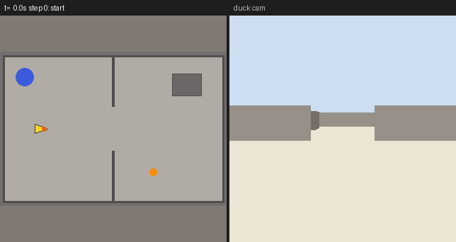

# Exploring a room, and finding something in it

A Microduck in its simulator, given a room, can walk a room it has never seen and take a map of it
a stop at a time (`explore`), or do that while looking for something with its camera (`find`). Two
starter tasks show both: `find-the-ball` and `favourite-spot`. Their rules are on
[the Microduck's page](../adapters/microduck/README.md#explore-walking-to-what-its-map-has-not-seen),
and why they stop to look is [ADR-0071](../adr/0071-a-duck-explores-what-its-map-has-not-seen-and-stops-so-the-map-can-look.md).



*The scripted pilot, not a model:
`quackd record find-the-ball --room two-rooms --llm fake --seed 3 --gif-size 320`. Left, the room
from above, with the floor its map has not seen yet shaded. Right, the duck's camera.*

> [!NOTE]
> A real Microduck is offered neither yet. On odometry alone it keeps no map, and beside `mapd`
> nothing publishes the radius of its body, which a way round a room is planned by. The duck says
> so beside its body, and a task that needs either is refused in those words.

## Find the ball

```bash
quackd run find-the-ball --room two-rooms --yes
```

`two-rooms` hides the ball in the room the duck does not start in, so it has to go and look. Both
verbs ask first, because they walk a room nobody has looked at yet: `--yes` answers for you, and
at a terminal without it you are asked. This run used the scripted pilot and a seed, and is
trimmed to the verbs, the first of `find`'s commands and the results:

```
$ quackd --no-color run find-the-ball --room two-rooms --llm fake --yes --seed 3
┌─ 🦆 find-the-ball ──────────────────────────────────────────────────────────────────────────────┐
│ provider  fake (scripted:find-the-ball)                                                         │
│ robot     microduck:sim2d  seed 3                                                               │
│ detector  color_blob on this machine                                                            │
└─ Ctrl-C or q stops the duck. Press it twice to quit at once. ───────────────────────────────────┘
▶  verb    find(target='ball', minutes=4)
⚠  gate    confirm: allowed the confirm gate was allowed
→  send    look x4 over 1.5 s (x 0.766..1, y -0.643..0.643, z 0)
→  send    stop
→  send    move x11 over 1.0 s (vx 0, vy 0, wz -1)
✓  result  find ok: find: found the ball: ball dead ahead ~0.87 m; marked 'ball' where it stands, facing it: 2 stops, 29 looks, walked 1.4 m, 5.5 m² of floor seen; 'start' is where it began (39.3 s sim, 1.6 s wall, 300 intents)
▶  verb    go_to(target='ball', stop_distance=0.3)
✓  result  go_to ok: reached the ball: ~0.30 m away, bearing +0° (3.9 s sim, 0.4 s wall, 40 intents)
▶  verb    say(text='The ball was about 0.9 m from the spot I marked ball.')
✓  result  say ok: said 'The ball was about 0.9 m from the spot I marked ball.' as [chirp] (0.0 s, 1 intent)
▶  verb    go_to_place(name='start')
✓  result  go_to_place ok: go_to_place: 0.07 m from 'start' by its map, facing within 20° of the way it faced there; walked 1.5 m in 16 s, 1 stop, 0 re-plans (16.0 s sim, 0.4 s wall, 156 intents)
┌─ ✓ SUCCESS ─────────────────────────────────────────────────────────────────────────────────────┐
│ found the ball, walked up to it, said where, and came back                                      │
│ steps 4 · llm calls 6 · tokens 12261+96 · time 2.7 s (model 0.0 s) · model calls p50 0.0 s, p90 │
│ 0.0 s, max 0.0 s · first motion at 0.1 s, after 2 model calls · cost $0                         │
│ run dir  runs\20261027-191546-find-the-ball                                                     │
│ gif      runs\20261027-191546-find-the-ball\run.gif                                             │
└─────────────────────────────────────────────────────────────────────────────────────────────────┘
```

`find` was one verb and one confirm. Its first stop looked all the way round, the head turning for
the views either side of straight ahead and the body for the rest, and saw no ball. It walked
through the doorway to the edge of what its map had seen, looked all the way round again, and saw
the ball. It turned to face it, saw it again dead ahead, and marked the spot it stood on as
`ball`, facing the ball. The pilot then walked up to the ball with `go_to`, said where it was, and
walked back to `start`, which `find` had marked where it began.

The scripted pilot is a rule, so it does the same every time on the same seed. A model pilots the
same task with `--llm anthropic` or any other, and decides between the verbs itself.

## Mark a spot, explore, come back

```bash
quackd run favourite-spot --room two-rooms --yes
```

`favourite-spot` marks where the duck stands as `favourite`, explores for up to two minutes, walks
back to the spot and says so. `explore` ends on its own once nothing is left that it can reach,
as it did here well inside its minutes:

```
$ quackd --no-color run favourite-spot --room two-rooms --llm fake --yes --seed 3
▶  verb    mark_place(name='favourite')
✓  result  mark_place ok: marked 'favourite' where the robot stands, (-1.00, 0.00) by its map (0.0 s, 0 intents)
▶  verb    explore(minutes=2)
✓  result  explore ok: explore: done, no gap in its map is left that it can reach: 2 stops, 26 looks, walked 1.4 m, 5.5 m² of floor seen; 'start' is where it began (35.6 s sim, 1.1 s wall, 269 intents)
▶  verb    go_to_place(name='favourite')
✓  result  go_to_place ok: go_to_place: 0.07 m from 'favourite' by its map, facing within 19° of the way it faced there; walked 1.3 m in 13 s, 1 stop, 0 re-plans (12.7 s sim, 0.4 s wall, 121 intents)
▶  verb    say(text='Back at my favourite spot.')
✓  result  say ok: said 'Back at my favourite spot.' as [chirp] (0.0 s, 1 intent)
```

## Check a task against a room

A task that names no robot, as these two do, is checked by `quackd validate` against every verb
something installed here can offer, a simulator in a room among them. To check it against the
duck's simulator itself, give the room the run would lay out:

```
$ quackd --no-color validate ducks/find-the-ball.duck --robot microduck:sim2d --room two-rooms
quackd validate
┌──────────────────────────┬───────────────┬───────┬───────────────────────┐
│ file                     │ name          │ verbs │ result                │
├──────────────────────────┼───────────────┼───────┼───────────────────────┤
│ ducks/find-the-ball.duck │ find-the-ball │     7 │ ✓ valid for microduck │
└──────────────────────────┴───────────────┴───────┴───────────────────────┘
✓ 1 file valid
```

Without `--room` the same simulator keeps no map and offers no place verbs, and the file is
refused, `requires find, but microduck (microduck) does not provide it` first among its lines.

`explore` and `find` ask first, so a run given a plain goal with `--goal`, which allows safe verbs
alone, never uses them. A task file allows them.
