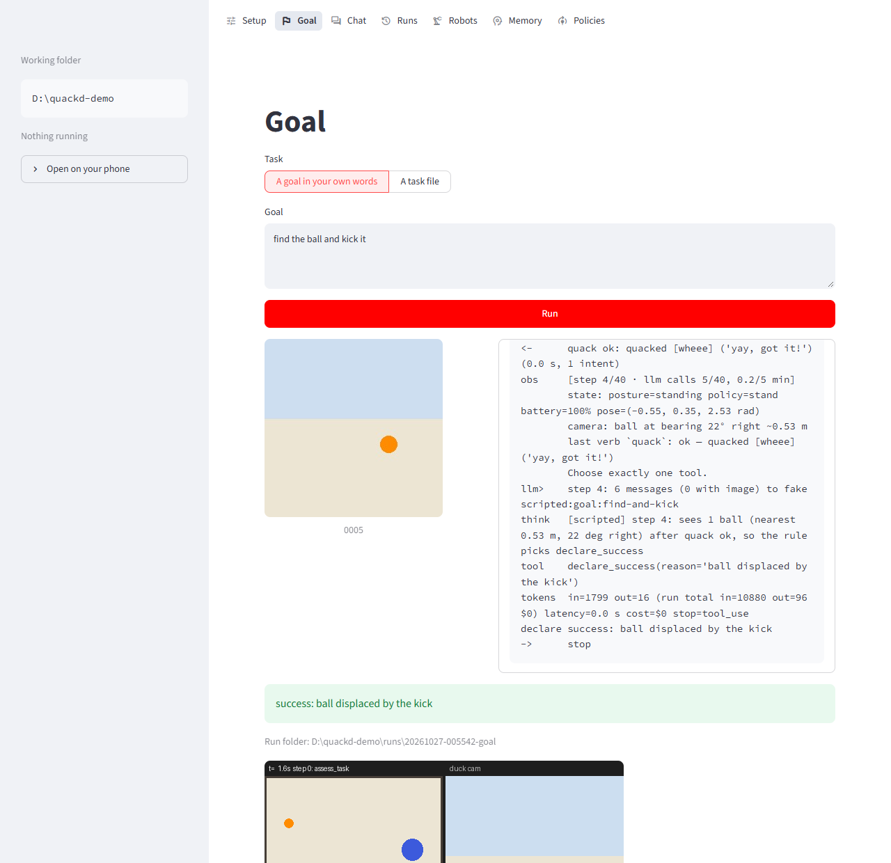
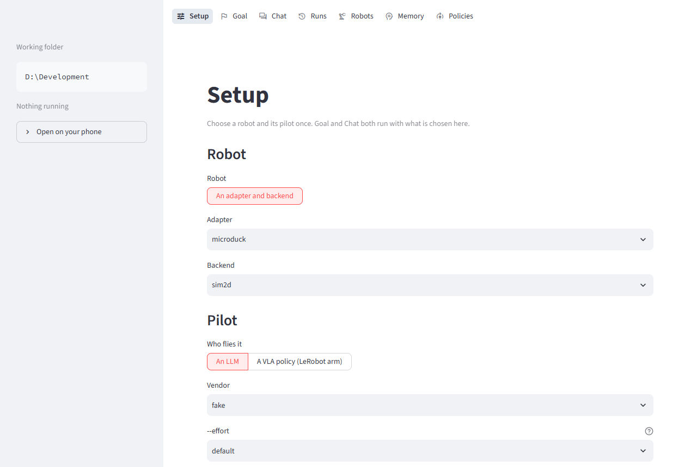
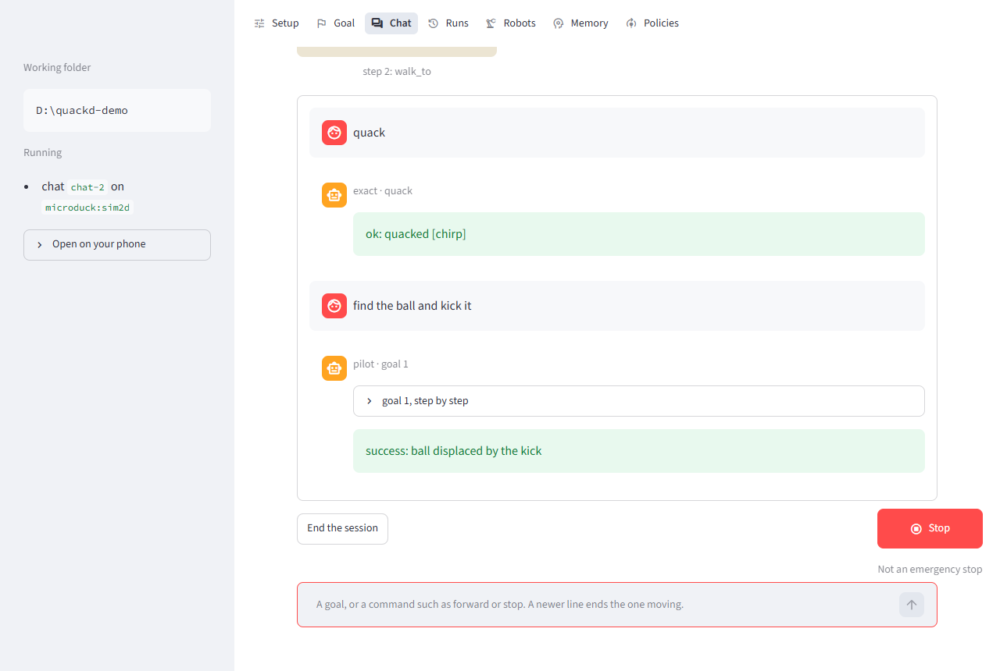
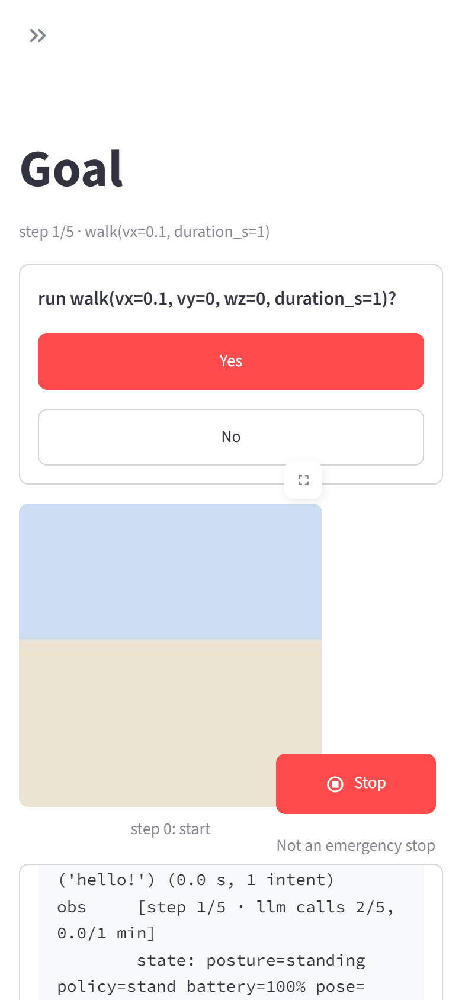

# The page: `quackd ui`

`quackd ui` serves a page in your browser for what `quackd run` and `quackd drive` do. You choose
a robot and its pilot, turn any of their options on or off, then give the robot one goal or chat
with it goal after goal, answer its questions and stop it. It works from a phone too.

The page is a front for the CLI, not a second quackd. Every goal it starts is `quackd run` and
every chat is `quackd drive`, each in a process of its own, so the flags, the refusals, the `.env`
a run loads and the run directory it writes are the terminal's own. The Setup screen shows the
command to type at a terminal for the same run, which makes the page a way to learn the CLI as
well as a way around it.



## Install and start

Streamlit, which draws the page, comes with the `ui` extra and nothing else installs it:

```bash
uv pip install "quackd[ui]"
quackd ui
```

Or with nothing installed, the page and the duck's cartoon simulator in one go:

```bash
uvx --from "quackd[ui,microduck]" quackd ui
```

It opens the page in your browser and prints where it is. This is what it printed from
`D:\quackd-demo`, everything above `quackd ui:` Streamlit's own, with the token left out here:

```
$ quackd ui --no-browser
2026-10-27 03:24:21.204 Uvicorn server started on 127.0.0.1:8501

  You can now view your Streamlit app in your browser.

  URL: http://127.0.0.1:8501

quackd ui: http://127.0.0.1:8501/?token=…
Stop in the page is not an emergency stop. Ctrl-C here stops the page and its runs.
```

The page asks every visitor for its token, this computer's own browser too, and the address
`quackd ui` prints and opens carries it. Streamlit's own `URL:` line does not: opened as it is, it
shows only the refusal.

The folder you start it in is the page's working folder, shown in its sidebar. Runs start there,
read its `.env` and write their run directories under its `runs/`, as they would from a terminal
in that folder. Each run loads that `.env` itself, so it can tell a file's values from the
shell's as a run from a terminal does.

| Option | What it does |
|---|---|
| `--bind ADDRESS` | Where the page listens. `127.0.0.1`, the default, is this computer alone, and `0.0.0.0` every network it is on ([On your phone](#on-your-phone)). Wherever it listens, it asks for the token the address it prints carries |
| `--port N` | The port, 8501 unless you say |
| `--no-browser` | Print the address and open nothing |
| `--new-token` | Make the page a new token, so every address saved with the old one stops working |

Without the extra it says what to install:

```
✗ error: quackd ui needs Streamlit, which comes with the ui extra
  uv pip install "quackd[ui]", or run uvx --from "quackd[ui]" quackd ui
```

## A first goal, with no robot and no key

1. Start `quackd ui`. The page opens on **Setup**.
2. Under **Robot**, choose the adapter `microduck` and the backend `sim2d`, the duck's cartoon
   simulator. It needs `quackd[microduck]`, and the page says so where it is missing.
3. Under **Pilot**, leave **An LLM** and choose the vendor `fake`, the scripted pilot, which needs
   no key and no network.
4. Open **Goal**, type `find the ball and kick it` and press **Run**.



While the run goes, the Goal screen shows what it is waiting on, its camera, its steps as a
terminal narrates them, and any question it puts to you, with a Yes and a No. When it ends it shows
the outcome, the run's folder, the last frame it saved and, on a simulator that draws one, its
`run.gif`. Setup's **Same as** shows the same run as the command to type at a terminal, with
`...` where the Goal screen's goal goes:

```bash
quackd run --goal ... --llm fake --robot microduck:sim2d
```

A goal can also be a task file: **A task file** on the Goal screen offers the ones that ship with
quackd for one robot, or one of your own, which the page checks with `quackd validate` before it
offers to run it.

## Chat

**Start a chat** on the Chat screen starts `quackd drive` with the robot and the pilot on Setup,
and the robot stays connected from one line to the next. Each line goes to the session the moment
you send it, as a line typed at drive's own prompt does, and the reply says which lane took it:

- a verb of the body's own, such as `quack`, `sit` or `kick left`, runs at once, with no model
  asked, and the reply is marked `exact`;
- a preset walk, such as `forward` or `turn left`, is worked out from the body's own clamps and
  runs at once too;
- anything else is a goal, which the pilot flies as a run of its own and the reply marks `pilot`,
  with its steps folded under it. With a decision LLM on Setup, a line no verb names is put to it
  first, marked `fast`.

`stop`, `halt`, `brake` or `q` brakes at once, and a newer line that moves the body ends whatever
is still moving it. Questions are answered with their buttons, never by typing, so a line is
always a command. **End the session** stops the robot, folds it where it folds and lets go of it.
Everything a line can be is in [Driving a robot](drive.md).



> [!NOTE]
> A chat's goals fly with what Setup chose for a goal, the pilot's settings, memory and a VLA pilot
> among them, and put their questions to you with the same buttons, each named after its goal:
> whether to run a gated verb, whether to go ahead when the pilot is not sure, and whether the arm
> did it. Under a VLA pilot each line is its one instruction to the arm's policy
> ([Driving a robot](drive.md#a-vla-pilot-a-line-at-a-time)). The few options still marked *goal
> only*, a GIF, a picture and talking with robots nearby, do not reach a chat.

## The pilot

**An LLM** is a vendor and a model: for a cloud vendor one of the rows `quackd list-models`
prints, and for a local server the id it serves, typed in. Beside it, the page says whether that
vendor's key is set and where, masked as `quackd doctor` masks it:

```
ANTHROPIC_API_KEY: set in the environment (sk-a…ef)
```

A key is looked for where a run the page starts would find it: a key typed into the page, then
the environment the page was started in, then the working folder's `.env`. A key typed into the
field under it is kept in the page's memory for as long as the page runs, and reaches each run
through that run's environment. It is never written to a file, never put on a command line and
never shown in the **Same as** lines, and it is gone when the page stops.

The effort, vision, a base URL for a local server, an extra request body and a price are under the
model.

**A VLA policy** flies the LeRobot arm instead, through a policy server: its address, whether the
arm keeps moving while the next chunk is on its way, and whether to accept a policy learned on an
arm calibrated another way. Its pilot asks no model, so while it is chosen the model's settings
and the decision LLM leave the command, which `quackd run` would otherwise refuse. The
[Policies screen](#runs-robots-memory-and-policies) starts a server on this computer and fills the
address in. [Policies](policies.md) has the rest.

**A decision LLM** is the optional stepper in front of the pilot in a goal, and the fast lane for
a line in a chat, whose goals have the stepper too only with a mode chosen
([Decision LLMs](decision-llms/README.md)).

## Every other option

Everything else `quackd run` and `quackd drive` take is under **Everything else**, grouped as
`--help` groups it, each with the flag it sets and that flag's own help. An option one of the two
commands does not take is marked *goal only* or *chat only*. Memory is one switch for both, on as
a run keeps it, so a chat keeps a memory unless you turn it off, where `quackd drive` at a terminal
keeps none unless asked. An option that is on or off unless a task file says otherwise offers three
choices: the default, on and off. Options that carry a secret are offered as key fields, which
reach a run as keys do.

The page reads these options from the commands themselves, so a flag added to `quackd run`
appears on the page with nothing changed in it. It leaves out the few it sets itself or cannot
apply: `--front`, `--live`, `--verbose`, `--log`, `--log-prompt`, `--by-hand`, `--flock` and
`--robots`.

**Same as**, at the bottom of Setup, is the command each mode would run, a goal's and a chat's,
built from what you changed and nothing else.

## Connecting a real robot

Choose an adapter and one of its real backends, and Setup shows a box for connecting it: the
address, the camera, and the adapter's own word on what both are for this robot, what has to be
running on the robot, what to do once before the first connect, and where its page is. A robot
that takes a token gets a field for it, which reaches a run as a key does, under the variable its
transport reads.

**Check the connection** connects, asks the robot how it is and closes, as `quackd robot list
--probe` does for one robot. It drives the robot nowhere, and it runs in a process of its own, so
no robot's SDK is ever loaded in the page.

> [!CAUTION]
> Connecting the LeRobot arm takes torque off every motor for a moment, as any connect does, a
> check included. Hold an arm that is holding itself up before you check it. Setup says so above
> the button.

<!-- generated: connect-rows, by scripts/connect_docs.py from quackd/adapters/catalogue.py. Change a block there and run the script, not this table. -->

| Robot | `--address` | For example | With none given | Token | More |
|---|---|---|---|---|---|
| `microduck:jsonrpc` | robotd's socket: `unix:///PATH` with quackd on the duck itself, or `tcp://HOST:PORT` for the socket forwarded over ssh | `tcp://127.0.0.1:9870` | `unix:///run/robotd.sock` | none | [microduck](../adapters/microduck/README.md) |
| `lerobot:real` | the arm's USB serial port on this computer: `COM5` or the like on Windows, `/dev/ttyACM0` elsewhere | `COM5` | refused: one must be given | none | [lerobot](../adapters/lerobot/README.md) |
| `rosbridge:ws` | rosbridge_server's WebSocket, which carries the topics too: `ws://HOST:9090?cmd_vel=/cmd_vel&odom=/odom&image=/camera/image/compressed` | `ws://robot.local:9090?cmd_vel=/cmd_vel&odom=/odom&image=/camera/image/compressed` | `ws://localhost:9090` | none | [rosbridge](../adapters/rosbridge/README.md) |
| `open_duck:bridge` | quackd's bridge daemon on the duck's Pi, `tcp://HOST:PORT` | `tcp://127.0.0.1:9871` | `tcp://open-duck.local:9871` | `--token` or `QUACKD_DUCK_TOKEN` | [open_duck](../adapters/open_duck/README.md) |
| `xlerobot:zmq` | the robot's ZeroMQ host, `tcp://HOST:5555`, with `?variant=omni3`, `diff2` or `mecanum` | `tcp://192.168.1.42:5555` | `tcp://127.0.0.1:5555` | none | [xlerobot](../adapters/xlerobot/README.md) |
| `alohamini:zmq` | the robot's ZeroMQ host, `tcp://HOST:5555`, with `?model=alohamini1`, `alohamini2` or `alohamini2pro` | `tcp://192.168.1.50:5555` | `tcp://127.0.0.1:5555` | none | [alohamini](../adapters/alohamini/README.md) |
| `toddlerbot:bridge` | quackd's daemon on the robot's Jetson, `tcp://HOST:PORT` | `tcp://127.0.0.1:9873` | `tcp://toddlerbot.local:9873` | `--token` or `QUACKD_TODDLERBOT_TOKEN` | [toddlerbot](../adapters/toddlerbot/README.md) |
| `huebot:jsonrpc` | the maker's shim, which speaks robotd's protocol: `tcp://HOST:PORT`, or `unix:///PATH` with quackd on the robot itself | `tcp://127.0.0.1:9870` | refused: one must be given | none | [huebot](../adapters/huebot/README.md) |
| `moss:cockpit` | MOSS's cockpit on the rover, `http://HOST:8904`, with quackd's bridge port as `?bridge=9876` | `http://127.0.0.1:8904` | `http://127.0.0.1:8904?bridge=9876` | `--token` or `QUACKD_MOSS_TOKEN` | [moss](../adapters/moss/README.md) |

<!-- end generated: connect-rows -->

A robot you have registered with `quackd robot add` is under **A registered robot**, with its
address, cameras and token already stored. The Robots screen registers one from the page, its
token passed by the name of the variable that holds it (`--token-env`), so it is never on a command
line. [Registered robots and flocks](registry.md) has the rest.

## On your phone

The page runs on the computer the robot is connected to, and a phone opens it in its browser.
Nothing is installed on the phone.

1. Start the page so the Wi-Fi can reach it:

   ```bash
   quackd ui --bind 0.0.0.0
   ```

2. It prints each address this computer has on its networks, with the page's token in it, and
   a QR code of the first. Among what it prints, with the addresses and the token made up here:

   ```
   quackd ui: http://192.168.1.23:8501/?token=…
              http://10.0.0.5:8501/?token=…
   Anyone who can reach this address and has the token can drive your robots. Keep the address to yourself.
   ```

   The QR code follows, drawn in the terminal, or saved as `ui-qr.png` in the quackd home where
   the terminal cannot draw it.

3. Scan the code with the phone's camera, or type the address. The phone has to be on the same
   network as the computer.

4. On Windows, the firewall asks the first time the page listens on a network. Allow it on
   private networks.

The same address and code are in the page's sidebar, under **Open on your phone**, so a session
begun at a desk can be picked up on the phone.



**The token** is made the first time, kept in `ui.token` in the quackd home (`~/.quackd`, or
wherever `QUACKD_REGISTRY_DIR` points in the shell, never where a `.env` points it) where only
you can read it, and is the same at every start, so a shortcut on the phone's home screen keeps
working. `quackd ui --new-token` replaces it, and every address saved with the old one stops
working.

**A shortcut on the home screen** opens the page in the phone's browser: in Safari on an iPhone,
Share and then Add to Home Screen; in Chrome on Android, the menu and then Add to Home screen.

**On a small screen** the sidebar folds away, and while anything runs a large Stop button floats
at the bottom right of every screen, on every open tab and phone, within a second of the run
starting from any of them. The question a run puts has two large buttons. In a chat, sending
`stop` brakes as the button does.

**Locking the phone** leaves the run going, under its own limits on steps and minutes. Unlock it
and the page finds the run again, its questions and its Stop with it.

**Away from home**, a private network that reaches both, such as Tailscale, works the same way:
start the page on that network's address, `quackd ui --bind 100.x.y.z`, rather than on every
network. This has not been tried on a phone yet.

> [!WARNING]
> Never put the page on the open internet, through a public tunnel or a forwarded port. The token
> is all that stands between anyone who finds the address and your robots.

> [!WARNING]
> The page is plain HTTP. On the Wi-Fi, the token, and any key you type into the page on the
> phone, cross the air unencrypted. Type keys at the computer, or keep them in its `.env`.

## When you stop, or the page goes away

> [!WARNING]
> **Stop is not an emergency stop.** It asks the run to stop, as the kill switch's first Ctrl-C
> does: the verb moving is ended, a stop is sent, the arm folds and the record closes. A robot
> that is not answering cannot hear it. Keep the robot's own power switch within reach.

- **Stop** in a goal stops it. A second press, **Quit at once**, ends the run without waiting for
  its fold, as a second Ctrl-C does. In a chat every Stop brakes, and the session goes on.
- **Stop** stops every goal and chat the page has going, on every robot.
- **A question nobody answers** within five minutes is taken back, and the run records it as
  unanswered, never as a no. A Stop takes it back too.
- **Closing the tab, refreshing, or locking the phone** leaves the run going. The Goal and Chat
  screens find it again.
- **A chat no Chat screen has shown for fifteen minutes** is ended in order: the robot stopped,
  folded and let go of, so a robot is never left held by a page nobody has open.
- **Ctrl-C in the page's terminal** stops the page. It stops each goal as its Stop would, ends
  each chat in order and waits for them: on Windows, a run waiting on a question ended `aborted`
  for the `stop button`, with its record closed.
- **A page process that dies** ends each run's input, which stops the run as a stop nobody
  pressed. The verb ends, the robot stops and folds, and the record closes with `the page went
  away`. On Windows that held with the page's process killed outright, both as `quackd.exe` and
  as `python`, while a run waited on a question.
- **One robot, one job.** The page runs one goal, chat or check at a time on a robot, and refuses a
  second while the first holds it. It cannot see a run on the same robot started from a terminal.

A Yes clicked in the page counts as a person's answer: it can clear a dangerous verb and run the
arm under a VLA pilot, and the record says a person answered, on the web. That holds only because
the page can be reached by you alone: it listens on this computer alone by default, and asks for
its token everywhere, since another account on the same computer reaches it too, and so can a web
page in your browser that points a name of its own at it
([ADR-0070](../adr/0070-the-page-is-reachable-by-its-own-user-alone.md)).

## Runs, Robots, Memory and Policies

- **Runs** lists the run directories under the working folder's `runs/`, with how each ended, its
  steps, its seconds and its cost. One replays as `quackd log` replays it, the system prompt shown
  if you ask, with its frames, its `run.gif` and what its terminal showed, and a chat's goals one by
  one.
- **Robots** is the registry, tokens never shown: register a robot, forget one after a second
  click, and look for robots announcing themselves on the network, which needs `quackd[lan]`.
  Recording an arm's rest pose and releasing an arm need somebody at the arm, so the screen gives
  the terminal command for each.
- **Memory** is what a robot remembers between runs: read it, add a note, or clear it after a
  second click.
- **Policies** starts a policy server on this computer, `scripted:sweep` by default, which needs no
  GPU. **Fly the arm with it** sets Setup to fly the arm with that server, and **Check it** asks it
  what it serves. Hugging Face endpoints this computer started are listed, paused and deleted
  there, and **Start one (paid)** starts one only after a box naming the GPU and the region it
  bills in is ticked, then shows its progress as it comes: starting one can take half an hour,
  and nothing on the page waits on it.

## Troubleshooting

**The port is taken.** Another `quackd ui`, or another program, listens on it:

```
✗ error: port 8501 is already in use: another quackd ui, or another program, listens there
  quackd ui --port 8502
```

**The phone cannot reach the page.**

- The page was started without `--bind`, so it listens on the computer alone.
- The firewall blocked it. On Windows, allow Python on private networks, and check that the Wi-Fi
  is a private network in the settings, not a public one, which keeps everything out.
- The phone is on another network: mobile data, a guest Wi-Fi that keeps devices apart, or a
  second access point on another subnet.
- The first printed address belongs to a virtual network, such as a VPN or WSL's. Try the others.

**"This page needs its token."** Open the address the page printed, which carries it, or scan its
code. After `--new-token`, a saved shortcut needs the new address.

**"This adapter is not installed"** or **"Its SDK is not installed"** name the extra to install.

**A run refused.** The page shows the CLI's own refusal and its hint, as the terminal would, and
the same command under **Same as** reproduces it at a terminal.

**"is busy".** A goal, chat or check already holds that robot. Stop it, or end the chat.

## What the page does not do yet

- `--by-hand`, and the questions at the end of a run about an arm that missed its rest pose: both
  wait for somebody at the arm to press Enter, and stay at the terminal.
- Flocks: `--flock`, `--robots` and task files with a `flock:` block.
- A GIF of a chat, and a chat that talks with robots nearby: `quackd drive` takes neither `--gif`
  nor `--talk`.
- `--live`, and a picture sent with a chat line.
- HTTPS. Streamlit can serve it through its own settings, and quackd has no flag for it yet.
- An app to install on the phone.
